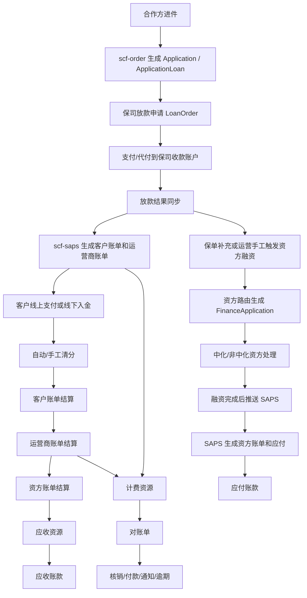

# 保费分期核心业务链路与资金账务逻辑

更新时间：2026-06-29

业务线：保费分期  
WorkHub 业务线编码：`BL000001`  
GitLab group：`scf`  
代码范围：`data/git-cache/scf` 本地受控缓存  
知识库目录：`wiki/公司项目/projects/保费分期`

> 本页基于代码静态梳理，未连接生产数据库、日志或远程运行环境做数据核验。文中“保司放款”按代码里的“对保险公司/商户收款账户发起放款或代付”链路理解。

## 一句话摘要

保费分期主链路由 `scf-order` 承接进件、保司放款、资方融资申请，由 `scf-saps` 承接客户账单、运营商账单、资方账单、还款清分、应收应付和对账单。保司放款成功后，订单侧把贷款订单、还款计划和融资状态同步到 SAPS；SAPS 生成客户/运营商账单。商业险、非商业险垫资按资方路由生成融资申请，资方融资完成后 SAPS 生成资方账单和应付。客户还款通过线上支付、线下入金自动清分或手工清分统一落客户支付订单，再驱动客户账单、运营商账单、资方账单逐层结算，并沉淀对账单、应收账款、应付账款和付款单。

## 系统边界

### `scf-order`

负责进件申请、申请单状态、放款申请、放款单、融资申请、资方路由、资方合同和中化资方接口编排。

核心职责：

- 接收合作方进件接口，生成 `Application` 和 `ApplicationLoan`。
- 发起保司放款申请，生成 `LoanOrder`，对接支付查询放款结果。
- 在放款成功、保单补充完成或运营手工触发后，按资方路由生成 `FinanceApplication`。
- 对中化资方推送保理融资申请，对非中化资方触发融资合同签署。
- 把贷款订单、还款计划、资方融资状态同步到 `scf-saps`。

### `scf-saps`

负责资金账务域：客户账单、运营商账单、资方账单、还款计划、支付订单、入金流水、清分、应收应付、对账单、付款单、退款和挂账。

核心职责：

- 生成客户账单和运营商账单。
- 生成资方账单、融资申请镜像和应付账款。
- 接收客户还款支付结果，完成客户账单、运营商账单和资方账单结算。
- 从支付系统拉取银行入金流水，自动或手工匹配账单、线下还款、首笔款、退费、资产转让等业务。
- 根据计费资源生成对账单、应收账款、应付账款，并处理核销、付款、通知和逾期。

### `scf-intf-zhonghua`

负责中化资方接口适配。订单侧通过 `IntfCapitalClient` 调用资方保理进件、进件结果查询、放款结果查询、补件、合同下载、退保/退费等接口。

## 核心单据

### 订单侧

- `amp_application`：申请单主表，保存申请编号、订单号、项目/产品、合作方、资金方、状态、账单状态、放款状态、结算状态、合同状态、资产信息等。
- `ApplicationLoan`：申请单放款/融资扩展，保存垫资金额、首付款、保理对价款、服务费、融资期数、商业险/非商业险/交强险/车船税/其他险金额、保单上传状态、已还/未还/逾期金额等。
- `LoanOrder`：保司放款申请单，保存放款申请号、放款金额、收款账户、放款状态和支付流水。
- `FinanceApplication`：资方融资申请单，保存融资编号、险种类型、资方、融资金额、融资状态、融资合同、资方推送标识、SAPS 推送标识、融资还款计划等。

### SAPS 侧

- `loan_order`：SAPS 侧贷款订单镜像，承接订单侧同步的基础贷款信息、产品/项目、还款计划、融资状态。
- `repayment_plan`、`bill_fee_detail`、`repayment_plan_sub`、`bill_fee_detail_sub`：运营商账单、账单科目、子账单和子账单科目。
- `customer_bill`、`customer_bill_fee_detail`、`customer_bill_sub`、`customer_bill_fee_detail_sub`：客户账单、客户侧展示/结算科目、子账单和子账单科目。
- `financing_application`：SAPS 侧融资申请镜像。
- `funder_bill`、`funder_bill_fee_detail`、`funder_bill_sub`、`funder_bill_fee_detail_sub`：资方账单、资方账单科目、子账单和子账单科目。
- `account_payable`：应付账款，通常由融资放款或资方账单生成时沉淀。
- `statement_charge_resource`、`statement_resource`、`statement`、`statement_fee_detail`：对账单计费资源、对账单明细、对账单主表和对账单科目明细。
- `receivable_accounts`：应收账款，由对账单或资方还款相关资源生成。
- `customer_order`、`customer_transaction`：客户支付订单和支付交易，用于线上支付、线下清分和支付结果处理。
- `pend_transaction`：银行入金待清分流水。

## 1. 进件

### 入口

`scf-order` 的 `ApplyController` 暴露：

- `POST /api/apply/order`
- `POST /api/apply/order/V2`

入口逻辑：

1. 从请求头读取 `orgCode`。
2. 通过 `OrgCooperation` 校验合作方。
3. 使用 `ApplyParamValidation.validation(paramJson)` 做进件参数校验。
4. 把合作方信息写入参数，调用 `ApplicationBaseServer.generate(param)`。
5. `generate` 用 Redis key `amp:order:add:{orderNo}` 防重复提交。
6. 如果 `applicationService.findByOrderNo(orderNo)` 已存在，直接拒绝重复进件。
7. 最终进入 `loanService.generate(ApplicationParam)` 生成申请单及其扩展数据。

### 核心要素

进件阶段要沉淀的核心信息：

- 外部订单号：`orderNo`。
- 内部申请号：`applicationNo`。
- 合作方：`partnerCode`、`partnerName`。
- 项目和产品：`projectId`、`projectNo`、`productId`、`productCode`。
- 客户、车辆、保司、渠道、商户等基础业务信息。
- 资金方默认路由：产品配置中的 `firstFunder` 会写入申请单和放款扩展。
- 费用与金额：商业险、非商业险、交强险、车船税、其他险、首付款、服务费、保理对价款、垫资金额等。
- 还款计划：按产品配置中的还款计划策略、资方服务费策略、还款日规则生成。

### 状态和输出

申请单核心状态保存在 `Application.status`，账单、放款、结算相关状态分别保存在 `billStatus`、`loanStatus`、`settlementStatus`。当外部状态同步为 `LOAN_SUCCESS` 且账单/结算状态为空时，订单侧会把账单状态设置为正常，把结算状态设置为正常。

进件结果可通过 `ApplyController` 的 `/apply/auditResult` 查询。订单侧还提供 `/audit/result/notice` 对申请单结果做异步通知补偿。

### 代码证据

- `data/git-cache/scf/scf-order/scf-order-controller/src/main/java/com/thchengtay/order/controller/ApplyController.java`
- `data/git-cache/scf/scf-order/scf-order-service/src/main/java/com/thchengtay/order/service/application/impl/ApplicationBaseServer.java`
- `data/git-cache/scf/scf-order/scf-order-model/src/main/java/com/thchengtay/order/model/application/po/Application.java`
- `data/git-cache/scf/scf-order/scf-order-model/src/main/java/com/thchengtay/order/model/application/po/ApplicationLoan.java`
- `data/git-cache/scf/scf-order/scf-order-service/src/main/java/com/thchengtay/order/service/impl/ApplicationServiceImpl.java`

## 2. 保司放款

### 入口

订单侧 `LoanOrderServiceImpl.loanApply(LoanApplyRequest)` 负责发起放款申请。定时任务 `LoanPaymentSchedule` 通过 `@XxlJob("loanPaymentJob")` 执行实际付款推动。

### 核心逻辑

1. 校验 `applicationNo` 必填。
2. 使用 Redis 锁防止重复发起。
3. 通过 `findValidLoanOrder` 防止重复有效放款单。
4. 执行业务校验 `loanApplyCheck`。
5. 查询客户代扣协议签约状态。
6. 读取申请单放款数据 `applicationLoanService.getLoanData(applicationNo)`。
7. 保存委托代理服务合同编号。
8. 组装 `LoanOrder` 和 `LoanOrderOtherInfo`，生成 `loanApplicationNo`。
9. 初始状态为 `WAIT_APPLY_LOAN`。
10. 填充并保存收款账户。
11. 校验申请单状态，只有审核通过、待放款、放款失败、放款申请拒绝、银行退票等状态允许再次发起。
12. 对自营保费分期 `channelType=2`，放款本金取 `carrierAdvanceTotalAmount`。
13. 校验收款账户户名与商户/保司名称一致。
14. 校验收款金额等于商业险加其他险种金额。
15. 保存保险公司收款信息。
16. 保存放款单后进入内部校验、风控和支付处理。

### 付款与结果

实际支付由定时任务推动：

- `loanPaymentJob` 查找 `WAIT_LOAN` 放款单。
- 如果已存在 `LoanPayment`，不重复支付。
- 否则调用 `startPayment` 发起付款。

结果查询逻辑会处理 `ON_LOAN` 状态的放款单，把支付结果更新为：

- `LOAN_SUCCESS`
- `LOAN_FAILURE`
- `PARTIAL_SUCCESS`
- `BANK_REFUND`

并通知外部系统。

### 和 SAPS 的关系

订单侧在贷款订单变化时会组装 `LoanOrderUpdateReq` 同步到 SAPS，字段包括申请号、保理合同号、保理进件结果、保理对价款、收益率、保理放款日、保理签约日、融资状态、资金方和必要的还款计划。

### 代码证据

- `data/git-cache/scf/scf-order/scf-order-service/src/main/java/com/thchengtay/order/service/loan/impl/LoanOrderServiceImpl.java`
- `data/git-cache/scf/scf-order/scf-order-service/src/main/java/com/thchengtay/order/service/xxljob/LoanPaymentSchedule.java`
- `data/git-cache/scf/scf-order/scf-order-service/src/main/java/com/thchengtay/order/service/impl/ApplicationServiceImpl.java`

## 3. 客户账单/运营商账单出账

### 入口

SAPS 的 `CustomerBillProviderController` 暴露：

- `POST /api/generate/customer/bill/V2`

注释说明该接口是“账单出账 V2（客户和运营商）”，自营一期上线都调用这个出账。实际调用：

`billGenerateBizService.generateOperatorAndCustomerBill(request)`

### 运营商账单和客户账单的区别

运营商账单：

- 主账单：`RepaymentPlanEntity`
- 科目：`BillFeeDetailEntity`
- 子账单：`RepaymentPlanSubEntity`
- 子账单科目：`BillFeeDetailSubEntity`
- 用于运营商侧应收、结算、计费和对账。

客户账单：

- 主账单：`CustomerBillEntity`
- 科目：`CustomerBillFeeDetailEntity`
- 子账单：`CustomerBillSubEntity`
- 子账单科目：`CustomerBillFeeDetailSubEntity`
- 用于客户还款、渠道端账单展示、线上/线下支付。

两类账单在出账时共享 `billNo` 和期次结构，但客户账单会按 `CustomerBillSubject` 过滤客户侧展示和结算科目。

### 核心逻辑

1. 使用 Redis lock `scf:saps:lock:bill:{applicationNo}` 防重复出账。
2. 根据 `applicationNo` 查询 SAPS 侧 `LoanOrderEntity`，如果已存在则拒绝重复出账。
3. 读取 `BillConfig`。
4. 保存 SAPS 侧贷款订单 `loan_order`。
5. 读取客户账单科目配置 `customerBillSubjectService.selectBillSubject(productCode)`。
6. 读取运营商账单科目配置 `billSubjectService.selectBillSubject(productCode)`。
7. 校验请求级科目汇总与各期还款计划科目汇总一致。
8. 生成基础账单号，逐期组装 `billNo`。
9. 每期同时生成运营商主账单、客户主账单、运营商科目、客户科目、运营商子账单、客户子账单及对应子账单科目。
10. 校验主账单科目金额与 `costAmount` 一致，校验主账单与子账单同科目金额一致。
11. 批量保存账单、科目、子账单和子账单科目。
12. 出账成功后，同步生成技术服务费、渠道分润等计费资源。

### 贷款订单镜像

`saveLoanOrder(request)` 会复制请求信息到 SAPS 侧 `LoanOrderEntity`，并设置：

- 本金、服务费、技术服务费、其他费。
- 初始融资状态 `UN_FINANCING`。
- 贷款状态和贷后状态。
- 渠道类型。

### 代码证据

- `data/git-cache/scf/scf-saps/saps-controller/src/main/java/com/amp/saps/controller/provider/bill/CustomerBillProviderController.java`
- `data/git-cache/scf/scf-saps/saps-business/src/main/java/com/amp/saps/business/BillGenerateBizService.java`
- `data/git-cache/scf/scf-saps/saps-business/src/main/java/com/amp/saps/business/impl/BillGenerateBizServiceImpl.java`

## 4. 资方融资

### 触发时机

融资申请主要由订单侧 `FinanceApplicationService.financeApply` 推动。典型触发来源：

- 运营端或接口手工触发 `/manage/finance/financeApply`。
- 贷后保单补充完成后，如果商业险保单已全部上传、订单已放款成功且商业险垫资金额大于 0，异步触发融资申请。
- 中化资方拒绝后，系统会把原资方加入忽略列表，再重新执行资方路由。

### 资方路由

融资申请会读取项目资方路由配置：

`financingConfigService.queryByProjectId(application.getProjectNo())`

路由判断包括：

- 是否已有有效融资单。
- 商业险和非商业险是否已分别融资。
- 资方是否启用。
- 资方是否支持当前险种。
- 资方授信额度是否足够。
- 当前融资期数是否在资方支持范围。
- 中化资方还会校验保司白名单。

### 融资申请单核心字段

`buildFinanceApplication` 生成融资申请，核心字段包括：

- `financingCode`，前缀 `FA`。
- `applicationCode`。
- 客户、公司、渠道、保司、供应商、资方信息。
- 车辆规模。
- 总保费、商业险、交强险、车船税、其他险金额。
- 融资金额。
- 期数。
- 代理合同号。
- 放款申请号。
- 保司放款时间。
- 初始状态 `WAIT_APPLY_LOAN`。
- 初始放款状态 `WAIT_LOAN`。
- `pushSapsFlag=false`。
- `pushFunderFlag=false`。

商业险融资金额来自 `ciAdvanceTotalAmountRefund`，非商业险融资金额来自 `nciAdvanceTotalAmountRefund`。

### 中化资方链路

中化资方对应的融资申请初始会进入 `ON_APPLY_LOAN`，等待资方审核或线下确认。订单侧通过 `FinanceFactoringHandleService.apply` 推送保理申请：

1. 校验融资申请单存在且状态为 `ON_APPLY_LOAN`。
2. 已存在 `factoringNo` 且已推送资方时，拒绝重复推送。
3. 使用 Redis lock `finance:factoring:lock:{applyNo}` 防重复。
4. 构建 `FactoringApplyDTO`，包含资产信息、车主信息、挂靠单位、保险公司、合同、车辆、还款计划。
5. 调用 `intfZhonghuaClient.factoringApply(applyDto)`。
6. 成功后保存 `factoringNo`，并设置 `pushFunderFlag=true`。

中化融资确认通过后：

- 状态从 `ON_APPLY_LOAN` 改为 `APPLY_LOAN_APPROVED`。
- 放款状态改为 `LOAN_SUCCESS`。
- 写入放款时间和保理合同号。
- 生成资方还款计划并推送 SAPS。
- 执行保理手续费调整计划。

中化拒绝后：

- 状态改为 `APPLY_LOAN_REJECT`。
- 重新执行融资路由，并忽略原中化资方。

### 非中化资方链路

非中化资方融资申请生成后，订单侧会初始化融资合同并触发签署流程，同时把 `pushFunderFlag` 设置为可推送状态。

### 代码证据

- `data/git-cache/scf/scf-order/scf-order-controller/src/main/java/com/thchengtay/order/controller/finance/FinanceApplicationController.java`
- `data/git-cache/scf/scf-order/scf-order-controller/src/main/java/com/thchengtay/order/controller/finance/FinanceFactoringApiController.java`
- `data/git-cache/scf/scf-order/scf-order-service/src/main/java/com/thchengtay/order/service/finance/FinanceApplicationService.java`
- `data/git-cache/scf/scf-order/scf-order-service/src/main/java/com/thchengtay/order/service/finance/FinanceFactoringHandleService.java`
- `data/git-cache/scf/scf-order/scf-order-api/src/main/java/com/thchengtay/order/api/IntfCapitalClient.java`
- `data/git-cache/scf/scf-order/scf-order-service/src/main/java/com/thchengtay/order/service/impl/ApplyServiceImpl.java`

## 5. 资方账单出账

### 入口

SAPS 的 `RepaymentPlanProviderController` 暴露：

- `POST /api/generate/funder/bill`

注释为“资方账单出账 V2”。如果请求是迁移模式，则走存量运营商账单迁移刷新；否则调用：

`billGenerateBizService.generateFunderBill(request)`

### 核心逻辑

1. 从请求获取 `financingApplicationNo`。
2. 从资方还款计划获取 `applicationNo`。
3. 查询渠道账户。
4. 查询 SAPS 侧贷款订单 `LoanOrderEntity`。
5. 先生成 `AccountPayableEntity` 应付账款：
   - 应付编号前缀 `YF`。
   - 订单号、合同号、业务流水、付款日。
   - 合作方、商户、资方。
   - 债务金额、收益率、保理对价款。
   - 融资状态、融资类型。
   - 收款渠道账户。
   - 初始结算状态通常为已结算或按生成场景设置。
6. 以 `financingApplicationNo` 防重复，如果 SAPS 侧融资申请镜像已存在则直接返回。
7. 保存 `FinancingApplicationEntity`。
8. 读取 `BillConfig`。
9. 查询已有运营商账单，用运营商账单期次匹配资方账单。
10. 读取资方账单科目配置 `funderBillSubjectService.selectBillSubject(productCode)`。
11. 对每期资方还款计划生成：
    - 资方主账单 `FunderBillEntity`。
    - 资方账单科目 `FunderBillFeeDetailEntity`。
    - 资方子账单 `FunderBillSubEntity`。
    - 资方子账单科目 `FunderBillFeeDetailSubEntity`。

资方账单通过 `financingBillNo` 关联运营商账单的 `billNo`，后续客户还款结算资方账单时，会根据客户交易中的运营商账单号反查资方账单。

### 代码证据

- `data/git-cache/scf/scf-saps/saps-controller/src/main/java/com/amp/saps/controller/provider/bill/RepaymentPlanProviderController.java`
- `data/git-cache/scf/scf-saps/saps-business/src/main/java/com/amp/saps/business/impl/BillGenerateBizServiceImpl.java`
- `data/git-cache/scf/scf-order/scf-order-service/src/main/java/com/thchengtay/order/service/finance/FinanceApplicationService.java`

## 6. 还款清分

### 客户线上支付

SAPS 的 `CustomerPayAppController` 提供：

- `/app/prepay/bill/calc`：还款试算。
- `/app/customer/pay`：支付申请。
- `/app/customer/order/result`：支付结果查询。
- `/app/customer/pay/offline`：查询线下银行收款账户和附言码。
- `/app/customer/pay/cancel`：取消未支付订单。

`CustomerPayBizServiceImpl.pay` 的核心流程：

1. 生成支付订单号。
2. 校验参数。
3. 计算订单摘要。
4. 用 2 秒窗口做防重复。
5. 通过支付策略 `PaymentStrategyService` 按场景坐标落单和发起支付。

`trialCalc` 支持：

- `CONSUME_BILL`：按客户账单号返回未付金额。
- `CONSUME_SETTLE`：汇总同申请单所有客户账单未付金额。
- `CONSUME_PAYMENT_SLIP`：按首笔款缴费单返回未付金额。

### 线下入金清分

SAPS 定时任务 `PendEntrySchedule` 包含：

- `pendEntrySchedule`：从支付系统查询银行入金流水并保存为待清分流水。
- `pendAutoClearSchedule`：自动清分未结算、真实入金、无 hold 或允许自动重试的流水。

自动匹配逻辑 `PendAutoClearBizImpl.matchCustomerBill`：

- 非渠道打款时，优先按转账备注匹配线下客户账单订单，要求金额相等、订单未支付、备注包含 `remarkCode`。
- 否则按付款卡号绑定客户号，查同客户、未结算、未付金额等于入金金额的客户账单。
- 匹配成功后把流水标记为线下还款申请或客户账单结算。

校验逻辑：

- 客户账单已结算则 hold。
- 入金金额与账单未付金额不一致则 hold。

### 手工清分

`PendClearingBizImpl.manualClearing` 支持：

- 账户充值。
- 首笔款。
- 退费/退保。
- 资产转让。
- 线下还款申请。
- 客户账单结算。
- 保费补缴。

防重复 key：`PEND_MANUAL{pendSerialNo}`。

客户账单清分 `customerBillSettle`：

1. 查询 `CustomerBillEntity`。
2. 不存在或已结算则报错。
3. 暂不支持部分支付，入金金额小于账单未付金额会报错。
4. 组装 `CustomerPayRequest`，交易模式为 `BANK_TRANSFER`，支付子类型为 `CONSUME_BILL`。
5. 调用 `customerPayBizService.pay(payRequest)` 落客户支付订单。
6. 更新入金流水业务类型和业务订单号。

线下还款申请清分 `offlinePayApplySettle`：

1. 查询线下还款申请 `CustomerOrderEntity`。
2. 模拟支付结果通知，状态为成功。
3. 调用 `BillPaymentResultHandleService.paymentHandle(paymentResult)`。
4. 更新入金流水。

### 支付结果处理

`BillPaymentResultHandleService.paymentHandle`：

1. 按支付单号查询 `CustomerOrderEntity`。
2. 如果订单已成功或失败，幂等跳过。
3. 根据交易类型选择支付结果策略：
   - 普通账单：`PAYMENT.RESULT.CONSUME_BILL`
   - 提前结清：`PAYMENT.RESULT.CONSUME_SETTLE`
   - 客户账单人工核销：`PAYMENT.RESULT.CONSUME_BILL.WRITE_OFF`
4. 执行 `PaymentResultProcesserService.process(...)`。
5. 协议代扣成功后，事务提交后异步执行下一条代扣任务。

### 三层结算

客户账单结算 `CustomerBillSettleBizImpl.executeSettlement`：

- 按客户交易 `goodsId` 构建账单上下文。
- 查询客户主账单、科目、子账单、子账单科目。
- 校验主账单未付金额和费用明细未付金额一致。
- 校验子账单未付金额和子账单明细未付金额一致。
- 结算子账单，再结算主账单。
- 如果交易金额有剩余，写入 `customerTransaction.rechargeAmount`。
- 批量持久化支付明细、科目支付明细、账单金额和状态。

运营商账单结算 `OperatorBillSettleBizImpl.executeBillSettlement`：

- 构建运营商账单上下文。
- 查询客户账单支付科目明细，用于同步罚息等金额。
- 如果账单已代偿或超过宽限日，走代偿结算；否则走正常结算。
- 结算子账单，再结算主账单。
- 正常还款线上的罚息转付给先行通。
- 生成支付场景计费资源。

资方账单结算 `FunderBillSettlementBizImpl.executeFundBillSettle`：

- 客户订单和客户交易必须是账单支付或提前结清。
- 根据申请单查询融资申请，必须存在资方。
- 按客户交易 `goodsId` 中的运营商账单号反查资方账单。
- 超过资方宽限日且未结算的账单走代偿，账单状态改为代偿，结算状态改为已结算。
- 正常结算不支持部分结算，交易金额必须覆盖相关资方账单未付总额。
- 更新资方账单、科目、子账单和支付记录。
- 生成应收资源。
- 涉及中化资方时，执行客户还款通知，通知类型为 `CUSTOMER_PAY`。

### 代码证据

- `data/git-cache/scf/scf-saps/saps-controller/src/main/java/com/amp/saps/controller/app/CustomerPayAppController.java`
- `data/git-cache/scf/scf-saps/saps-business/src/main/java/com/amp/saps/business/pay/impl/CustomerPayBizServiceImpl.java`
- `data/git-cache/scf/scf-saps/saps-schedule/src/main/java/com/amp/saps/schedule/pay/PendEntrySchedule.java`
- `data/git-cache/scf/scf-saps/saps-business/src/main/java/com/amp/saps/business/pend/impl/PendAutoClearBizImpl.java`
- `data/git-cache/scf/scf-saps/saps-business/src/main/java/com/amp/saps/business/pend/impl/PendClearingBizImpl.java`
- `data/git-cache/scf/scf-saps/saps-business/src/main/java/com/amp/saps/business/impl/BillPaymentResultHandleService.java`
- `data/git-cache/scf/scf-saps/saps-business/src/main/java/com/amp/saps/business/settle/customerbill/impl/CustomerBillSettleBizImpl.java`
- `data/git-cache/scf/scf-saps/saps-business/src/main/java/com/amp/saps/business/settle/customerbill/impl/OperatorBillSettleBizImpl.java`
- `data/git-cache/scf/scf-saps/saps-business/src/main/java/com/amp/saps/business/settle/impl/FunderBillSettlementBizImpl.java`

## 7. 对账单、应收与应付

### 对账单生成

SAPS 的 `StatementGenerateBizServiceImpl.execute(params, statementType)` 是对账单生成统一入口：

1. 如果没有执行日期，默认使用当天。
2. 按 `StatementTypeEnum` 选择扩展策略 `StatementGenerateService`。
3. 执行具体策略生成对账单。
4. 异常时发送研发告警。

抽象策略 `AbstractStatementGenerateProcesser.generateStatement` 的统一流程：

1. `fetchDataSource(params)` 查询对账单数据源。
2. 无数据源则不生成对账单。
3. 按项目和结算账户分组生成 `StatementEntity`。
4. 生成 `statementNo`。
5. 写入结算账户、付款账户、项目、合作方、对账单类型、账单日、最后付款日、宽限日、总金额、未付金额、推送标识等。
6. 保存 `statement` 主表。
7. 保存 `statement_resource` 明细。
8. 插入 `statement_fee_detail`。
9. 更新原始计费资源 `generateBillFlag=true` 并回写 `statementNo`。
10. 更新账单和账单科目结算状态。
11. 执行生成后的同步或通知逻辑。

### 计费资源来源

保费分期链路中对账单资源主要来自：

- 客户/运营商出账成功后的技术服务费、渠道分润计费资源。
- 客户还款成功后的支付场景计费资源。
- 资方账单结算时生成的应收资源。
- 退费、退保、代偿、回购、转付等专题场景资源。

### 主要定时任务

对账单相关任务：

- `plateformStatementGenerateSchedule`：技术服务费对账单。
- `offlineStatementGenerateSchedule`：线下对账单。
- `paymentFeeStatementGenerateSchedule`：支付手续费对账单。
- `transferStatementGenerateSchedule`：转付对账单。
- `channelShareStatementSchedule`：分润对账单。
- `channelCollectionStatementSchedule`：代收代付对账单。
- `tradeInStatementGenerateSchedule`：代偿对账单。
- `refundInsuranceStatementGenerateSchedule`：退保对账单。
- `statementNoticeSchedule`：对账单通知。
- `statementOverdueSchedule`：对账单逾期费计算。
- `transferFeePayResultQuerySchedule`：转付对账单付款结果查询。

应收账款相关任务：

- `onLineReceivalGenerateSchedule`：资方线上应收。
- `offLineReceivalGenerateSchedule`：资方线下应收。
- `tradeInReceivalGenerateSchedule`：资方代偿应收。
- `refundReceivalGenerateSchedule`：退费应收。
- `refundInsureAnceReceivalGenerateSchedule`：退保应收。
- `payReceiveAccountSchedule`：应收账款发起付款。

应付账款相关任务：

- `accountPayablePaymentSchedule`：应付账款代付失败结果查询。

### 应收账款

`ReceivableAccountsServiceImpl.generateFromStatement` 用于从对账单或相关资源生成应收账款。调用端注释明确提到 `StatementBizService.manualVerification` 是对账单核销方法。

核心逻辑：

1. 按 `relatedBusinessId` 做唯一性校验，避免对账单重复生成应收。
2. 生成 `arNo`，前缀 `AR`。
3. 写入应收生成时间。
4. 查询渠道账户作为付款方。
5. 初始结算状态为未结算。
6. 按资方读取应收配置。
7. 当前代码调整为生成应收账款后进入双岗审核语义，默认写入审核通过状态，后续通过跑批或流程发起付款。

### 应付账款

`AccountPayableService.generateAccountPayable` 用于生成应付对账单/应付账款。

核心逻辑：

1. 校验申请单号、合作方名称、债务金额、保理对价款等必要参数。
2. 如果资金方是中化或特定资方，且融资状态不是已完成，则不生成应付账单。
3. 按申请单号和融资类型防重复。
4. 生成 `accountPayableNo`，前缀 `YF`。
5. 写入收款账户、融资类型、生成时间。
6. 初始结算状态为未结算。
7. 保存后当前逻辑会直接发起应付付款。

应付核销 `statementPayables` 会按申请单列表查询应付账款，把结算状态改为已结算，写入结算时间，并保存附件。

### 对账单付款

`StatementServiceImpl.generatePayOrder` 会基于对账单生成付款单：

1. 构建转付交易。
2. 回写对账单付款方、收款方、银行账号等信息。
3. 按对账单类型设置业务类型和转付类型，例如代收代付、分润、退保。
4. 调用 `transferTransactionService.generatePaymentOrder` 生成付款单。
5. 成功后把对账单结算状态改为结算中。
6. 异常时把异常信息写入备注。

### 代码证据

- `data/git-cache/scf/scf-saps/saps-business/src/main/java/com/amp/saps/business/impl/StatementGenerateBizServiceImpl.java`
- `data/git-cache/scf/scf-saps/saps-business/src/main/java/com/amp/saps/business/strategy/statement/AbstractStatementGenerateProcesser.java`
- `data/git-cache/scf/scf-saps/saps-service/src/main/java/com/amp/saps/service/impl/ReceivableAccountsServiceImpl.java`
- `data/git-cache/scf/scf-saps/saps-service/src/main/java/com/amp/saps/service/impl/AccountPayableService.java`
- `data/git-cache/scf/scf-saps/saps-service/src/main/java/com/amp/saps/service/impl/StatementServiceImpl.java`
- `data/git-cache/scf/scf-saps/saps-schedule/src/main/java/com/amp/saps/schedule/statement/`
- `data/git-cache/scf/scf-saps/saps-schedule/src/main/java/com/amp/saps/schedule/apar/`

## 端到端链路

## 风险与待验证

- 本页未查生产库、日志和线上配置，实际是否启用某资方、某项目、某产品配置，需要用只读数据库或 WorkHub MCP 再核验。
- “保司放款”不是代码中的统一模块名，本页按放款单对保险公司/商户收款账户付款的逻辑归类。
- 账单、清分、对账单链路依赖大量配置：账单科目、客户账单科目、资方账单科目、项目账单配置、资方授信、融资路由、应收配置、对账单配置。排查单个项目问题时，应先锁定项目号、产品码、合作方、资方、险种和期次。
- 本地配置文件中存在敏感连接信息，整理时未写入本页。
