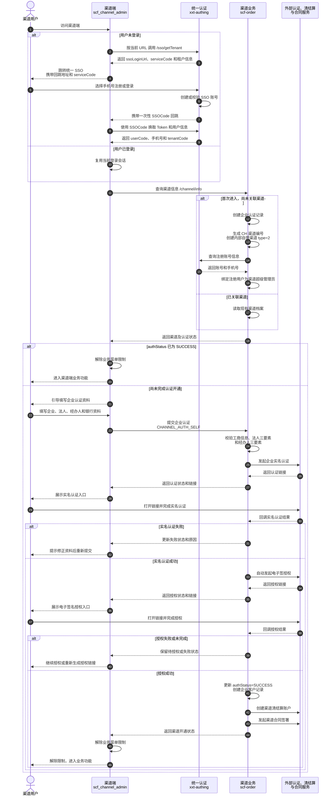
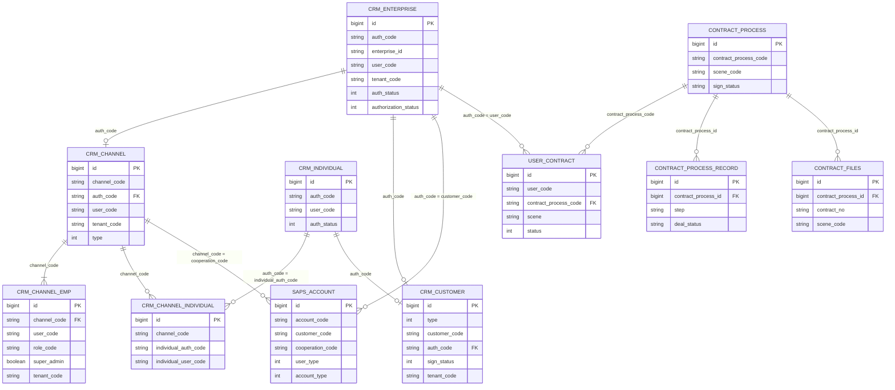
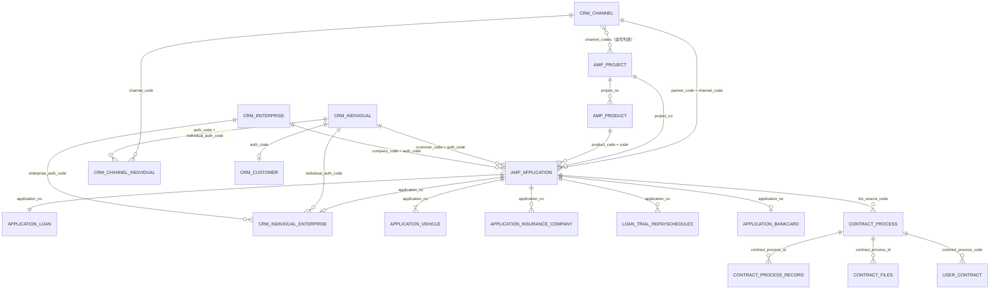
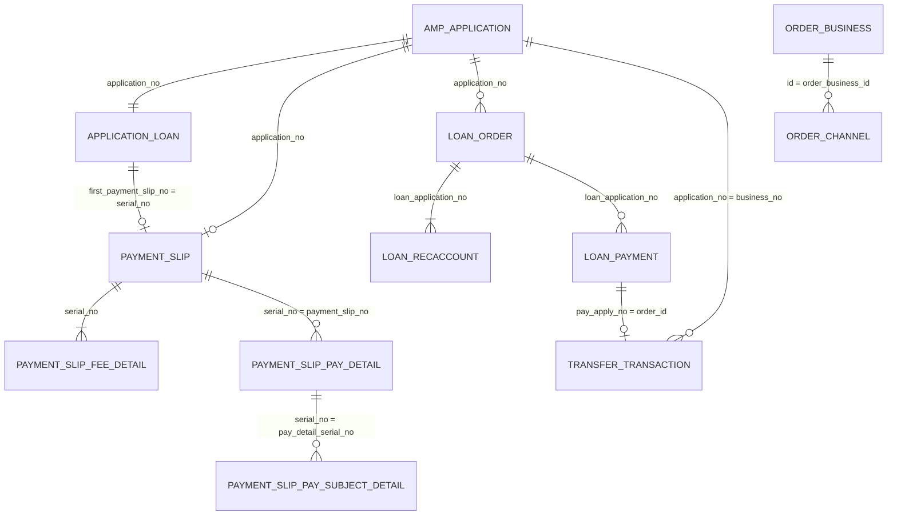
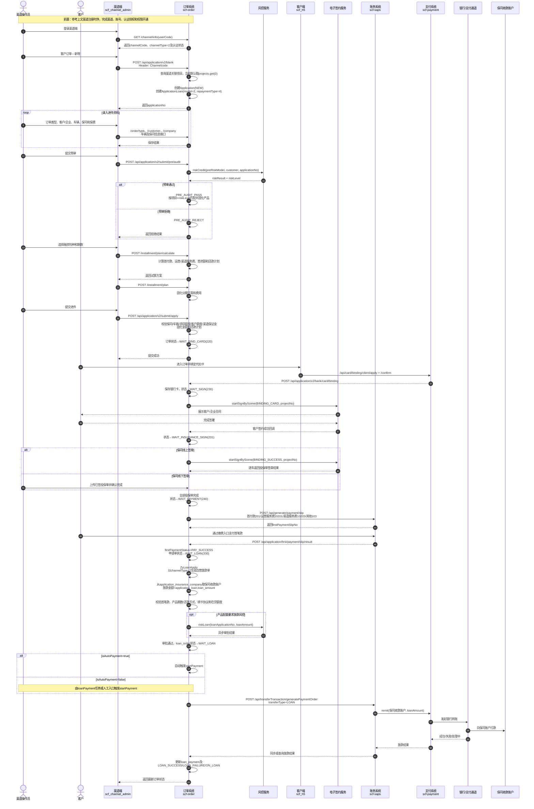

# 系统现状

## 一句话摘要

保费分期当前按接入方式分为平台类渠道和自营类渠道：平台类渠道通过接口对接，自营类渠道通过渠道端、运营端和 H5 客户端协同进件；资方包括系统内置保理公司资方和外部中化资方。

## 当前理解

### 业务线接入模式与资方边界

#### 渠道类型

| 渠道类型  | 接入和进件方式                                                | 排查入口                                  |
| ----- | ------------------------------------------------------ | ------------------------------------- |
| 平台类渠道 | 外部业务方通过接口与保费分期平台对接                                     | 先查合作方接口契约，再核对网关、接口实现、项目/产品配置和目标环境运行情况 |
| 自营类渠道 | 渠道自行在渠道端注册，或由运营人员在运营端注册；随后由渠道在渠道端新建订单，客户配合在 H5 客户端完成进件 | 先查运营端、渠道端、H5 客户端和 `scf-order` 订单流程    |
|       |                                                        |                                       |

自营类渠道的两个注册入口最终汇合到渠道端订单和 H5 客户进件链路：

```text
渠道端自行注册 ─┐
                ├→ 渠道端新建订单 → H5 客户端客户完成进件
运营端注册渠道 ─┘
```

#### 资方类型

| 资方类型 | 当前定位 | 排查入口 |
| --- | --- | --- |
| 保理公司资方 | 系统内置资方 | 从系统内部资方配置、融资申请、账单和清分链路排查 |
| 中化资方 | 外部资方 | 从中化接口契约、`scf-intf-zhonghua`、资方路由和外部交互日志排查 |

#### 接口资料

- 平台类渠道合作方接口：[IT_先行通供应链金融平台接入文档V1.2](</Users/aslight/IDEAWorkspace/workhub-server/docs/company/raw/projects/保费分期/接口文档/IT_先行通供应链金融平台接入文档V1.2.md>)。
- 外部中化资方接口：[IT_保费分期对接文档V1.3](</Users/aslight/IDEAWorkspace/workhub-server/docs/company/raw/projects/保费分期/接口文档/IT_保费分期对接文档V1.3.md>)。
- 导入来源与版本说明：[README](</Users/aslight/IDEAWorkspace/workhub-server/docs/company/raw/projects/保费分期/接口文档/README.md>)。

两份文档是接口契约参考，不单独证明目标环境已经实现或启用。排查具体问题时，仍需先确认渠道类型、资方类型、目标环境和分支，再结合代码、配置、日志与只读数据形成结论。`IT_先行通供应链金融平台接入文档V1.2.md` 的文件名为 V1.2，但文内修订历史已记录至 V1.6，引用字段时应同时说明文内版本和核对日期。

### 三端划分

| 业务端 | 主要用户    | 前端系统/仓库             | 主要职责                                         |
| --- | ------- | ------------------- | -------------------------------------------- |
| 客户端 | 保费分期客户  | `scf_h5`            | 客户注册登录、查看订单和账单、绑卡、还款、签署等客户侧业务操作。             |
| 渠道端 | 渠道及渠道员工 | `scf_channel_admin` | 渠道注册登录、企业资料维护、实名认证与电子签名授权、客户及订单管理、账单和财务业务操作。 |
| 运营端 | 平台运营人员  | `insurance_admin`   | 平台运营管理，包括渠道管理、渠道代建与账号管理、项目和订单管理、财务及配置管理。     |

### 渠道端注册

渠道端具备渠道自行注册入口。账号注册与登录由公共统一认证系统 `xxt-authing` 提供；渠道端 `scf_channel_admin` 负责获取租户配置、跳转 SSO、处理登录回跳和认证状态引导；`scf-order` 负责首次进入时创建渠道档案，以及后续企业认证、授权和开通。



- `serviceCode`、`SSOCode`、`tenantCode` 和 `channelCode` 含义不同：

| 标识 | 当前值/生成方式 | 作用 | 多渠道是否相同 |
| --- | --- | --- | --- |
| `serviceCode` | 渠道端生产配置为 `SSHWFAYXR132`；SSO 跳转实际以 `/sso/getTenant` 返回值为准 | 标识接入统一 SSO 的“保费分期渠道端应用”，用于识别登录来源和应用权限上下文 | 同一渠道端入口相同 |
| `SSOCode` | SSO 每次登录成功后临时生成 | 一次性授权码；由 SSO 携带回跳渠道端，再用于换取业务 Token，不是 `serviceCode` | 每次登录不同，使用后失效 |
| `tenantCode` | 当前保费分期主租户为 `T8DGY35T935` | 表示账号、渠道、认证数据和配置所属的业务租户；用于选择角色模板、认证参数、合同模板等 | 当前同一保费分期租户下相同 |
| `channelCode` | 首次进入时生成 `CH...`，运营端历史渠道也可能使用其他编号规则 | 标识具体渠道，是渠道业务数据隔离的主要维度 | 每个渠道不同 |
| `userCode` | SSO 创建账号时生成 | 标识具体登录用户，并通过渠道员工关系归属到一个渠道 | 每个账号不同 |

- SSO 往返参数方向：渠道端跳转 SSO 时携带固定应用标识 `serviceCode` 和回跳地址；SSO 登录完成后携带临时 `SSOCode` 回到渠道端；渠道端再以 `SSOCode` 换取 Token 和用户信息。
- 一个渠道端入口支持多个渠道注册和登录。各渠道共用渠道端地址、`serviceCode` 和当前 `tenantCode`，登录后通过各自的 `channelCode` 隔离渠道、员工及业务数据；前端业务请求同时携带 `tenantCode`、`serviceCode`、`channelCode` 和 `userCode`。
- 当前账号关系按一个 `userCode` 查询一条渠道员工记录，未提供“同一账号登录后选择或切换多个渠道”的能力。因此，多渠道分别使用各自账号注册登录可以走通；同一账号管理多个渠道不属于当前支持范围。
- 渠道自行注册时，登录手机号会自动带入企业认证的“经办人手机号”，当前登录用户在首次进入时绑定为渠道超级管理员。登录账号不要求必须是法人，可以是授权经办人；法人信息和经办人信息分别进行校验。
- 运营端代建渠道时，系统也使用提交资料中的经办人姓名、手机号和证件信息创建渠道管理员账号。因此，两条入口最终都形成“经办人账号—渠道管理员—`channelCode`”关系。
- 注册用户首次进入渠道端时，`scf-order` 自动创建内部自营渠道档案、渠道编号、企业认证记录和渠道超级管理员关系。
- 未完成企业实名认证或电子签名授权时，渠道端会限制普通业务菜单并引导用户进入对应认证页面。
- 授权成功后，系统继续创建企业客户记录、渠道清结算账户并发起合同签署。清结算开户或合同签署异常会记录日志，但当前实现不会回滚已经更新的 `SUCCESS` 认证状态，因此开通结果仍需分别核验。
- 运营端代建渠道是另一条有效入口：运营人员新增并提交渠道资料后，系统为经办人创建渠道管理员账号；后续与渠道自行注册流程汇合到同一套认证和开通链路。

#### 涉及表与 ER 关系

渠道注册在 `scf-order` 内的核心落表如下。统一 SSO 账号由 `xxt-authing` 管理；`scf-order` 只保存其返回的 `userCode`，因此下表不虚构本地 SSO 用户表。

| 表                                                                             | 用途                    | 关键字段及关系                                                                                                                      |
| ----------------------------------------------------------------------------- | --------------------- | ---------------------------------------------------------------------------------------------------------------------------- |
| `crm_enterprise`                                                              | 企业认证记录                | `auth_code` 是代码生成的认证业务标识，供认证生命周期和下游业务关联，`enterprise_id` 是统一社会信用代码，用于企业查重。                                                    |
| `crm_channel`                                                                 | 渠道主档                  | `channel_code` 是代码生成的渠道业务标识；`auth_code` 关联 `crm_enterprise.auth_code`；`user_code` 保存渠道初始/主账号；`type=2` 表示内部自营渠道。              |
| `crm_channel_emp`                                                             | 渠道员工与登录账号关系           | `channel_code` 关联 `crm_channel.channel_code`；`user_code` 对应 SSO 用户；`role_code`、`super_admin`、`status` 表示角色、超级管理员和启停状态。       |
| `crm_individual`                                                              | 进件客户个人认证记录         | `auth_code` 是个人认证业务标识，`user_code` 逻辑关联 SSO 账号；保存脱敏/密文身份信息、手机号、认证链接、`service_id`、`auth_status`和认证时间。 |
| `crm_channel_individual`                                                      | 渠道与进件客户关系（下游延伸） | `channel_code` 关联进件渠道，`individual_auth_code` 关联 `crm_individual.auth_code`，`individual_user_code` 保存客户 SSO `userCode`。该表不在渠道注册时写入，而在渠道新建订单并保存客户信息时创建。 |
| `crm_customer`                                                                | 统一 CRM 客户主体记录   | `type=1` 表示个人、`type=2` 表示企业；`auth_code` 关联对应认证记录。个人认证成功时以 `customer_code=crm_individual.auth_code` 创建，并保存个人授权合同状态。 |
| `scf-saps.account`                                                            | 清结算账户                 | 渠道认证成功后以企业 `auth_code` 和 `channel_code` 开现金/保证金账户；个人认证成功后以 `customer_code=crm_individual.auth_code`、`user_type=60` 开个人清结算账户。                    |
| `user_contract`、`contract_process`、`contract_process_record`、`contract_files` | 渠道授权成功后发起的渠道合同签署及过程留痕 | `user_contract.user_code=crm_enterprise.auth_code`，再以 `contract_process_code` 关联签署流程；流程记录和合同文件通过 `contract_process_id` 归属流程。 |



关系说明：

- `crm_enterprise` 和 `crm_channel` 的数据库物理主键都是自增 `id`；`auth_code`、`channel_code` 是代码层业务标识。当前仓库建表 DDL 只声明了 `id` 主键，没有为这些业务标识声明唯一键或物理外键。
- 渠道关联的是一次企业认证业务主体及其状态、回调、授权和合同生命周期，所以使用稳定的 `auth_code`。渠道首次初始化时就会生成 `auth_code` 并建立关系，此时企业资料尚未填写，`enterprise_id` 可能为空。
- `enterprise_id` 是企业统一社会信用代码，保存企业资料时用于“该企业是否已经认证”的查重；它属于企业自然身份，不是认证流程实例标识。若企业资料纠错或认证流程重建，直接以自然身份字段耦合渠道会放大变更影响。
- 法人证件号 `legal_ident_no` 和经办人证件号 `agent_ident_no` 都是人员敏感信息，并不唯一代表渠道或企业：同一法人/经办人可以服务多个企业，且当前模型还保存密文、摘要和脱敏值，因此不适合作为渠道关系键。
- 当前唯一性主要依靠服务代码在保存时按 `enterprise_id` 查询并拒绝重复，数据库层没有相应唯一约束；并发写入或绕过服务写库时仍存在重复数据风险，这是现状边界，不应把 `auth_code` 理解成已受数据库唯一约束的候选键。
- `crm_channel_emp.user_code` 与 SSO 用户是跨系统逻辑关联；当前代码按一个 `userCode` 取一条渠道员工关系。`SAPS_ACCOUNT` 对应 `scf-saps` 的实际表 `account`，与 `scf-order` 表之间同样只是跨库业务键关联。
- `crm_channel_individual` 是渠道开通后的下游客户归属表，不是渠道员工表：`crm_channel_emp` 管“谁可以登录并操作该渠道”，`crm_channel_individual` 管“哪些进件客户归属该渠道”。同一客户可以与不同渠道分别建立关系。

##### 进件客户个人认证与账号链路

| 阶段 | 账号/业务记录 | 关键标识 | 处理规则 |
| --- | --- | --- | --- |
| 渠道保存订单客户 | `xxt-authing` SSO 账号 | `userCode`、手机号 | `AuthIndividualServiceImpl.createAccount()` 以客户手机号创建或复用客户端 SSO 账号，返回 `userCode`。当前新账号初始密码规则为证件号后 6 位；密码由 `xxt-authing` 管理，`scf-order` 不保存密码。是否由统一认证强制首次登录改密，本次未核实。 |
| 创建个人认证主体 | `crm_individual` | `auth_code=COI...`、`user_code=userCode` | 按证件号查询并创建或复用个人认证记录，初始状态为 `NEW(0，待认证)`；订单保存 `customer_code=auth_code`、`user_code=userCode`。 |
| 绑定客户与渠道 | `crm_channel_individual` | `channel_code`、`individual_auth_code`、`individual_user_code` | 按订单 `partner_code` 和客户 `userCode` 查重后插入，使渠道端只能查询和复用归属本渠道的客户。 |
| 客户提交个人认证 | `crm_individual` | `service_id`、`auth_url`、`auth_status` | H5 先查询登录账号信息和证件 OCR，再调用 `POST /auth/individual/commit`。后端以 SSO 账号手机号做姓名、证件号、手机号三要素校验，然后发起外部实名认证；状态流转为 `NEW(0) → IN_AUTH(1) → AUTHED(2)` 或 `AUTH_FAIL(3)`。 |
| 认证成功回调 | `crm_customer`、个人合同、`scf-saps.account` | `crm_customer.type=1`、`customer_code=auth_code`、`user_type=60` | `POST /auth/individual/notice` 命中认证成功后调用 `authedHandle()`：更新认证状态/时间，创建个人 CRM 客户主体，发起 `APPLICATION_AUTH` 授权合同，并开立个人清结算账户。合同或开户失败当前只记录日志，不回滚已完成的实名状态。 |
| 账号维护 | SSO 账号 + `crm_individual` + `crm_channel_individual` | `userCode`、新手机号 | `/auth/individual/getSmsCode`、`/changeMobile`、`/cancel` 分别用于获取验证码、修改登录手机号和注销账号。修改手机号仅允许已实名客户操作，会把个人认证与授权合同重置为待办并更新 SSO 手机号，`userCode` 和渠道关系不变；注销前必须不存在未结清账单，成功后会逻辑删除个人认证、渠道关系、个人—企业关系和 CRM 客户记录。 |

#### 系统入口

渠道自行注册和运营端代建最终都会形成“经办人账号—渠道员工—`channelCode`”关系，但前端起点不同，后端在企业认证和渠道开通阶段汇合。

##### 前端入口

| 系统端                     | 页面/代码入口                                                                                           | 用户操作                                                                    | 调用入口                                                                                                                         | 处理结果                                                   |
| ----------------------- | ------------------------------------------------------------------------------------------------- | ----------------------------------------------------------------------- | ---------------------------------------------------------------------------------------------------------------------------- | ------------------------------------------------------ |
| 渠道端 `scf_channel_admin` | `src/plugins/permission.ts`、`store/modules/user.ts`、`src/views/enterpriseCertification/index.vue` | 未登录用户跳转统一 SSO 注册/登录；回跳后换取令牌、查询渠道状态；未开通时填写企业、法人、经办人和银行资料，继续完成实名认证与电子签授权。 | `GET /web/user/sso/getTokenByCode`、`GET /web/user/sso/getUserInfoByToken`、`GET /channel/info`、`POST /auth/enterprise/commit` | 首次进入触发渠道初始化；认证未完成时限制业务菜单，成功后放行。                        |
| 运营端 `insurance_admin`   | `src/views/counterparty/channels/components/EditDialog.vue`                                       | 运营人员新增渠道，保存草稿或提交渠道企业及经办人资料。                                             | `POST /channel/save`、`POST /channel/commit`                                                                                  | 后端按 `OPERATOR_ADD_CHANNEL` 场景创建渠道及管理员账号，后续与渠道自行注册链路汇合。 |
| 外部认证/电子签页面              | 后端返回的认证链接和授权链接                                                                                    | 经办人打开第三方页面完成企业实名和电子签名授权。                                                | 第三方页面；完成后由第三方回调 `scf-order`                                                                                                  | 认证或授权结果回写，失败时保留原状态并支持重新发起。                             |

##### 后端入口

| 入口类型     | Controller / API                                                                                                | 核心处理                                                                                                          | 处理结果                                                      |
| -------- | --------------------------------------------------------------------------------------------------------------- | ------------------------------------------------------------------------------------------------------------- | --------------------------------------------------------- |
| 统一认证     | `GET /web/user/sso/getTokenByCode`、`GET /web/user/sso/getUserInfoByToken`                                       | `xxt-authing` 使用一次性 `SSOCode` 换取 token 和用户信息，返回 `userCode`、手机号、`tenantCode` 和授权资源。                            | 建立渠道端登录会话；SSO 账号仍由 `xxt-authing` 管理。                      |
| 渠道首次初始化  | `ChannelController.info()`：`GET /channel/info?userCode=...`                                                     | `ChannelServiceImpl.info()` 在查询不到渠道关系时发起企业认证，生成 `CH` 编号和 `type=2` 内部自营渠道，并调用 `ChannelEmpServiceImpl` 绑定超级管理员。 | 形成渠道主档、企业认证记录和“`userCode`—`channelCode`”员工关系。             |
| 渠道自主认证提交 | `AuthEnterpriseController.commit()`：`POST /auth/enterprise/commit`                                              | `AuthEnterpriseServiceImpl.commit()` 按 `CHANNEL_AUTH_SELF` 场景校验工商、法人和经办人资料，并向外部认证服务发起认证。                      | 保存企业资料、认证状态及认证链接。                                         |
| 运营代建渠道   | `ChannelController.save()` / `commit()`：`POST /channel/save`、`POST /channel/commit`                             | `ChannelServiceImpl.save()` / `commit()` 按 `OPERATOR_ADD_CHANNEL` 场景保存并提交企业认证，以经办人资料创建或关联渠道管理员账号。             | 形成运营代建的渠道和管理员，后续进入共用认证、授权与开通链路。                           |
| 认证与授权回调  | `AuthEnterpriseController`：`POST /auth/enterprise/authenticateNotice`、`POST /auth/enterprise/authorizateNotice` | 更新实名认证和电子签授权结果；授权成功后创建企业客户、渠道清结算账户并发起渠道合同。                                                                    | 更新 `authStatus` / `authorizationStatus`；认证成功后渠道端解除业务菜单限制。 |

#### 多租户现状边界

- 保费分期代码和表结构保留了多租户字段，渠道、渠道员工、企业/个人认证、合同配置和部分公共服务调用会实际使用 `tenantCode`。
- 当前生产主链路主要围绕租户 `T8DGY35T935` 运行，部分历史代码仍直接写死该值。因此现状是“具备部分多租户模型和配置隔离能力，但尚未达到无改造新增第二个租户”的程度。
- 当前材料只能证明技术模型存在多租户预留，尚不能据此认定业务侧已经提出新增第二个保费分期租户的明确需求；是否存在正式多租户业务需求仍需结合需求单确认。

#### 生产实例：山西鸿瑞坤租赁有限公司

以下为 2026-08-12 生产只读查询快照，账号信息已脱敏：

- 渠道编号：`HZF000144`；租户：`T8DGY35T935`；渠道状态：启用。
- 最初注册及开通账号为 `朱** / 155****1987`，同时是企业认证的授权经办人和渠道超级管理员；该实例说明手机号注册登录账号实际可由经办人使用，并非必须由法人本人登录。
- 当时渠道员工表共有 5 个账号，其中 4 个启用、1 个停用；除超级管理员外还可由渠道管理员或员工账号登录。
- 生产只读库未提供统一 SSO 登录日志，因此上述数据能够确认账号归属和启停状态，不能证明最近一次实际登录使用了哪个账号。

### 自营渠道进件流程

1. **前置配置**：运营端完成内部自营渠道、项目、产品、额度、保证金、费率、资金路由和渠道账号权限配置。
2. **渠道端建单**：渠道人员在“客户订单”点击“新增”，系统通过 `POST /api/application/v2/blank` 创建空白订单，并自动绑定当前渠道、有效项目及垫资方。
3. **客户与企业认证**：渠道录入客户和挂靠企业；客户在 H5 完成实名认证与授权，非纯个人订单还要求企业完成认证授权。
4. **提交预审**：系统按项目配置调用预审风控模型；通过后根据风险等级匹配产品并固化首付比例、服务费等产品参数。
5. **补齐进件资料**：渠道录入车辆、保险公司、保司收款账户、投保单及分期方案，完成还款计划试算。
6. **提交进件**：系统校验融资险种、期数、车辆、保司、项目额度、客户额度和渠道保证金，固化金额及还款计划后进入待绑卡。
7. **客户绑卡与签约**：客户在 H5 绑定代扣银行卡并完成客户合同签署；随后按项目签章模式完成线上或线下投保单签章。
8. **首笔款**：签章完成后 `scf-order` 调用 `scf-saps` 生成首笔款缴费单。首笔款包括首付款、运营商服务费、渠道服务费和其他非融资险种费用中的适用科目。
9. **保司放款**：首笔款支付成功后，系统自动生成自营保司放款申请，将垫资款支付至订单配置的保司收款账户；自营业务免视频校验，但仍校验首笔款、绑卡签约、产品和收款信息。
10. **保单与资方融资**：承保后渠道逐车上传正式保单；全部正常车辆的商业险保单齐全后，系统按项目资金路由触发资方融资。
11. **出账与贷后**：放款和融资信息同步至 SAPS，继续生成客户、运营商及资方账单，并进入还款、清分、代偿、退保退费和对账流程。

#### 涉及表与 ER 关系

以下按“渠道建单—资料进件—绑卡签约—首笔款—保司放款”主链整理核心业务表；字典、通用附件、操作日志、消息通知和任务执行日志等辅助表不在本图逐一展开。

| 系统/阶段 | 涉及表 | 用途与关键关系 |
| --- | --- | --- |
| `scf-order` 渠道与项目 | `crm_channel`、`amp_project`、`amp_product` | `crm_channel.channel_code` 是进件渠道；项目通过 `amp_project.channel_codes` 维护可用渠道（逗号列表，非规范化中间表）；产品以 `amp_product.project_no` 归属项目。新建空白单当前取渠道有效项目列表的第一项。 |
| `scf-order` 申请主数据 | `amp_application`、`application_loan` | 两表以 `application_no` 一对一组织订单主状态和融资要素；`amp_application.partner_code/project_no/product_code` 分别引用渠道、项目和产品；`application_loan` 保存融资比例、金额、期数、还款方式、首笔款编号和后续放款申请号。 |
| `scf-order` 客户、渠道与企业 | `crm_individual`、`crm_channel_individual`、`crm_customer`、`crm_enterprise`、`crm_individual_enterprise` | `amp_application.customer_code/company_code` 分别关联个人、企业的 `auth_code`；`crm_channel_individual` 固化客户与进件渠道的归属；个人认证成功后生成 `crm_customer(type=1)`；个人—企业—订单关系由 `crm_individual_enterprise` 的 `individual_auth_code/enterprise_auth_code/application_no` 固化。 |
| `scf-order` 车辆与保司 | `application_vehicle`、`application_insurance_company` | 两表均通过 `application_no` 归属申请；车辆按 `vin` 区分，保司表保存 `company_code` 及实际收款账号、银行、联行号和付款摘要。 |
| `scf-order` 分期与绑卡 | `loan_trial_repayschedules`、`application_bankcard` | 试算还款计划以 `application_no + vin + period` 组织；绑卡回调按 `application_no` 保存代扣银行卡，并推动订单从待绑卡进入待签约。 |
| `scf-order` 合同签署 | `contract_process`、`contract_process_record`、`contract_files`、`user_contract` | `contract_process.biz_source_code` 在订单签约场景逻辑关联 `application_no`；流程记录和合同文件以 `contract_process_id` 归属流程，用户合同以 `contract_process_code` 关联签署流程。 |
| `scf-saps` 首笔款 | `payment_slip`、`payment_slip_fee_detail`、`payment_slip_pay_detail`、`payment_slip_pay_subject_detail` | `payment_slip.application_no` 关联申请，`serial_no` 回写 `application_loan.first_payment_slip_no`；费用科目、支付明细和支付科目明细分别通过缴费单流水、`payment_slip_no`、`pay_detail_serial_no` 逐层关联。 |
| `scf-order` 保司放款 | `loan_order`、`loan_recaccount`、`loan_payment` | `loan_order.application_no` 关联申请；放款收款账户和付款记录均以 `loan_application_no` 关联放款单；`loan_payment.pay_apply_no` 是单次付款申请号。 |
| `scf-saps` / `scf-payment` 转账 | `transfer_transaction`、`order_business`、`order_channel` | SAPS 转账单以 `business_no=application_no`、`order_id=pay_apply_no` 承接保司付款；支付系统在 `order_business` 保存业务订单，在 `order_channel` 通过 `order_business_id` 保存支付渠道订单和通道结果。 |

核心申请数据关系：



首笔款和保司放款延伸关系：



关系说明：

- ER 图聚焦代码主链使用的业务键。`amp_project.channel_codes` 是逗号分隔字段，`scf-order`、`scf-saps`、`scf-payment` 之间也是跨库逻辑关联，均不是数据库跨库外键；`TRANSFER_TRANSACTION → ORDER_BUSINESS` 由接口调用和业务流水承接，因本次未核验生产数据中的具体流水取值，没有在图中强画等值关系。
- 保存订单客户信息时，`ApplicationProprietaryController.editCustomer()` 使用订单 `partner_code` 调用 `AuthIndividualServiceImpl.createAccount()`。服务创建或复用 SSO 客户账号和 `crm_individual`，再按“`channel_code + individual_user_code`”查询 `crm_channel_individual`，不存在时插入关系，最后将 `crm_individual.auth_code` 回写到 `amp_application.customer_code`。因此关系创建早于客户后续在 H5 完成实名认证和授权。
- 生产只读核对（2026-08-15）：`crm_channel_individual` 共有 2,408 条有效关系，覆盖 2 个渠道和 2,404 个个人认证编号；303 笔已保存客户的自营订单全部能按“`partner_code = channel_code` 且 `customer_code = individual_auth_code`”匹配到有效关系，未匹配数为 0。
- 上述 303 笔自营订单对应 176 个去重客户：172 个人的 `crm_individual.auth_status=AUTHED(2)` 且均已建立 `crm_customer(type=1)`；4 个人仍为 `NEW(0，待认证)`，尚未建立个人 `crm_customer`。这证明“账号/渠道关系先创建，客户实名及 CRM 客户主体后完成”是生产实际状态。
- 现状风险：生产表只有 `id` 主键，没有为渠道和客户关系建立唯一索引；当前代码使用“先查询、再插入”去重。生产已存在 1 组重复的有效“`channel_code + individual_auth_code`”组合，并发或写入时仍有继续重复的风险。

#### 系统入口

自营渠道进件由渠道端负责建单和资料录入，客户端负责客户认证、绑卡、签约和首笔款，运营端负责前置配置、辅助确认和异常处理；后端由 `scf-order` 编排主流程，并调用风控、支付、合同、SAPS 和资方系统。

##### 前端入口

| 系统端 | 主要页面/操作 | 主要调用入口 | 现状与边界 |
| --- | --- | --- | --- |
| 渠道端 `scf_channel_admin` | “客户订单”新增订单；`addOrder.vue` 按步维护订单类型、客户、挂靠企业、车辆/投保单、保司和分期方案；发起预审、提交进件和上传正式保单。 | `/api/application/v2/blank`、`/api/application/v2/order/type`、`/api/application/v2/customer`、`/api/application/v2/company`、`/api/application/v2/submit/pre/audit`、`/api/application/v2/submit/apply`、`/api/application/vehicle`、`/api/application/insurance/company`、`/installment/plan/*`、`/api/application/vehicle/update/insurance/policy` | 进件的主操作端。当前新建空白单默认取当前渠道关联的第一个有效项目，项目选择边界需在新增多项目时重点复核。 |
| 客户端 `scf_h5` | `Mine/Authens/UserInfoAuth.vue` 完成身份证 OCR、个人实名认证与授权；后续完成代扣银行卡绑定、客户合同签署和首笔款支付。 | `GET /auth/individual/queryByUserCode`、`POST /auth/individual/ocr`、`POST /auth/individual/commit`、`POST /api/card/binding/client/apply`、`POST /api/card/binding/client/confirm`；合同签署链接和首笔款支付入口 | H5 不负责创建进件或 SSO 账号；客户使用渠道录入的手机号登录，实名、绑卡、签约和支付结果通过后端回调推动后续状态。 |
| 运营端 `insurance_admin` | 配置渠道、项目、产品、额度、保证金、费率和资金路由；查询订单和放款结果；按项目签章方式处理线下投保单签章；在授权范围内发起放款或融资补偿。 | 运营管理接口、`GET /api/loan/zyLoanApply`、`GET /manage/finance/financeApply` | 运营端不是自营渠道资料录入的主入口；补偿操作必须复用后端幂等业务方法。 |
| 外部页面 | 客户/挂靠企业的实名认证页、电子合同签署页 | 后端生成的认证链接、签署链接 | 页面属于外部认证/合同平台；完成后通过回调进入 `scf-order`。 |

渠道侧新建订单的起始调用链为：`customerOrder.vue#addOrder()` → `apiList.order.createOrder` → `POST /api/application/v2/blank` → `ApplicationProprietaryController.generateBlankOrder()`。后端返回 `applicationNo` 后，前端跳转 `addOrder.vue` 继续进件。

##### 后端入口

以下表按后端 API/系统事件展开进件主链；前端页面与操作统一见上表。

| 阶段      | 后端 API / 系统事件                                                                                                                                    | 核心代码入口                                                                                                                                                | 系统接入与处理结果                                                                                  | 状态/结果                                                                               | 自动补偿入口                                                                                      |
| ------- | -------------------------------------------------------------------------------------------------------------------------------------------- | ----------------------------------------------------------------------------------------------------------------------------------------------------- | ------------------------------------------------------------------------------------------ | ----------------------------------------------------------------------------------- | ------------------------------------------------------------------------------------------- |
| 新建空白订单  | `POST /api/application/v2/blank`                                                                                                | `ApplicationProprietaryController.generateBlankOrder()`                                                                | 从 Header `Channelcode` 读取当前渠道，默认取关联的第一个有效项目，绑定垫资方/供应商，保存 `Application` 和 `ApplicationLoan` | `NEW(1)`，返回 `applicationNo`                                                         | —                                                                                           |
| 订单类型    | `POST /api/application/v2/order/type`                                                                                                        | `setOrderType()`；`ApplicationProprietaryController.settingOrderType()`                                                                                | 仅新建状态允许设置订单类型                                                                              | 保持 `NEW(1)`                                                                         | —                                                                                           |
| 客户信息    | `POST /api/application/v2/customer`                                                                                     | `ApplicationProprietaryController.editCustomer()` → `AuthIndividualServiceImpl.createAccount()` → `ChannelIndividualService`                                                                                                     | 创建或复用 SSO 客户账号和 `crm_individual`，写入 `crm_channel_individual` 客户—渠道关系，再将 `customer_code/user_code` 绑定到订单                                                                           | 保持 `NEW(1)`；客户后续登录 H5 完成实名与授权                                                                         | —                                                                                           |
| 客户个人认证 | `GET /auth/individual/queryByUserCode`、`POST /auth/individual/ocr`、`POST /auth/individual/commit`；回调 `POST /auth/individual/notice` | `AuthIndividualController` → `AuthIndividualServiceImpl.commit()` / `notice()` → `authedHandle()` | 查询 SSO 账号手机号，进行三要素校验并发起外部实名；成功回调后创建 `crm_customer(type=1)`、个人授权合同和 `scf-saps` 个人账户 | `crm_individual.auth_status：0 → 1 → 2/3`；不直接改变订单状态 | 外部合同或开户失败当前仅记录日志，不回滚实名状态 |
| 挂靠企业    | `POST /api/application/v2/company`                                                                                       | `ApplicationProprietaryController.editCompany()`                                                                                                      | 绑定企业及个人—企业—订单关系                                                                            | 保持 `NEW(1)`                                                                         | —                                                                                           |
| 车辆和投保单  | `/api/application/vehicle`                                                                                               | `ApplicationVehicleController`                                                                                                                        | 保存车辆、险种金额和投保单附件                                                                            | 进件资料待完善                                                                             | —                                                                                           |
| 保司信息    | `/api/application/insurance/company`                                                                                   | 保司信息 Controller/Service                                                                                                                               | 保存保司、收款账户、开户行、联行号和签章模式                                                                     | 作为签章和放款入参                                                                           | —                                                                                           |
| 预审风控    | `POST /api/application/v2/submit/pre/audit`                                                                | `ApplicationProprietaryController.submitPreAudit()` → `SelfOperatedOrderService.riskControlAudit()`                                                   | `scf-order` 调用风控 `POST /api/risk/credit`；`RiskFeignClient.riskCredit()` 返回风险结果/等级，再匹配产品    | `PRE_AUDIT_PASS(102)` 或 `PRE_AUDIT_REJECT(101)`                                     | —                                                                                           |
| 分期试算/保存 | `/installment/plan/calculate`、`/installment/plan`                                                                         | `ApplicationProprietaryController.installmentPlanCalculate()` / `editInstallmentPlan()`；`SelfOperatedOrderService.calculateAmount()`                  | 按产品配置计算首笔款、垫资额、运营/渠道服务费和还款计划                                                               | 固化分期方案                                                                              | —                                                                                           |
| 提交进件    | `POST /api/application/v2/submit/apply`                                                                       | `ApplicationProprietaryController.submitApply()` → `SelfOperatedOrderService.submitApply()`                                                           | 校验保司、车辆、项目/客户额度和渠道保证金，固化金额及还款计划                                                            | `WAIT_BIND_CARD(220)`                                                               | —                                                                                           |
| 客户绑卡    | `POST /api/card/binding/client/apply`、`POST /api/card/binding/client/confirm`                                                                                       | `CardBindApiController` → `CardBindingStrategyServiceImpl` → 资金路由绑卡策略                                                                                 | `scf_h5` 调用 `scf-payment` 完成代扣签约                                                           | 支付侧绑卡完成                                                                             | —                                                                                           |
| 绑卡结果通知  | `POST /api/application/v2/bank/card/binding`                                                                                                 | `ApplicationProprietaryController.bankCardBindingCompleted()` → `SelfOperatedOrderService.bankCardBindingCompleted()`                                 | `scf-payment` 回调 `scf-order`，保存订单银行卡并异步发起客户合同                                              | `220 → WAIT_SIGN(230)`                                                              | —                                                                                           |
| 客户合同签署  | 合同场景 `BINDING_CARD`；回调 `POST /api/contract/callback`                                                                                         | `SelfOperatedOrderService.startCustomerSignFlow()` → `ContractSigningService.startSignByScene()`；回调分发至 `customerSignCompleted()`                      | `scf-order` 主动调用合同系统，保存签署流程号；完成后启动投保单签章                                                    | `WAIT_SIGN(230) → WAIT_INSURANCE_SIGN(231)`                                         | `autoRetryStartCustomerSignFlow` 扫描 `WAIT_SIGN(230)`，重试 `startCustomerSignFlow()`           |
| 投保单签章   | 合同场景 `BINDING_SUCCESS`；回调 `POST /api/contract/callback`                                                                                      | `SelfOperatedOrderService.startVehicleSignFlow()`；回调分发至 `insurancePolicySignCompleted()`                                                              | 线上按车辆调用合同系统；线下签章由运营侧确认；全部完成后生成首笔款                                                          | `231 → WAIT_PAYMENT(240)`                                                           | `autoRetryStartInsuranceSignFlow` 扫描 `WAIT_INSURANCE_SIGN(231)`，重试 `startVehicleSignFlow()` |
| 首笔款缴费单  | `scf-order` 调用 `POST /api/generate/payment/slip`                                                                                             | `SelfOperatedOrderService.generateFirstPaymentSlip()` → `AmpSapsClient.generatePaymentSlip()` → `PaymentSlipProviderController.generatePaymentSlip()` | `scf-saps` 生成首付款、运营服务费、渠道服务费和其他费用缴费单，返回缴费单号                                                | 保持 `WAIT_PAYMENT(240)`                                                              | `autoRetryGeneratePaymentSlip` 扫描 `WAIT_PAYMENT(240)` 且无缴费单，重试 `generateFirstPaymentSlip()` |
| 首笔款支付结果 | `POST /api/application/first/payment/slip/result`                                                                                            | `PaymentSlipBizServiceImpl.notifyPayResult()` → `ApplicationController.firstPaymentSlipResult()`                                                      | `scf-saps` 回调 `scf-order`，写入支付成功并异步生成自营保司放款申请                                              | `240 → WAIT_LOAN(330)`                                                              | 放款申请未生成时由 `autoRetryApplyLoan` 接续                                                           |
| 保司放款申请  | 内部调用 `LoanOrderServiceImpl.ZyLoanApply()`；人工重试 `GET /api/loan/zyLoanApply`                                                                   | `LoanOrderServiceImpl` → `LoanOrderServiceTransational.dealLoanApply()`                                                                               | 以保司收款账户和 `loanAmount` 生成放款单，校验首笔款、绑卡签约、产品、收款账户和在贷额度；自营跳过视频校验                               | 放款审批/待放款                                                                            | `autoRetryApplyLoan` 扫描自营 `WAIT_LOAN(330)` 且无有效放款单，重试 `LoanOrderService.ZyLoanApply()`      |
| 保司付款及结果 | `POST /api/transferTransaction/generatePaymentOrder`；回调 `POST /api/loan/notifyPayResult`                                                     | `LoanOrderServiceTransational.startPayment()`；`LoanOrderController.notifyPayResult()` → `LoanOrderServiceImpl.notifyPayResult()`                      | `scf-order` 调用 `scf-saps`，再由 `scf-saps` 调用 `scf-payment`/银行向保司付款；回写同步或异步结果                 | `LOAN_SUCCESS(351)`、`LOAN_FAILURE(350)`、`PARTIAL_SUCCESS(361)` 或 `BANK_REFUND(360)` | `isAutoPayment=false` 时由 `loanPayment` 任务/人工入口发起；处理中可查询支付结果                                 |
| 正式保单上传  | `POST /api/application/vehicle/update/insurance/policy`                                                                                      | `ApplicationVehicleController.updateInsurancePolicy()`                                                                                                | 渠道端上传正式保单，校验保单车架号；全部正常车辆商业险保单齐全后触发融资                                                       | `insurancePolicyUploaded=true`                                                      | 下一阶段由 `autoRetryFinancing` 接续                                                               |
| 资方融资    | `FinanceApplicationService.financeApply()`；管理补偿 `GET /manage/finance/financeApply`；回调 `/api/finance/apply/result`、`/api/finance/loan/result` | 中化：`FinanceFactoringHandleService.apply()`；回调：`FinanceApplicationCallbackApiController` → `FinanceApplyBizService` / `FinanceBusinessService`         | `scf-order` 按项目资金路由调用资方，更新审批、保理单号和融资放款状态，并同步 `scf-saps`                                    | 融资中/融资成功/失败                                                                         | `autoRetryFinancing` 扫描满足待融资条件的订单，重试 `financeApply()`                                       |

补偿处理必须复用表中的幂等业务方法，不能只直接修改订单或放款状态。只有项目、产品、支付方式、签章场景、收款模型或资金路由无法由现有配置表达时，才应扩展对应处理器。

#### 自营渠道进件时序图

本时序以上文“渠道端注册”为前置：渠道已建档，登录账号已通过 `channel_emp` 关联到正确的 `channelCode`，并已完成企业实名认证、电子签授权及业务菜单开通。



放款审批通过后是否立即向保司付款取决于 `commonParamConfig.isAutoPayment`；关闭自动放款时，放款单保持 `WAIT_LOAN`，等待 `loanPayment` 任务或人工入口发起付款。

核心状态流转：

`NEW(1) → PRE_AUDIT_PASS(102) → WAIT_BIND_CARD(220) → WAIT_SIGN(230) → WAIT_INSURANCE_SIGN(231) → WAIT_PAYMENT(240) → WAIT_LOAN(330) → LOAN_SUCCESS(351)`

异常场景由签约、投保签章、首笔款缴费单、保司放款和资方融资等自动重试任务补偿；进入实际放款阶段后，订单不能再由渠道随意撤销。

详细接口、状态分支、线上/线下签章差异及证据边界见 [自营渠道进件流程](</Users/aslight/IDEAWorkspace/workhub-server/docs/company/projects/保费分期/自营渠道进件流程.md>)。

#### 代码基线与边界

- 核对日期：2026-08-14。
- `scf-order`：受控缓存 `master`，提交 `2c1e1ac902c801bde7e41b395012cbddb0456b8a`。
- `scf-payment`：受控缓存 `master`，提交 `3b84cd26cc0b9a29085afb0192c8c6cee221a542`。
- `scf-saps`：受控缓存 `master`，提交 `72819c90333d107b17f4940ae1c3a36b516e02aa`。
- `scf_h5`：受控缓存 `master`，提交 `67018225aed6fec887631bf1676856d0d6e43c81`。
- `scf_channel_admin` 远端仍无 `master`；渠道端页面入口来自默认分支 `scf_selfoperation_20251016`，提交 `8e68a8003321c49d51af3d710cbbab4425c162e4`，属于前端代码证据，不代表已核验的生产部署提交。
- WorkHub 当前未配置生产访问入口，本次也未核验生产部署镜像、运行日志或数据库数据；以上为生产默认分支的静态代码入口。

### 支付与还款现状

本节聚焦客户账单支付，尤其是生产存量平台类项目“聚保融保费分期项目”（项目号 `XXT-PRJ-JBR-A`、渠道 `HZF000166`）。聚保融线上还款主要走合作方支付结算接口，不等同于内部自营渠道代扣；线上还款、线下还款和提前结清最终汇入同一套客户账单、运营商账单、资方账单、计费资源和对账单链路。

#### 统一口径

- 当前聚保融实际只融资商业险，客户月度账单主要是商业险垫资本金；运营服务费已在首笔款一次性收取，渠道服务费当前为 `0`，技术服务费由运营方与技术服务方结算，均不在客户月度还款时重复收取。
- 聚保融还款的资金归属主要由“资方是否已经代偿”决定，而不是由线上或线下决定：代偿前，本金归实际资金方，其他费用、罚息等非资方科目归渠道；代偿后，资方已经通过代偿收回本金，客户后续支付的本金、其他费用、罚息和提前结清手续费均按渠道应收处理。
- 还款处理统一落 `customer_order`、`customer_transaction`，支付成功后结算 `repayment_plan` 和对应 `funder_bill`，再生成 `statement_charge_resource`，进入资方应收、保理转付、代收代付等对账链路。
- 当前产品还款方式为“提前付息、按月还本”，每期基础本金为“商业险垫资金额 ÷ 分期期数”。资方服务费是运营商与资方之间的内部账务，不在客户还款时另行加收。

#### 三种支付场景

| 场景 | 还款逻辑 | 限制条件 | 清分规则 | 计费规则 |
| --- | --- | --- | --- | --- |
| 线上还款 | 聚保融调用 `/api/settle/apply`，SAPS校验融资、账单、期次和金额，完成试算并创建“合作方支付结算”订单；支付系统扣款成功后，依次结算客户账单、运营商账单和资方账单，并生成计费资源。可指定一期或连续多期，但必须从最早未结清期开始。 | 订单须到达可还款状态；账单须存在、未结清且未退费；合作方支付流水不可重复；必须有有效绑卡协议；不允许跳期；代偿前/宽限期内实付金额必须等于试算金额；本金未结清时不得优先结算罚息；已有支付中订单或未支付线下申请时不得重复发起。代偿后能否继续线上扣款受具体支付渠道的 `onlinePayDayLimit` 控制。 | 京东、通联当前按不实时分账处理，资金先进入支付商户，再通过资方应收、保理转付和代收代付对账结算；支持实时分账的渠道按科目配置下发分账指令。代偿前本金归资方、非资方科目归渠道；代偿后全部还款科目归渠道。 | 正常应付为当期未还本金，加上合作方传入且通过校验的罚息。运营服务费、渠道服务费和技术服务费不重复计收；本金未结清时不允许支付罚息。 |
| 线下还款 | 客户或渠道发起线下还款申请，系统返回先行通收款账户、应还金额和附言码；银行入金落入 `pend_transaction` 后，按申请单自动清分或人工清分，匹配成功即模拟支付成功并复用统一账单结算链路。合作方也可以通过 `/api/settle/apply` 以线下方式同步已经发生的支付。 | 账单须未结清且未还金额大于 `0`；原则上按账单未还全额发起，不支持少付后部分入账；金额和附言必须匹配；已处理申请不能重复清分；同一账单当日已有未支付申请时复用原申请；无法唯一匹配的入金进入挂账。合作方接口仍要求按期次顺序。 | 自动匹配优先使用“入金金额＝申请金额＋附言包含唯一附言码”；不能按附言匹配时，可按“付款银行卡＝客户绑定银行卡＋金额＝账单未还金额”匹配；否则转人工清分。线下资金不做支付通道实时分账，先进入先行通账户，再按代偿前后和科目归属生成资方线下应收或渠道代收代付对账。 | 客户应付与线上正常还款一致，即当期未还本金加已确认罚息；线下支付结果手续费为 `0`。少付不支持正常结算，多付不能直接自动结清，未匹配部分需挂账处理。 |
| 提前结清 | 结算类型为 `PRE_SETTLE(201)`。系统查询申请单全部未结清账单，从最早一期开始纳入所有剩余期次，完成试算后一次性支付；支付成功后，各期账单按提前结清方式结算并更新订单未还本金和贷后状态。 | 必须已到达可还款状态并存在资方账单；必须覆盖全部剩余未结清期次，不能只结清某个未来期次；实付总额必须等于试算总额；不能与支付中订单或未支付线下申请并行。代偿后的账单仍可结清，但合作方必须逐期传入支付金额和结算状态；通用试算接口不支持代偿账单。 | 代偿前，全部剩余本金归实际资金方，罚息和提前结清手续费等非资方科目按配置归渠道；代偿后，全部剩余本金、罚息和提前结清手续费均归渠道。不实时分账时，先由诚泰保理转付先行通，再由先行通通过代收代付账务结算渠道。 | 提前结清金额＝全部剩余未还本金＋未还罚息＋提前结清手续费。当前未发现聚保融按固定比例自动计算提前结清手续费的产品配置，只有合作方明确传入正数 `advanceFee` 时才新增该科目；已在首笔款收取的运营服务费不退，技术服务费不因提前结清自动退回。 |

#### 代偿前后清分

| 阶段 | 本金 | 其他费用、罚息、提前结清手续费 | 资方账单 | 渠道账务 |
| --- | --- | --- | --- | --- |
| 代偿前 | 归实际资金方。诚泰融资按诚泰资金路径留存或结算；中化融资同步还款结果并生成相应资方应收、转付账务。 | 归渠道。 | 客户支付后结算对应资方账单，并生成线上或线下还款资方应收。 | 非资方科目经保理转付、代收代付链路结算给渠道。 |
| 代偿后 | 资方已经通过代偿收回本金，客户后续本金不再重复结算给资方，转为渠道应收。 | 全部归渠道。 | 不因客户后续还款重复生成同一笔资方本金结算。 | 客户后续还款按日生成渠道相关计费资源和代收代付对账。 |

#### 系统入口

支付与还款入口分为前端操作入口和后端业务入口。前端负责发起、查询和展示；后端负责校验、试算、支付单创建、入金清分、账单结算和对账单生成。

##### 前端入口

| 系统端 | 主要页面与操作 | 调用入口 | 现状与边界 |
| --- | --- | --- | --- |
| 客户端 `scf_h5` | 订单详情中发起“立即还款”和“提前结清”；收银台选择协议代扣或银行转账；“线下还款申请单”查询转账申请。 | `POST /app/customer/pay`、`POST /app/prepay/bill/calc`、`GET /app/customer/pay/offline`、`POST /app/customer/offline/queryOfflineRepayPage`、`GET /app/customer/order/result`。 | 正常还款选最早未结清期次；提前结清由后端组装全部剩余账单。前端对已逾期账单限制发起提前结清。 |
| 渠道端 `scf_channel_admin` | “订单台账-客户还款计划”可对最早未结清期次发起“立即扣款”；“财务管理-线下还款”查询、查看和撤销线下申请。 | `POST /app/customer/pay`、`GET /channel/offline/queryOfflineRepayPage`、`GET /channel/offline/queryPendTransactionList`、`POST /channel/offline/updateCancelStatusById`。 | 后端已提供线下还款预览和确认接口，但当前受控前端分支未检索到对 `offlineRepay/preview`、`offlineRepay/confirm` 的调用；未发现渠道端提前结清操作入口。 |
| 运营端 `insurance_admin` | 客户账单和还款交易查询；还款记录详情可发起协议扣款；线下还款管理；银行入金挂账和人工清分；线下还款对账单查询。 | `POST /app/customer/pay`、`GET /offline/queryOfflineRepayPage`、`GET /offline/queryPendTransactionList`、`GET /pend/transaction/queryPendTransaction`、`POST /pend/transaction/confirm`、`GET /statement/offline/repayment/page`。 | 运营端以查询、正常期次扣款、入金清分和对账为主；未发现运营端提前结清操作入口。 |
| 聚保融合作方系统 | 由聚保融自有页面发起还款试算、线上/线下支付和提前结清，SAPS只提供合作方API。 | `POST /api/trial/calc`、`POST /api/settle/apply`、`POST /api/query/payment/result`。 | `scf` 项目组受控代码中没有聚保融前端仓库，因此合作方的页面路径、按钮和前端校验未核实。 |

##### 后端入口

| 入口类型 | Controller / API | 核心处理 | 适用场景 |
| --- | --- | --- | --- |
| 客户端支付 | `CustomerPayAppController`：`/app/prepay/bill/calc`、`/app/customer/pay`、`/app/customer/order/result`、`/app/customer/pay/offline`、`/app/customer/pay/cancel` | `CustomerPayBizServiceImpl` 按结算类型路由到普通还款或提前结清策略；支付回调后再进入账单结算策略。 | H5、渠道端和运营端发起的协议扣款、银行转账和提前结清。 |
| 合作方支付 | `PartnerPayApplyApiController`：`/api/trial/calc`、`/api/settle/apply`、`/api/query/payment/result` | 依次完成参数/重复流水校验、账单试算、支付订单保存和结算申请；聚保融账单由 `RepaymentPlanBizServiceImplV2` 和 `NormalSettleBillTemplate` 处理。 | 聚保融正常还款、合作方线下支付同步、提前结清和支付结果查询的主入口。 |
| 渠道线下还款发起 | `ChannelCustomerBillController`：`GET /channel/customer/bill/offlineRepay/preview`、`POST /channel/customer/bill/offlineRepay/confirm` | `ChannelCustomerBillOfflineRepayBizImpl` 校验账单、试算金额、生成线下还款申请和附言码。 | 渠道代客户发起线下还款；当前前端接入情况需以实际发布分支复核。 |
| 线下申请管理 | 渠道端 `ChannelCustomerOfflineRepayController`：`/channel/offline/*`；运营端 `CustomerOfflineRepayController`：`/offline/*` | 查询、导出、撤销线下申请，并查询可关联的挂账入金。 | 线下还款申请单的渠道和运营管理。 |
| 银行入金清分 | `PendTransactionManageController`：`/pend/transaction/queryPendTransaction`、`/save`、`/confirm`、`/auto`、`/detail` | `PendAutoClearBizImpl` 按附言码、金额和付款卡匹配；`PendClearingBizImpl` 处理人工清分；`PendEntrySchedule` 定时获取和处理入金。 | 线下转账入账、自动清分、人工清分和挂账处理。 |
| 统一账单结算 | 支付回调和入金清分共同进入 `BillPaymentResultHandleService`、`CustomerBillSettleApplyBizImpl` | 结算客户账单、运营商账单和资方账单，生成计费资源；聚保融由 `BillSettlementJbrAExt` / `BillSettlementCtayJbrAExt` 生成对应资方、转付和代收代付资源。 | 线上、线下和提前结清的共用收口。 |

#### 事实边界与待验证

- 聚保融是平台类渠道。平台接口支持合作方上送罚息和提前结清手续费，但当前生产账务快照未发现该项目已生成的罚息科目记录；其罚息由聚保融计算并同步，还是尚未实际启用，仍需业务确认。
- 宝付存在代偿后继续扣款的设计，通联部分诚泰场景存在限制；当前新增/默认支付配置为京东，京东代偿后的具体可扣天数以生产 `AgreementPay` 配置为准。
- 渠道端线下还款接口的注释声明要校验账单归属和顺序，但 `master` 实现主要只校验账单存在、未结清和金额大于 `0`，未完整落实渠道归属与前序账单校验，属于需要补强的实现风险。
- 本节生产事实以 2026-08-14 只读数据快照为准；代码基线为 `scf-saps@master` 提交 `72819c90333d107b17f4940ae1c3a36b516e02aa`。2026-08-15复查生产库时堡垒机认证失败，因此未把当日增量交易作为新证据。
- 更完整的账单、入金、计费资源和对账单关系见 [核心业务链路与资金账务逻辑](</Users/aslight/IDEAWorkspace/workhub-server/docs/company/projects/保费分期/核心业务链路与资金账务逻辑.md>)。

### 入金查询零流水异常与修复进度（2026-10-21）

2026-10-21 生产任务 46 `pendEntrySchedule` 的 00:00、00:05、00:10 三次执行，在交行当日明细成功但记录数为 0 时，因 Payment 返回成功且 data 为空，触发 SAPS `PendEntryBizImpl.saveBatchFromPaymentQuery` 空指针。00:15 查询到流水后恢复成功，截至 09:55 连续成功 117 次；该恢复不表示缺陷已被修复。

用户 v4 已明确“保留当前抛异常的修改”。SAPS 本地分支 `fix/pend-entry-empty-details-20261021` 保留对空响应和成功但空 data 的明确业务异常；data 存在且明细为空时正常跳过。Payment 修改和新增测试已撤回、工作区干净。2026-10-21T10:28:31+08:00，SAPS 7 项测试及 8 个 reactor 模块成功，测试前后源码哈希一致。当前 Payment 零流水返回 data=null 时任务仍失败，错误由空指针改为业务异常，不能记为生产零流水失败已消除。尚未提交或部署。唯一规格及证据：[入金空流水修复 Tasks](</Users/aslight/IDEAWorkspace/workhub-server/docs/requirements/业务线/BL000001-保费分期/REQ-c15a7da7-8d88-4b2d-b4f2-6d4e22ed7848-保费分期入金空流水异常修复/tasks.md>)。
