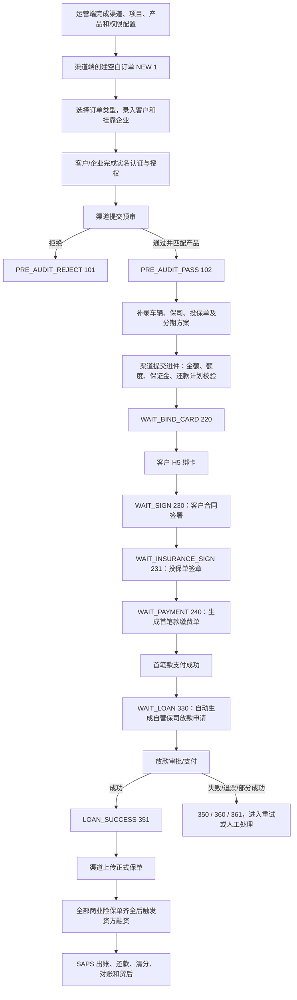

# 保费分期自营渠道进件流程

更新时间：2026-08-12  
业务线：保费分期（`BL000001`）  
GitLab 项目组：`scf`  
目标环境：生产  
后端与客户端基线：`master`  

> 本页梳理“内部自营渠道（`channelType = 2`）”从渠道开通、渠道端建单到客户绑卡签约、首笔款、保司放款和资方融资的完整主流程。代码已通过 WorkHub 刷新至受控缓存；生产数据库只读核查因堡垒机认证失败未完成，因此实际启用渠道、生产部署提交及真实订单状态仍列为待验证。

## 一句话摘要

自营渠道由平台运营先完成渠道、项目、产品和权限配置，渠道人员再在渠道端创建空白订单，录入客户和挂靠企业并推动其完成认证授权；预审通过后补齐车辆、保司及分期方案并提交进件。提交成功后订单依次进入客户绑卡、客户合同签署、投保单签章、首笔款缴费、保司放款、保单回传和资方融资，放款成功后再衔接账单和贷后流程。

## 适用范围与角色

### 适用范围

- 渠道类型为内部自营，即 `channelType = 2`。
- 渠道通过公司提供的渠道端操作，不走合作方旧进件接口 `POST /api/apply/order`。
- 当前代码假定一个渠道只绑定一个有效项目，创建订单时默认取该渠道关联项目的第一条。

### 主要角色

| 角色 | 主要操作端 | 核心职责 |
| --- | --- | --- |
| 平台运营 | 运营端 `insurance_admin` | 建渠道、项目、产品，配置项目额度/保证金、融资险种、费率、还款规则、资金路由和渠道账号权限。 |
| 渠道人员/客户经理 | 渠道端 `scf_channel_admin` | 创建订单，录入客户、企业、车辆、保司、分期方案，提交预审与进件，后续上传投保单/保单。 |
| 客户（车主） | 客户端 `scf_h5` | 实名认证与授权、绑卡、签署合同，查看订单状态。 |
| 挂靠企业 | 认证/签署链路 | 企业实名认证、授权及按订单类型参与合同签署。 |
| 订单系统 | `scf-order` | 订单、预审、额度校验、签约编排、首笔款、保司放款、保单上传及资方融资触发。 |
| 账务系统 | `scf-saps` | 首笔款缴费单、客户/运营商账单及后续账务处理。 |

## 前置开通

自营进件前必须具备以下配置：

1. 运营端新增渠道，渠道类型选择“内部自营”，补全企业资料并开通渠道账号。
2. 渠道完成企业实名认证、电子签名授权及必要的清结算开户、合同签署。
3. 新增并生效项目，关联运营商、技术服务方、渠道、产品、额度、保证金、融资险种和资金路由。
4. 新增并生效产品，配置首付比例、服务费率、渠道服务费率、分期期数、还款日及宽限期等规则。
5. 给渠道角色开通客户订单新增、编辑、提交以及贷后所需菜单权限。

创建订单时，后端会从请求头读取 `Channelcode`，据此写入合作方/渠道、渠道类型、项目、垫资方和供应商。未关联项目、项目未生效或已失效时不能创建订单。

## 主流程

### 1. 渠道端创建空白订单

- 页面入口：渠道端“客户订单”点击“新增”。
- 接口：`POST /api/application/v2/blank`。
- 后端生成 `AP` 开头的申请号，状态为 `NEW(1)`，默认签约状态为待签约。
- 渠道即历史合作方：写入 `partnerCode`、`partnerName` 和 `channelType`。
- 绑定渠道项目和项目垫资方，同时生成 `ApplicationLoan`，默认 `model = 2`、`repaymentType = 4`。

### 2. 录入客户、企业并完成认证授权

渠道先选择订单类型，再填写客户信息和单位信息：

- 个人客户：渠道端录入后，系统创建或复用客户账号，并把客户绑定到订单。
- 挂靠企业：非纯个人订单需选择已存在且完成认证授权的企业，并建立个人—企业—订单关系。
- 新客户账号以手机号登录客户端，完成个人实名认证和授权。
- 提交预审前，个人必须处于已认证状态；非个人订单的企业也必须完成认证授权。

主要接口：

- `POST /api/application/v2/order/type`
- `POST /api/application/v2/customer`
- `POST /api/application/v2/company`

### 3. 提交预审并匹配产品

- 接口：`POST /api/application/v2/submit/pre/audit`。
- 仅 `NEW(1)` 可提交。
- 系统按项目配置读取预审风控模型，提交客户实名信息进行预审。
- 预审拒绝：进入 `PRE_AUDIT_REJECT(101)`。
- 预审通过：进入 `PRE_AUDIT_PASS(102)`；系统按风险等级匹配产品，并把产品首付比例、技术服务费率等固化到订单。
- 未匹配到可申办产品时，订单关闭并记为“无可申办产品”。

### 4. 补齐车辆、保司与分期方案

预审通过后，渠道端开放以下信息页：

- 车辆信息：车辆识别信息、商业险/交强险/车船税/附加险金额及投保单附件。
- 保司信息：保险公司、收款账户、开户行、联行号、付款附言和签章模式。
- 分期方案：融资险种、期数、首付、运营商服务费、渠道服务费、垫资额和还款计划试算。

首笔款的代码口径为：

`首笔款 = 首付款 + 渠道服务费 + 运营商服务费 + 其他非融资险种费用`

具体费率、融资险种和期数均以生产项目/产品配置为准，不能只按某一个渠道模板推断。

### 5. 提交进件

- 接口：`POST /api/application/v2/submit/apply`。
- 仅 `PRE_AUDIT_PASS(102)` 可提交；被进件拒绝的 `210` 也可由渠道端修订后重新提交。
- 提交前校验：融资险种、分期期数、保司信息、所有车辆资料、项目额度、客户额度、渠道保证金。
- 系统固化金额与正式试算还款计划。
- 校验通过后进入 `WAIT_BIND_CARD(220)`。

这一步是自营渠道“进件提交”的业务分界点：此前由渠道录入和预审，之后由客户 H5、签约、支付和系统自动任务接续。

### 6. 客户绑卡

- H5 订单状态 `220` 展示“去绑卡”。
- 客户填写本人银行卡号、银行预留手机号等，通过短信验证码完成代扣卡绑定。
- 绑卡结果回调 `POST /api/application/v2/bank/card/binding`，保存订单银行卡信息。
- 绑卡完成后状态变为 `WAIT_SIGN(230)`，系统异步发起客户合同签署流程。

### 7. 客户合同与投保单签章

客户合同：

- H5 状态 `230` 展示“去签约”，通过订单签署链接进入电子签平台。
- 客户签署完成后，状态进入 `WAIT_INSURANCE_SIGN(231)`。

投保单签章分两种：

- 线上签章：系统按车辆发起投保单签署；全部车辆签署成功后进入待支付。
- 线下签章：运营/渠道上传已签投保单并确认签章完成；代码校验商业险投保单齐全后进入待支付。

签章完成后订单进入 `WAIT_PAYMENT(240)`，系统异步生成首笔款缴费单；失败时由自动重试任务补偿。

### 8. 首笔款缴费

- `scf-order` 调用 `scf-saps` 生成首笔款缴费单，科目可能包括首付款、运营商服务费、渠道服务费和其他费用。
- H5 当前代码在状态 `240` 隐藏“去支付”按钮，并提示“签约已完成，请联系客户经理支付首笔款”；渠道端提供首笔款管理及付款明细页面。
- 支付成功回调 `/api/application/first/payment/slip/result`，写入 `firstPaymentStatus = PAY_SUCCESS`。
- 自营订单随即进入 `WAIT_LOAN(330)`，异步调用 `ZyLoanApply` 生成保司放款申请；失败由 `autoRetryApplyLoan` 补偿。

### 9. 保司放款

- 自营放款的收款方来自订单保司收款账户，金额取订单垫资/放款口径。
- 放款前再次校验首笔款已支付、产品期数、绑卡签约及收款信息；自营业务跳过视频校验。
- 状态依次可能经历 `WAIT_APPLY_LOAN(300)`、`ON_APPLY_LOAN_INNER(309)`、`ON_APPLY_LOAN(310)`、`WAIT_LOAN(330)`、`ON_LOAN(340)`。
- 结果包括 `LOAN_SUCCESS(351)`、`LOAN_FAILURE(350)`、`BANK_REFUND(360)` 和 `PARTIAL_SUCCESS(361)`。

### 10. 正式保单回传与资方融资

- 保司放款、承保后，渠道按车辆上传正式保单、保单号和签单日期。
- 系统校验保单 PDF 中的车架号与订单车辆一致。
- 当订单下所有正常车辆的商业险保单均已上传时，标记 `insurancePolicyUploaded = true`，并按退费后垫资金额触发 `financeApply`。
- 资方路由取决于项目配置；例如某些自营项目约定优先中化、失败后再走诚泰，但不能泛化为所有自营渠道的固定顺序。
- 触发失败由 `autoRetryFinancing` 定时任务补偿。

### 11. 出账与贷后

放款和融资后，订单信息同步至 `scf-saps`，进入客户账单、运营商账单、资方账单、还款清分、代偿、退保退费、对账和应收应付流程。详见 [核心业务链路与资金账务逻辑](</Users/aslight/IDEAWorkspace/workhub-server/docs/company/projects/保费分期/核心业务链路与资金账务逻辑.md>)。

## 状态速查

| 阶段 | 状态码 | 状态名 | 主要责任方 |
| --- | ---: | --- | --- |
| 建单 | 1 | 新建 | 渠道 |
| 预审 | 100 / 101 / 102 | 审批中 / 预审拒绝 / 预审通过 | 风控、渠道 |
| 进件 | 200～211 | 进件/资方审批、拒绝、通过 | 订单系统、渠道 |
| 客户操作 | 220 | 待绑卡 | 客户 |
| 客户操作 | 230 | 待签约 | 客户 |
| 投保签章 | 231 | 待投保签章 | 客户、渠道、运营 |
| 首笔款 | 240 | 待支付首笔款 | 客户经理/渠道、账务系统 |
| 保司放款 | 300～361 | 放款申请、审批、支付及结果 | 订单系统、支付系统 |
| 贷后 | 410～530 | 还款、结清、逾期、退费/退保 | SAPS、渠道、客户 |

## 异常与补偿

- 重复创建/提交：接口状态校验和 Redis 锁防止重复处理。
- 预审拒绝：渠道修订客户/企业信息后按页面允许范围处理；是否可重提取决于具体状态和权限。
- 进件拒绝 `210`：渠道端允许重新编辑车辆、保司和方案后再次提交。
- 签约流程或投保单签章发起失败：自动重试任务分别补发客户签约和投保签章。
- 首笔款缴费单生成失败：`AutoRetryGeneratePaymentSlip` 补偿。
- 保司放款申请失败：`AutoRetryApplyLoan` 补偿；放款失败/退票可从渠道端重新放款。
- 资方融资触发失败：`AutoRetryFinancing` 补偿。
- 放款前渠道可取消订单；进入实际放款后受状态限制，不允许随意撤销。

## 事实、推断与待验证

### 已确认事实

- WorkHub 业务线配置：保费分期 `BL000001`，GitLab group 为 `scf`。
- 自营订单后端主入口是 `/api/application/v2/*`，渠道类型为 `2`。
- 后端 `scf-order`、账务 `scf-saps`、客户端 `scf_h5` 已按受控缓存 `master` 梳理。
- 自营流程在提交进件后进入绑卡、签约、投保单签章、首笔款、保司放款、保单上传和资方融资。
- 自营放款跳过视频校验，但仍受首笔款、绑卡签约、产品和收款信息校验约束。

### 有依据的解释

- 代码中仍保留旧合作方进件入口，但渠道端实际调用的是 `/api/application/v2/blank`、`/submit/pre/audit` 和 `/submit/apply`，所以本页将“自营进件”定义为渠道端人机协同流程，而不是旧的合作方 API 进件。
- 状态 `200～211` 的通用枚举仍存在，但当前自营 `submitApply` 实现校验通过后直接进入 `WAIT_BIND_CARD(220)`，没有在该方法中停留于通用进件审批态。

### 待验证

- 生产数据库当前实际启用的内部自营渠道、项目、产品、资金路由、费率和还款规则。
- 生产环境各服务当前部署 commit/镜像是否与本次 `master` 缓存一致。
- 渠道端生产部署版本：`scf_channel_admin` 远端未提供 `master`，本页渠道端页面证据来自其默认分支 `scf_selfoperation_20251016`。
- 生产 H5 是否仍维持“隐藏首笔款支付按钮、由客户经理推动付款”的交互。
- 线上/线下投保单签章模式在各自营项目中的实际配置。
- 生产只读数据库核查因堡垒机认证失败未执行，恢复认证后需补充运行态复核。

## 来源

### WorkHub 上下文

- 业务线：保费分期（`BL000001`）。
- GitLab 项目组：`scf`。
- 环境：生产。
- 分支规则：生产默认 `master`。
- 代码缓存：`data/git-cache/scf`，2026-08-12 刷新，共 13 个仓库。

### 代码基线

- `scf-order`：`master`，`2c1e1ac902c801bde7e41b395012cbddb0456b8a`。
- `scf-saps`：`master`，`72819c90333d107b17f4940ae1c3a36b516e02aa`。
- `scf_h5`：`master`，`67018225aed6fec887631bf1676856d0d6e43c81`。
- `scf_channel_admin`：远端默认分支 `scf_selfoperation_20251016`，`8e68a8003321c49d51af3d710cbbab4425c162e4`；仅作渠道端页面补充证据。

### 核心代码位置

- `scf-order/.../ApplicationProprietaryController.java`
- `scf-order/.../SelfOperatedOrderService.java`
- `scf-order/.../ApplicationController.java`
- `scf-order/.../ApplicationVehicleController.java`
- `scf-order/.../LoanOrderServiceImpl.java`
- `scf-order/.../LoanOrderServiceTransational.java`
- `scf-order/.../ApplicationStatus.java`
- `scf_channel_admin/src/views/order/addOrder.vue`
- `scf_channel_admin/src/views/order/customerOrder.vue`
- `scf_channel_admin/src/api/api_list.ts`
- `scf_h5/src/views/Order/Index.vue`
- `scf_h5/src/views/Base/bank/addBank.vue`

## 相关页面

- [保费分期](</Users/aslight/IDEAWorkspace/workhub-server/docs/company/README.md#保费分期>)
- [系统现状](</Users/aslight/IDEAWorkspace/workhub-server/docs/company/projects/保费分期/系统现状.md>)
- [运营端功能菜单](</Users/aslight/IDEAWorkspace/workhub-server/docs/company/projects/保费分期/运营端功能菜单.md>)
- [核心业务链路与资金账务逻辑](</Users/aslight/IDEAWorkspace/workhub-server/docs/company/projects/保费分期/核心业务链路与资金账务逻辑.md>)

