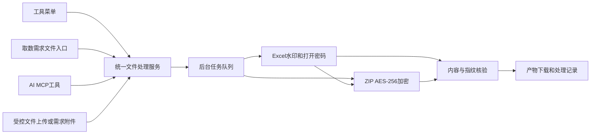

# Design：WorkHub工具菜单与Excel水印加密及ZIP工具

| 项目 | 内容 |
| --- | --- |
| 需求编码 | REQ-3d7414a7-fbae-493a-bf08-705d7eb95c2a |
| 对应 Proposal | [proposal.md](</Users/aslight/IDEAWorkspace/workhub-server/docs/requirements/workhub-server/REQ-3d7414a7-fbae-493a-bf08-705d7eb95c2a-WorkHub工具菜单与Excel水印加密及ZIP工具/proposal.md>)，v1 |
| 所属项目 | WorkHub 平台 |
| 版本/状态 | v1 草案，待完整规格统一确认；本轮未修改系统代码、数据库或运行配置 |
| 唯一目录 | `wiki/公司项目/研发需求/workhub-server/REQ-3d7414a7-fbae-493a-bf08-705d7eb95c2a-WorkHub工具菜单与Excel水印加密及ZIP工具/` |
| 当前核验 | 2026-10-29，Asia/Shanghai，本地工作区；后端 `codex/dev-20260820` / `fa56c77`，前端 `codex/dev-20260707` / `4098903`，包含既有未提交改动 |

## 1. 现状与证据

| 事实 | 本轮读取位置及结论 |
| --- | --- |
| 核心可拆出 | Demo `src/main/java/demo/WorkbookProtector.java`、`StreamingXlsxWatermark.java`、`TraceMetadata.java`、`PasswordGenerator.java`；公开入口是 Path + 水印 + char[] 密码，不依赖 Swing |
| 流式处理与内存 | 工作表通过 StAX 改元数据，不构建整个 XSSFWorkbook；共享字符串和样式原字节复制。但 `POIFSFileSystem()` 加密容器仍占内存，不能声称全程常量内存 |
| 加密算法 | `EncryptionMode.agile`、`CipherAlgorithm.aes256`、`HashAlgorithm.sha512`、CBC；原文件不覆盖，临时文件成功后才发布 |
| 依赖 | 后端根 pom 与 Demo 均使用 POI 5.4.1；未发现 ZIP 加密 Java 依赖，本机缓存无 zip4j |
| 菜单/路由 | 前端 `src/constants/menu.ts` 和 `src/router/index.ts`，按 permission 过滤与拦截 |
| 上传与附件 | `application.yml` multipart 20 MB/50 MB；`AttachmentService` 用 `getBytes()`、ByteArrayResource、`pm_attachment.file_content` 存取；另有 `INTAKE_DELIVERY_FILE` 类型 |
| 需求入口 | `IntakeListView.vue`、`IntakeService.saveStageActionFiles`；需求类型为“数据提取/运维”，已有文件区和历史记录 |
| MCP | `McpRuntimeController` → `McpRuntimeService` → `McpToolRegistry`；认证主体固定 `workhub-mcp`/ROLE_MCP，不代表某个人员账号；现有权限只允许 Token 访问 `/api/mcp/runtime` |
| 后台任务 | 系统预警清理使用独立 TaskExecutor、任务表、PENDING 等状态，可借鉴模式，不复用清理线程池 |
| 本地存储/密钥 | `StorageProperties.localPath` 默认 `data/uploads`；`McpProperties` 含开发默认主密钥，不能把该默认值用于保存新的交付密码 |
| 权限/审计 | `SecurityConfig`、`SystemAuditService`、`sys_permission`/`sys_role_permission`；新增权限沿用既有体系 |

Demo 核心来源 SHA-256：

- WorkbookProtector.java：`df7cb6436f0b4090d5633ddd01cdacf5358f1415815da9b1f9aa1e7b89a48264`
- StreamingXlsxWatermark.java：`adee9c77eddf08126aa0e41ee704c2adb8b214409495fe86c455aea37b3e8e24`
- TraceMetadata.java：`89130bea4b7ea738755f34199fe548dc464ea71d064bf689f17889777861c343`
- PasswordGenerator.java：`35b7aeb50f6aa7f0a60494ae6fbdc3b98bc85c8b4d09cb9beb9e4ceb05a393ab`

未核实：运行 WorkHub 的最终部署 OS、中文字体、反向代理上传限额、可用磁盘与堆内存。Demo README 中的既往测试结果是历史证据，不计为本次集成测试已通过。

## 2. 架构与页面

| 模块 | 职责与落点 |
| --- | --- |
| workhub-model | `model/tools`：任务、文件、参数、校验结果和分页 DTO |
| workhub-dao | `dao/tools`：文件索引、任务、传输票据；沿用 MyBatis |
| workhub-service | `service/tools`：文件接收、Excel 核心适配、ZIP、校验、任务执行、密码密文、权限与需求关联 |
| workhub-controller | `controller/tools`：Web 上传、任务、下载、密码读取；独立受控传输票据端点 |
| workhub-service/mcp | 注册工具并调用同一服务；不另写一套水印和加密逻辑 |
| workhub-job | 工具文件/密码到期清理；只清理登记过的工具目录 |
| workhub-support/bootstrap | 工具配置、执行器、认证规则及配置属性注册；无新消息队列或对象存储 |
| workhub-web | `views/tools`、`api/tools.ts`、`types/tools.ts`，菜单/路由与取数需求入口 |

一级菜单“工具”设于“需求管理”之后，子页面 `/tools/excel-protection` 和 `/tools/zip-encryption`。各页上方为文件和参数区，下方为当前处理状态及可筛选的历史任务。提交后后台处理，切换页面不终止任务，状态轮询终态后停止。

Excel 表单保留 Demo 六个独立身份选项。提取人默认当前登录人的展示名，可填写实际提取人；认证操作人另外固定记录，不能被表单冒充。AI 请求提取人时必须使用明确提供的身份，不能自动推测真实姓名。独立模式审批编号可空，核心适配允许缺失该字段且跳过其对象生成，不能用占位编号。绑定需求时真实编号从后端读取，界面只读；无审批号时提示缺失，其他工具操作仍可明确独立发起。

ZIP 页面支持 1～20 个明确选中的文件，不递归导入目录。默认 AES-256 + Deflate，拒绝重复条目名、路径分隔符、控制字符及空名称。已有加密 Excel 是普通二进制输入。成功后提供 ZIP、SHA-256 与校验文件，密码通过独立按钮显示/复制。

## 3. 文件、任务与接口契约

### 3.1 文件接收

文件统一先获得不可猜测 fileId，处理入口只接受 fileId/任务产物引用/需求附件引用，不接受任意服务器绝对路径、URL、shell 参数或把几十 MB 文件塞入 MCP JSON。

- Web：`POST /api/tools/files` 使用 `application/octet-stream` 流式上传；文件名用独立受校验字段/头传递，按实际读取字节限制 100 MiB。返回 fileId、原文件名、实际大小、SHA-256、过期时间。旧 multipart 配置保持原值。
- MCP：`prepare_file_tool_upload` 输入 filename、sizeBytes、sha256；返回工具上传 ticket、带过期时间的同源 uploadUrl、需传入的单文件传输 Token 头以及后续 fileAccessToken。二进制通过 HTTP PUT 上传，服务端验证实际长度和 SHA-256；上传完成后才允许作为输入。
- 上传 ticket 10 分钟内开始使用，绑定单一 fileId、动作和长度；Token 服务端只保存哈希。失败不发布文件。已消费票据不可二次写入；重试需新的票据，不可覆盖已有文件。
- 传输端点与普通附件接口分离，使用专用认证 Filter 校验票据，仅授予单一上传/下载动作，不把 MCP Token 扩成通用 Web 登录权限。真实地址从明确配置的 WorkHub public base URL 生成；不相信传入 Host/URL。
- 需求附件通过当前权限和 intakeId/attachmentId 配对校验后复制到工具工作目录并计算指纹；已有附件存储及下载权限不因新工具被放宽。
- 输出路径由服务器生成，使用不透明目录和受校验文件名；所有路径必须位于工具根目录，拒绝软链接越界，不覆盖输入或其他任务文件。

### 3.2 创建、状态与结果

| REST 接口（草案） | 作用 |
| --- | --- |
| `GET /api/tools/capabilities` | 返回实际配置限额、支持格式、算法、字体/密钥可用状态 |
| `POST /api/tools/excel-jobs` | 创建 Excel 处理任务；可选择接续 ZIP |
| `POST /api/tools/zip-jobs` | 创建 ZIP 处理任务 |
| `GET /api/tools/jobs` | 分页查询本人任务；管理员可按权限查询，支持 intakeId/toolType/status |
| `GET /api/tools/jobs/{jobId}` | 状态、阶段、输入输出摘要、指纹、验证结果、时间、失败原因；不返回密码 |
| `GET /api/tools/jobs/{jobId}/files/{fileId}/download` | 授权下载已完成且未过期的产物或校验文件 |
| `POST /api/tools/jobs/{jobId}/passwords/reveal` | 授权后单独读取密码；`Cache-Control: no-store` 并记录访问动作 |
| `GET /api/intake/{intakeId}/file-tool-jobs` | 查询该需求关联的处理记录；权限同时检查需求与工具 |

创建参数：

- 共通：`requestId`（UUID）、`inputFiles`、可选 `intakeId`；来源入口由服务端认证上下文确定，不相信调用方指定的 owner。
- 输入引用为明确的三种之一：已上传文件 `fileId`；任务产物 `jobId + fileId`；需求附件 `intakeId + attachmentId`。MCP 访问上传文件或任务产物还须携带对应 access token。
- Excel：`watermarkText`、`transparency`、`extractor`、可选 `approvalNumber`、提取人和审批号各三个布尔选项、`excelPasswordMode=AUTO|MANUAL`、手动密码/确认、`zipEnabled` 以及独立 ZIP 密码参数。
- ZIP：文件引用列表和 ZIP 密码模式/值/确认。
- AUTO 不接受同时传入手动密码。手动密码不 trim；重复确认不一致即拒绝；Excel 和 ZIP 同时手动设置时不得相同。自动生成分别使用 SecureRandom。
- 以 `(认证主体, requestId)` 唯一约束实现幂等；同 requestId 同参数返回原任务，不重新生成密码；不同参数返回 409。失败后重新发起需新的 requestId。

状态：`PENDING → RUNNING → SUCCEEDED|FAILED`。阶段用“校验输入、处理 Excel、生成 ZIP、验证产物、完成”表示真实步骤，不伪造百分比。文件过期由 `expiresAt/artifactsExpired` 表达，不把曾成功任务改成失败。

队列独立于预警清理和 AI 识别线程池；默认 1 worker、队列 8。事务提交后再调度；入队失败将已创建任务明确标记 FAILED。重启后旧 PENDING/RUNNING 标记为中断失败并清理各自 staging，不悄悄继续、不产生新的密码。失败重试由用户/AI 新建任务。

错误遵循项目统一异常封装，HTTP 分类保留 400/403/404/409/410/413/429；业务 errorCode 明确区分 `INVALID_FILE`、`EXCEL_ALREADY_ENCRYPTED`、`UNSUPPORTED_WORKBOOK`、`WATERMARK_CONFLICT`、`MISSING_FONT`、`PASSWORD_MISMATCH`、`SIZE_LIMIT`、`SOURCE_CHANGED`、`VERIFICATION_FAILED`、`SECRET_KEY_UNAVAILABLE`、`ARTIFACT_EXPIRED`。不得静默降为弱加密或返回旧文件。

### 3.3 MCP 契约

| 工具 | 必要输入与输出 |
| --- | --- |
| `prepare_file_tool_upload` | filename/sizeBytes/sha256 → 文件引用、上传 URL、单文件票据与到期时间 |
| `protect_excel_file` | 输入文件引用、完整水印参数、密码模式、可选 intakeId → jobId、jobAccessToken、状态；不返回文件正文 |
| `create_encrypted_zip` | 明确文件引用列表、密码模式、可选 intakeId → jobId、jobAccessToken、状态 |
| `get_file_tool_job` | jobId + jobAccessToken → 状态/结果元数据/指纹；无密码 |
| `get_file_tool_download` | jobId + jobAccessToken + fileId → 有效期 10 分钟的只读下载票据 |
| `get_file_tool_passwords` | jobId + jobAccessToken → 已成功任务的独立 Excel/ZIP 密码；访问留痕 |

MCP 使用现有 `ROLE_MCP`，同时用每个任务/上传随机能力票据隔离共享服务身份下的任务，数据库只存票据哈希。不能靠填写他人用户名或猜 jobId 访问其他结果。MCP 管理权限和 Web 用户权限不混用。

扩展现有 registry 支持这些工具的对象、数组、boolean 和范围约束 JSON Schema，以及相应 tool annotations；文件处理工具声明 `readOnlyHint=false`、`destructiveHint=false`、`openWorldHint=false`，创建工具使用 requestId 幂等。数据库和日志工具的只读/脱敏行为保持原契约。初始化说明更新为“只读诊断 + 受控文件处理”，要求 AI 在有用户指令、参数明确时调用。

关联需求的 MCP 任务在需求详情显示，不改变需求状态。Web 管理员有明确文件管理权限时可管理 MCP 产物；普通用户不能因为看到需求列表就自动取得其他任务密码。

### 3.4 数据模型与存储

拟新增三张表，最终字段按实施时 DAO 约定落地：

1. `tool_file`：id、owner_type/owner_key、role（上传/产物/校验文件）、job_id、intake_id、original_name、storage_key、size_bytes、sha256、state、access_token_hash、created_at/expires_at/deleted_at。源附件 ID 只作为溯源，不修改原附件。
2. `tool_file_job`：id/job_no、tool_type、owner、request_id/request_digest、intake_id、输入引用列表、白名单参数摘要、status/stage、输出引用、验证摘要、加密后的密码 envelope、job_token_hash、错误摘要与各时间。request 摘要不包含原密码；幂等参数比较使用服务器密钥 HMAC 后的密码字段摘要，避免泄露可离线猜测的手动密码。
3. `tool_file_transfer`：ticket_hash、action、file_id、owner、expected_size/sha256、expires_at、consumed_at；token 与密码不得出现在日志中。

文件置于 `${workhub.storage.localPath}/tools/{随机ID}/`，只有服务账号可读写。保存期间流式 SHA-256，成功完成后再将 staging 原子发布；发布失败不得返回 SUCCEEDED。DB 保存索引，不存新的大文件 BLOB。后台清理只按照这些表登记的工具文件执行，不扫描/删除用户 Desktop 或旧附件。

迁移路径沿用 `workhub-bootstrap/src/main/resources/db/schema/mysql/V{实施时间戳}__add_file_tools.sql`；新增表、索引和权限，权限使用 NOT EXISTS 模式防重复，SUPER_ADMIN 获得新权限，普通角色由管理员分配。创建脚本不修改业务数据，不在规格阶段执行。

## 4. 安全、容量与质量约束

- 权限：`tools:excel:view/use`、`tools:zip:view/use`、`tools:file:download`、`tools:file:reveal-password`、`tools:file:manage`。处理自己的文件同时检查工具权限和资源所有权；关联需求增加既有需求读取权限。前后端都检查。
- 密码：单独配置 32 字节主密钥 `WORKHUB_FILE_TOOLS_MASTER_KEY`，AES-GCM 随机 nonce 包装，AAD 绑定 jobId 和密码用途，保存 keyVersion；不使用 MCP 的开发默认密钥。配置缺失或格式错误时拒绝任务创建，不能产生不可恢复文件。真实密钥配置和轮换操作不在未经确认时执行。
- 日志：只记录任务编号、主体、文件名/大小/指纹、需求号、算法和结果。禁止记录原请求/密码/票据/文件内容，不仅依赖通用正则脱敏；审计密码读取动作但不保存其返回值。
- 文件默认保留：上传 24 小时；终态源副本/产物/密码密文 7 天。界面明确展示到期时间；清理成功才标记删除，失败可观测并于下次重试。运行中文件不删，先前用户文件不在清理范围。
- 输入限制：Excel/单文件 100 MiB、ZIP 合计 500 MiB、最多 20 文件，核心解包限制 1/2 GiB，并在实际读取流时计数而非只信 ZIP 目录声明；重复 ZIP 条目、XML 外部实体、超限 XML 与无效文件明确拒绝。
- 中文字体：启动/能力查询执行可显示性检查；保留 Demo 拒绝缺字的行为；不引入服务器未批准字体安装。
- 源码适配：迁移核心和非 UI 测试到 `service/tools/excel`，使用 Java 25 约定，不搬 Swing/Java8 启动兼容层。可见水印拼接从 Swing 提取为纯函数。已有不相关图片、图表、文本框、公式、样式、打印区及页眉页脚文字均保留。
- 验证：Excel 解密后比较规范化单元格/公式/类型哈希，非修改部件指纹；ZIP 解密流逐文件比 SHA-256；正确/错误/无密码及 AES 强度验证。只有验证成功才能发布产物，校验失败不得留下可下载的成功链接。
- 性能：用合成多页、30 万行、19 位及前导零标识、公式与样式的工作簿验证，覆盖超过 35 MiB、约 60 MiB 的文件；记录耗时和峰值内存，不用真实客户数据作测试夹具。若单并发仍不能满足已配置内存，发布前调整容量并重新确认，不能仅凭 Demo 历史结果宣称通过。

## 5. 交付、回滚和剩余确认

交付顺序：离线核验现有依赖 → 经授权引入 zip4j → 核心/任务/传输/权限/接口测试 → 前端构建与联调 → 功能文档更新 → 用户确认部署环境后准备配置、备份与迁移 → 发布验证。当前不发布、不重启运行 WorkHub。

回滚：禁用工具任务入口和新页面，等待或终止工具 worker 后恢复上一个版本。保留已有产物、任务表、指纹和密码密文直至保留期结束，不能在代码回滚时立即 drop 表或删全部文件。已有需求、附件和其他业务菜单不受影响。

实施完成后更新 WorkHub 系统设计与迭代日志、前端宪章/架构/路线图中的工具菜单、文件处理和 MCP 边界，记录实际开发、验证、部署状态。当前仅保存正式目录内的草案，不写成功能已上线。

待统一确认：v1 完整范围、容量与保留默认值、密码保存方式、新增 zip4j 2.11.6 下载授权。审批场景采用手动入口/AI 按指令调用已由用户确认。部署环境、真实主密钥和字体在实施后发布前核验。

与 Proposal 对应：菜单 AC-01；Excel AC-02～04；ZIP/组合 AC-05～06；需求 AC-07；MCP AC-08；容量 AC-09；任务 AC-10；密码与清理 AC-11～12。任务见 [tasks.md](</Users/aslight/IDEAWorkspace/workhub-server/docs/requirements/workhub-server/REQ-3d7414a7-fbae-493a-bf08-705d7eb95c2a-WorkHub工具菜单与Excel水印加密及ZIP工具/tasks.md>)。
