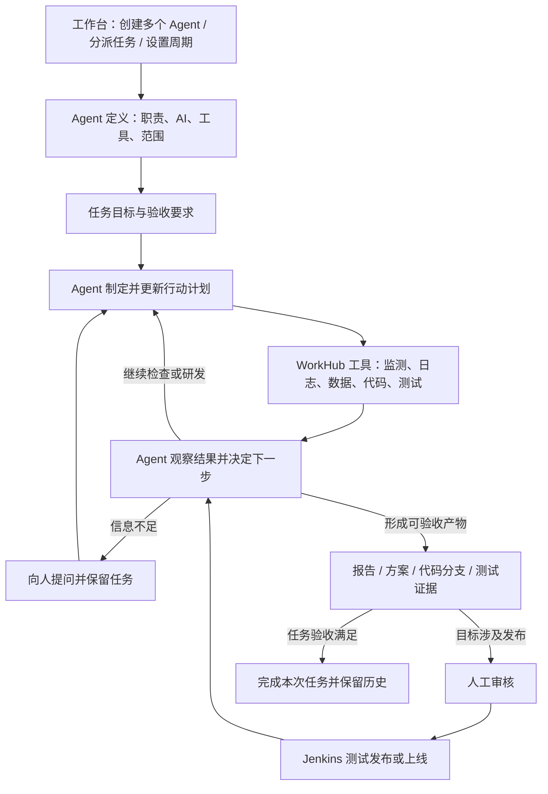

# Design：WorkHub Agent 工作台与自主迭代

### 已登记缺陷与运行证据关联补充（2026-11-04）

- 延续 v4 及用户“包括已登记缺陷和运行时发现的问题”的确认。`workhub.bugs.detail` 返回完整原记录的 `workItemVersion` 摘要，`inspection.next` 返回相同算法的 `sourceVersion`；查询时间和脱敏文本不参与版本计算。缺陷本身仍标为环境未定位。
- `case.link_bug` 在领取问题后，使用 `caseId/version/requestKey/workItemId/workItemVersion/observationId/pointer/reason` 提交 AI 关联判断；STALE_DATA 另传已使用的 `staleAfterSeconds`。服务端重新读取实际业务线内的缺陷，核对版本、本次运行的 Observation 和已登记到该问题的具体信号。范围取自证据，不能由缺陷或任务推测；账务历史环境未核实等来源限制保留于关联快照。
- 关联记录不可变，保存脱敏缺陷快照、原文摘要、证据位置、信号、理由、运行及处理版本。最大关联20个不同缺陷；完整快照超过28000字符时拒绝关联，继续待补充。相同请求键只回放；新的请求关联同一当前版本复用原记录。缺陷修订后新建历史版本并清空最新方案引用、递增问题处理版本；历史方案保留。
- 新增 `case.bugs` 和 `GET /api/autonomy/cases/{id}/bugs?agentId&page&pageSize` 分页读取关联历史、当前版本标记及来源状态（CURRENT/CHANGED/UNAVAILABLE）。需要原监测来源权限和 `work-item:view`，同时校验 Agent 所有者与请求人；已有缺陷关联的问题详情/方案/交付也遵守这一权限交集。
- `inspection.ack` 的缺陷 FINDING 必须匹配已保存的关联及巡检记录版本，证据引用由服务端从关联读取。关联只是 AI 判断，不自动关闭缺陷、生成正式需求或证明问题已修复。缺陷被编辑、移走、删除或改为非缺陷时，提交新方案/候选清单前重新核对；已有候选显示 `BUG_CONTEXT_CHANGED`，沿用现有审核前验证入口。
- 迁移落点仍为 WorkHub 实际 Flyway 目录 `workhub-bootstrap/src/main/resources/db/schema/mysql/`，新增 `V20261104_103540__add_autonomy_bug_links.sql`，在已有问题表之后创建关联及幂等请求两表；不修改原工作项或角色授权。新增版本仅执行一次，回退应用保留两表历史。执行前核对 `SHOW TABLES LIKE 'pm_autonomy_bug_link%'`，执行后检查 `SHOW CREATE TABLE pm_autonomy_bug_link` / `pm_autonomy_bug_link_request` 及 `SELECT case_id,case_version,COUNT(*) FROM pm_autonomy_bug_link GROUP BY case_id,case_version HAVING COUNT(*)>1`；真实数据库执行仍待获准部署。
- 问题详情及 `case.detail` SUMMARY 增加 `bugContext`：`historyCount/bugCount/changedCount/unavailableCount`。按每个缺陷的最新关联与实际工作项核对，历史版本不误计为当前变化；汇总覆盖所有关联，不依赖历史分页。无关联时均为0，不增加迁移。
- 工作台详情增加“关联缺陷”，有 `work-item:view` 才展示入口；分页展示脱敏原文快照、AI理由、关联时处理版本、运行/观察记录/信号引用、最新与历史标记及当前原文状态。页面保留账务历史环境未核实等限制；源记录读取失败显示失败，不能当作空列表。切换问题/Agent、关闭或停用页面使旧请求失效。
- 分析区先显示跨页的缺陷依据变化提示，区分当前/历史方案；候选变更把 `BUG_CONTEXT_CHANGED` 显示为“关联缺陷的需求依据已变化”。所有内容按文本显示，关联不会更改工作项或开放发布操作。
- 本地验证覆盖真实 Mapper/事务、缺陷巡检到信号关联再确认、重复与修订、过期版本/跨业务线/跨运行证据/权限撤销拒绝、跨页汇总、候选版本失效及历史回读；前端使用test构建和隔离HTTP样本核对分页、错误、迟到响应、权限与环境限制；不访问 Jenkins 或生产环境。

| 项目 | 内容 |
| --- | --- |
| 需求编码/唯一目录 | REQ-bf94e06e-8737-47dc-a7ba-68dba9556f9e；沿用本目录 |
| 所属业务线/仓库 | BL000012-工作台；workhub-server、workhub-web，目标业务代码在实际归属仓库 |
| 对应 Proposal / 状态 | v4 / 用户于 2026-11-04 确认实施；v3 调整为以 Agent/任务为核心 |
| 当前事实核对 | 2026-11-04，本地 server `codex/development-20261102`、web `codex/development-20261103`；工作区已有改动；未核实实际部署版本 |

## 1. 现状与证据

- 三个菜单在前端 router 中分别为 `/ops/monitors`（业务监测）、`/ops/accounting`（账务监测）、`/ops/system-alerts`（系统预警）。
- `ElkSystemAlertCollector` 按业务线/环境采集、分类、入库和通知；`XxlJobFailureAlertService` 产生带 Job/Log ID 的失败通知；已有定时入口。`OpsMonitorService` 的 MQ 类型仍为未接入采集，不能把配置字段当成有效数据源。
- `AccountingReconcileExecutor` 保存规则结果、异常条数/差异金额/样本，区分 WARN/ERROR、FAILED、SKIPPED；总结果为 SUCCESS/WARNING/PARTIAL/FAILED。只读对账失败与实际账务差异需分别处理。
- `DefaultAiGatewayClient` 支持 API/CLI，API 适配 Responses 和 Chat Completions 风格；现有请求主要返回文本/JSON，未提供平台统一的工具循环。`AiUseCaseDefinitions` 的研发分析仍只允许 CLI，CLI 有绕过沙箱路径，不能直接复用为新的自主执行边界。
- `ReleaseService` 为版本记录 CRUD，已核查代码无实际 Jenkins 发布适配。用户明确测试与生产均使用 Jenkins。
- 真实业务线/AI 配置尚未核验，最近 MCP 查询因数据库连接失败；不能从目录名推断真实归属。来源与用户答复见 [目标澄清](目标澄清.md)。

## 2. 架构与责任

Agent 是上层任务决策主体，WorkHub 是 Agent 工作台、运行宿主和工具提供方，AI 配置是 Agent 使用的模型资源，Jenkins 是需人工审核的发布工具。采用当前应用与 MySQL、既有调度/线程池/AI 网关/只读诊断/Git 能力，不预先引入消息队列或新执行基础设施。



### 执行主体补充（2026-11-04 用户实施中明确）

WorkHub 是连接企业与 Agent 的桥梁。页面上的 Agent 是配置/管理形式，实际智能执行使用 WorkHub 已配置的 AI API 或 CLI。用户已确认目前没有另一个完整 Agent 服务 API 需要接入，先复用现有 AI API 和 CLI。

执行适配器按实际接入方式工作：模型 API 通过受控工具桥接完成多步任务；CLI 可接收完整目标并原生规划、读写隔离代码和测试，不强制把 CLI 降为只返回平台逐步 JSON 的模型。平台负责身份/资源边界、执行句柄与取消恢复、事实证据、产物和人工审核。后续完整 Agent 服务 API 按真实协议适配，不预造服务端接口。

下文 §3.2 的结构化动作循环用于需要平台配套工具的模型 API 适配；它不是所有 Agent/CLI 的必经协议。任务领域对象与执行器解耦，生命周期和发布审核对各执行端一致。该补充来自用户对已授权实施的直接修正，继续实施，无需重复请求同一范围的确认。

实施契约补充（2026-11-04）：当前 API 适配的行动类型为 `TOOL_CALL / RESULT / NEEDS_INPUT`，仅模型 API 使用该协议；Codex CLI 接收完整任务、原生调用任务专属 MCP，最终仅返回结果或待补充信息。每个任务保存 `expectedArtifacts`，AI 报告标记 `AI_REPORT`，不能生成平台实测/发布事实。运行还固定 `AgentProviderBinding`（接入 ID、通道、协议、配置版本）；配置变动后旧运行停止继续使用，需按新配置发起新运行。

当前 CLI 验证边界：单运行临时目录、禁止绕过沙箱、关闭非任务工具/插件/宿主技能入口、独立 MCP 令牌及实时授权、记录进程身份、终止后核实进程退出。已通过本地 Java 子进程和真实 loopback MCP 测试；真实 Codex 账号与不同部署主机上的行为尚未验收，不能据命令参数或测试桩宣称所有 CLI 已可用。实现参考本机已安装 CLI 的 `exec --help`、`features list`，以及 [Codex 配置参考](https://developers.openai.com/codex/config-reference/)和 [MCP Streamable HTTP 规范](https://modelcontextprotocol.io/specification/2025-11-25/basic/transports)。

### 2.1 第一等对象：Agent、任务和运行

- **AgentDefinition**：名称、职责说明/默认目标、默认 AI Provider/模型与调用设置、可用工具集合、业务线/系统/环境/仓库范围、并发/预算、启用状态、配置版本。可创建多个，不把 Agent 固化成某一种监测或某个模型。
- **AgentTask**：用户分派的自然语言目标、输入引用、期望产物和验收条件、执行约束、所属 Agent、发起人。任务可为巡检、分析、审查、研发、报告或自定义目标；类型只是模板提示，不要求自定义任务先绑定告警或问题。
- **TaskSchedule**：一次执行或 cron/周期触发、时区、启停及错过时的补跑策略；人工“立即运行”也走相同的入队与授权检查。周期任务每次触发形成独立运行，空闲时无需保持一个模型进程永久占用。
- **AgentRun / Step / Artifact**：一轮运行固定 Agent/任务配置快照，保存计划及修订、模型/工具步骤、进度、上下文摘要、原始证据引用与产物。通用产物包括巡检结论、分析报告、代码审查、方案、变更清单和审核申请；代码/发布只是其中一类。

Agent 通用循环为“读取目标与可用能力→制定计划→选择工具→读取结果→调整计划→继续/请求输入/提交产物”。计划可因观测结果改变，不由系统规定必须按固定监测清单顺序调用。验收依据任务目标：只要求巡检的任务交付覆盖与发现；要求迭代解决的任务则继续跟踪修复/发布/验证，不能把巡检报告当成目标已解决。

通用运行状态：QUEUED、RUNNING、WAITING_INPUT、WAITING_APPROVAL、WAITING_RESOURCE、COMPLETED、FAILED、CANCELLING、CANCELLED。发布问题另有领域状态，两者不混用；一份研究/审查任务不需要经历 DEPLOYING_PROD 才能完成。

### 2.2 多 Agent 与任务隔离

Agent 的身份与工具许可由服务端配置决定；模型、任务文字和其他 Agent 的输出不能授予额外权限。每次工具调用校验 Agent/发起人/任务范围与资源实际授权的交集。运行采用配置快照，新授予权限只用于后续运行；撤销权限即时限制后续工具调用。

任务上下文、证据和工作区按 run 隔离，历史结果可作为有来源/时间的上下文读取，不能跨授权范围共享。并发受全局、Agent 与资源上限控制；同一问题的活动修复、同一目标分支写入、同一系统/环境发布需资源锁及租约。竞争者等待或关联已有任务，不复制修复/发布；只读审查可以在授权内并行。

Agent 停用停止新领取并向执行中的自身任务发出停止请求；模型/本地进程按既有取消规则回收。已提交 Jenkins 的操作由平台继续对账并展示，不假定它已停止，不误取消其他 Agent 的构建。周期重启补跑有界，同一 `(scheduleId, scheduledFor)` 仅创建一次运行，避免停机后重复副作用。

本期多个 Agent 的含义是可独立配置和分派任务；不额外引入默认自主创建 Agent、自动互派任务或无限多 Agent 扩张。必要的跨任务引用和人工改派保留审计，是否新增自动协同另按实际需求扩展。


| 模块 | 负责 | 不负责 |
| --- | --- | --- |
| AgentDefinitionService / AgentTaskService / TaskScheduler | Agent 配置、任务分派、周期/立即触发、运行与权限范围 | 固定智能决策顺序或代替人工发布审批 |
| SignalAdapter / SignalIngestService | 读取已授权来源、游标、事件幂等、问题聚合 | 仅凭告警文案决定改代码 |
| AgentRuntime / AutonomyCaseService | 运行通用行动循环、持久化步骤与预算；巡检修复时关联问题 | 强制所有任务进入同一问题状态链 |
| AiAgentLoop / ProviderAdapter | 从现有配置选择 AI，规范化动作/工具结果，保存每轮证据 | 审核自己的发布或绕过工具权限 |
| AutonomyToolExecutor | 受控日志/只读数据/代码搜索、隔离文件修改、构建测试 | 任意主机配置、业务库写入、私自发布 |
| ChangeSetService / GitDeliveryService | 仓库分支、提交、跨仓库依赖、验证清单及 MR | 直接推默认/受保护分支 |
| ReviewService / JenkinsReleaseService | 版本绑定审核、发布出站请求、队列/构建/部署状态 | 把构建成功当作业务修复成功 |
| VerificationService | 测试回归、上线后原问题复查、复发关联 | 在没有新鲜有效数据时宣告解决 |
| 前端 Agent 工作台与监测入口 | Agent 配置、任务分派/周期、运行/产物、问题证据、澄清/审核/驳回 | 直接访问 AI/GitLab/Jenkins 或校验业务状态 |

## 3. 契约与数据

### 3.1 主动巡检工具、信号、问题与上下文

WorkHub 向 Agent 提供受控能力目录，至少能发现当前可巡检的业务线/系统/环境和监测项，查询业务监测结果、账务运行与规则明细、系统预警、WorkHub 自身巡检状态/日志，并读取必要的需求、资料与代码上下文。查询返回数据时间、覆盖范围、空/未执行/失败原因，不能只给一个健康布尔值。

Agent 必须能在无异常推送时主动选择目标、读取当前监测结果，发现长时间未运行、监测失败或缺少数据等问题，并决定是否进一步查日志/只读数据/代码。需要主动执行配置好的只读巡检规则时，工具必须明确副作用只涉及 WorkHub 自身运行记录，不开放任意业务 SQL 写入。现有菜单服务可复用，缺少的高层查询能力补为工具适配器；现有 MCP 只读边界继续保留，发布是另一个经审批的内部工具。

异常事件、定时器和人工任务都是触发来源；推送只作为任务上下文或唤醒信号，不是 Agent 开始巡检的前提。

统一信号包含 `sourceType/sourceEventId/sourceVersion`、业务线/系统/环境、发生与采集时间、规则或任务 ID、严重程度、脱敏样本/受控证据引用。来源类型覆盖 SELF_LOG、BUG、INSPECTION、BUSINESS_MONITOR、ACCOUNTING、SYSTEM_ALERT。

来源事件唯一键防重复入库；问题指纹按业务线、系统、环境、规范化错误/规则和业务对象维度形成，原始时间戳不直接作为每次新问题的依据。已关闭问题再次出现关联旧问题并重新评估，不永远压制复发。高频重复只累计次数和最新证据，不重复发起模型/代码/发布任务。

优先复用已有持久化监测结果进行有界扫描；事务后事件用于唤醒，游标扫描负责补漏。扫描游标与信号入库同事务推进，失败不前移。WorkHub 自身日志/巡检需绑定实际运行环境和受控来源；不默认读取任意目录。停机恢复后按游标补扫，明确持续不可用时无法由停机的控制服务自行分析。

分析前解析业务线、环境、关联服务、GitLab 项目、代码基线与只读资源；单侧证据不足时扩展到已授权的关联业务线/共享系统。例如消费分期和嘉泰消费分期涉及再保理链路时，遵守已存在跨业务线规则。无法唯一定位时进入 NEEDS_INPUT，不猜仓库/分支。

账务结果按规则级处理：WARN/ERROR 形成差异候选；FAILED 形成监测执行问题；SKIPPED 记录不适用/缺表/未执行原因，不当作通过或账务缺陷；查询失败不以零异常解释。诊断输出包含事实、推断、影响、原因证据、方案、验收、回退、未知项及所需变更类型。

主动工具返回的受控事实将按运行/调用键保存为独立 Observation，先脱敏，保留工具、业务线/环境、查询时间、内容摘要及原始数据时间；API 与 CLI 使用同一记录方式。AI 登记问题时只能引用本次授权运行的 Observation 和受支持的记录位置，来源/业务线/环境/事件标识/问题主体由适配器从实际记录提取，不能由模型改写。截断到不能解析具体记录时要求缩小查询范围，不把不完整预览当完整证据。

信号以来源事件、版本和问题类型去重；问题指纹使用范围、来源、稳定主体和问题类型，不包含本次查询时间。问题保留独立的证据次数/最新观察时间与处理版本：重复事实不制造新修复任务，也不因轮询而使审批反复失效；方案修订、处理状态变化及有效复发更新处理版本。已关闭问题只有新的发生证据才重开，旧日志补扫仍归入旧历史。多个 Agent 对同一问题领取唯一活动修复运行；其他运行可以附证据并查看已授权进度。

分析与方案为不可变的 AI 来源记录，包含事实、推断、影响、方案、验收、回退、未知项及变更类型。登记或分析不会直接关闭问题，也不绕过普通需求确认生成正式工作项；实际验证与关闭继续由后续验收门禁处理。来源采集游标、BUG/巡检扩展接入和生产观察以各自实现及验证状态为准，不以问题表或工具存在视作全部来源已接入。

本地实现契约：`case.record/list/detail/claim/propose` 使用统一工具目录。登记仅接受已接入的监测/日志查询及持久巡检快照中受支持的完整记录位置；STALE_DATA 还须给出60秒至30天的预期时效，平台核实记录确实超时，但该阈值标记为 `AI_PROPOSED_LIMIT`，后续由实际验收标准确认。详情工具按 SUMMARY/EVIDENCE/PROPOSALS 返回，单条证据预留输出空间；页面接口 `/api/autonomy/cases` 以 Agent、业务线和环境重新鉴权，证据/方案独立分页，关联运行返回最近20条及总数。`autonomy:case:view/operate` 仍需叠加原监测来源权限，权限撤销后不返回旧证据。源码新增 Observation/Case/Signal/Proposal/CaseRun 五表，真实库迁移尚未执行；持久巡检进度及各来源覆盖见下文。

#### 连续巡检的读取契约（2026-11-04 实施补充）

- `monitor.business.detail` 读取实际逐次 XXL-JOB 日志（`xxlJobLogs`），不把按任务汇总的 `failedJobs` 当作日志页；支持固定开始/结束日期及每页大小，回执明确范围、页数与查询失败，问题证据仍引用 `/data/logs/{index}`。
- 增加 `monitor.accounting.runs`，在已授权业务线/环境内按运行 ID 倒序读取历史运行，可限制监测配置，使用 `beforeRunId` 续页。它发现曾失败但被最新成功覆盖的运行；是否账务差异仍须读取对应规则，不能从汇总推断。范围按现有监测配置关联，历史记录没有独立环境快照；若配置曾变更环境，需结合原始记录复核，不能把当前关联当作当时环境的独立证明。
- `monitor.accounting.detail` 保留 `run/results` 结构，按 `afterResultId` 正序读取有界规则页，附下一位置、是否还有记录及运行是否终结。只把实际读取的规则当作证据；未终结运行明确标记，单页或空页不代表全部规则通过。
- 状态清单支持配置 ID 和分页，单条输出过大时可以缩小页面；系统预警支持固定 `from/to` 时间范围，分页续读复用返回范围，避免每页默认“现在”移动窗口。输入日期、页数和数量服务端校验，不能直接拼接 SQL。
- 用户确认同时纳入已登记缺陷。增加 `workhub.bugs.list/detail`，通过项目的真实业务线关联限定范围，叠加现有 `work-item:view` 权限；列表按 ID 续页，详情再次在 SQL 限定业务线与“缺陷”类型。工作项没有结构化环境字段，返回 `environmentState=UNRESOLVED`，不借调用者的测试范围伪造环境；这些是待定位线索，保存在实际工具轨迹，不能直接冒充已定位环境的巡检 Observation 或关闭原工作项。
- 本轮工具目录由32项扩展至35项；Agent 与任务的工具清单容量由32调整为64，支持同时配置完整能力目录。每项权限、实时授权交集与运行预算仍逐项检查。
- 本轮使用现有监测表增加只读 Mapper，不修改监测源数据、配置、采集和原人工页面 API。上述续页位置是当前读取请求的查询位置，不是已处理的永久游标；跨运行的持久化扫描确认、迟到记录补扫和事务推进另行实现，不能宣称本轮已完成增量消费。

自主问题单关联原监测与既有需求/工作项；不存在关联时可形成 AI 来源的待整理需求，实施事实存于自主问题链路。新流程使用一次配置授权下的自动分析/研发，不套用旧草案逐条“确认设计完成”才编码的门槛；普通人工需求流程保持既有规则。业务线启用时明确可自动执行范围，超出范围才提具体澄清。

#### 跨运行巡检进度（2026-11-04 实施契约）

- `inspection.next/ack/pending` 提供持久化扫描、逐条分析确认及待补充清单。Agent 仍自主选择来源和行动；每次调用按任务、来源、实际业务线/环境重新鉴权。首批来源为已落库系统预警、已结束账务运行、已登记缺陷；外部 XXL-JOB 和文件日志仍使用原查询工具，不宣称已具备永久游标。
- 每个任务/来源/范围保存独立扫描位置。每轮固定当前可见最大 ID，正序每次最多读取20条，扫描到末尾后从头补扫，以发现低 ID 迟提交、后完成的账务运行和已修改缺陷；不能用永久递增 ID 假定无遗漏。记录在源库删除或保留期届满前未被扫描仍可能不可恢复，空页不证明采集健康。
- 扫描位置与脱敏来源快照在同一事务提交；以来源 ID 和完整内容摘要去重，摘要不含查询时间。每个范围一次只交付一条未确认记录；同一运行重复领取返回原记录，其他尚未结束或执行结果未知的运行不能抢走。原运行明确终止且无执行句柄后，后续运行可取得同一快照及本运行的 Observation。
- 分析确认分为 `NO_FINDING`、`FINDING`、`NEEDS_INPUT`，均保存不可变分析历史。`FINDING` 必须引用已登记、与当前快照事实一致的问题信号；重复来源信号允许关联原问题。确认只表示 AI 已分析，不代表修复、健康或发布完成。`NEEDS_INPUT` 保留在待补充清单，可显式重新领取；未确认记录不会因任务结束自动消费。缺陷没有环境字段，不能直接生成环境问题证据。
- 每次工具调用以运行及实际调用键保存请求摘要和结果，与进度变更同事务；同键不同参数拒绝。此机制保证工具层幂等，不把尚缺回执的外部运行自动判为可重做；通用未知执行对账继续按独立任务状态处理。
- 恢复补充：运行租约过期时，对 `inspection.next/ack` 以原运行、调用键及实际工具意图回读已提交的巡检调用结果，补回标准 `TOOL_RESULT` 和恢复来源记录。API 后续直接消费原回执，不重做扫描或确认；CLI 的企业工具结果与进程停止证明仍独立核对，进程尚未确认停止时不释放占位。无对应持久结果、工具意图不符或其他来源未知调用不推断成功/未执行，也不自动重发。恢复事务使用 `READ_COMMITTED`，避免等待原事务完成后仍读到旧快照。本补充复用已有表，无新迁移或真实配置变更。
- 账务运行的 `FINDING` 可引用同一运行/监测配置的规则详情 Observation；服务端校验来源范围、当前运行身份、实际规则及已登记信号，不允许拿其他运行的问题代替。系统预警使用当前快照本身；缺陷环境关联仍单独待实现。
- 扫描与确认事务显式使用 `READ_COMMITTED`，避免授权查询先建立 MySQL 一致性快照后，等待范围锁的运行仍读到旧队列。单页最多保存20条、待补充列表每页10条；长文本截断仍保留记录编号，只能先标为待补充，不能将预览确认为完整分析。新增3个工具后目录共38项，保持现有64项容量。
- 新增迁移 `workhub-bootstrap/src/main/resources/db/schema/mysql/V20261104_094232__add_agent_inspection_progress.sql`，依赖已有 Agent 与 Observation 表，由现有 Flyway 在获准部署时执行；当前仅本地 H2 验证。四表为 stream/item/analysis/call，无既有业务数据回填。迁移不是重复执行脚本；Flyway 版本去重。回退应用保留表及历史，不自动删除。执行前核对同名表不存在及 Flyway 历史；执行后检查四表、唯一键及 `SELECT COUNT(*) FROM pm_agent_inspection_item WHERE status NOT IN ('PENDING','NO_FINDING','FINDING','NEEDS_INPUT')` 为0；真实 MySQL 迁移另行验收。

### 3.2 多 AI 的共同执行循环

新增通用场景 `agent.task.step`，允许 API/CLI；Agent 从系统 AI 配置选择 Provider/模型/调用设置，运行默认使用该 Agent 的选择。诊断、方案、编码、复核等仅作为可选任务模板/提示词资源，不强制经过固定阶段或偷偷切换模型。若 Agent 显式配置了任务/阶段模型策略，按该策略解析并逐轮留存实际 Provider/模型。执行能力由平台工具提供，不按供应商品牌或 Codex 特判。

平台循环协议采用受验证的结构化 `AgentStep`：

- `kind=TOOL_CALL`：`callId/tool/arguments`；工具名必须属于该 Agent 本次任务的有效清单，服务端校验对象归属、授权范围、输入类型与预算。
- `kind=RESULT`：任务产物、诊断、方案、变更说明或复核结论，附证据引用与验收结果；不能以结果文本改变平台审核或发布状态。
- `kind=NEEDS_INPUT`：具体问题、已有证据、影响范围；用户答复以受审计上下文继续同一任务。

每轮可附 `planRevision/planDelta` 记录当前行动计划及调整理由，引用可核查的观察结果，不要求披露模型内部推理。平台执行工具，保存 `callId`、输入摘要、结果与幂等键，再把有界结果返回模型；断点恢复不得把同一变更工具重复执行。API 可按其协议返回结构化内容；对不支持原生工具/严格 JSON Schema 的接入，采用明确配置的文本动作协议与严格解析/有限纠正，同样由平台执行工具，不能悄悄降级权限或转交 Codex。非法动作/格式超过次数限额即明确失败，禁止执行自由文本命令。

CLI 是可原生执行任务的适配器，不自动获得宿主机完整权限；不能把所有 CLI 程序都套用 Codex 参数。按实际已配置 CLI 协议提供适配器；已安装程序和版本需预检。优先按已配置 CLI 的实际协议调用其原生能力；目录、网络、工具策略与审计验证通过后启用。无原生能力的 CLI 才使用明确适配的动作协议。当前全局配置和旧分析通道不因本功能自动扩权。

工具至少包括证据检索、受控 SQL 只读查询、仓库文件搜索/读取、补丁应用、Git 差异读取、已批准构建/测试命令；业务库写、主机配置、远端发布不出现在模型可直接执行的清单中。模型可生成数据修正或配置处置建议，实际执行需对应对象的明确审核和现有受控流程。

每个启用 Provider 必须验证：结构化动作、工具结果回读、临时仓库代码修改、测试失败修复和结果解释；API 验证中不调用 Codex 代做。注册能力、真实可用性与质量分别显示。某 Provider 不可用时保留错误并支持按明确策略重试/切换，不能冒充其已完成任务。

### 3.3 代码、跨仓库变更与独立验证

代码任务使用通用 ChangeSet 保存任务/运行/变更版本、方案/验收快照和涉及仓库的 `repositoryId/baseBranch/baseSha/sourceBranch/resultSha`；关联巡检问题时另存 caseId/caseVersion，普通研发任务无需先创建告警问题。专用工作区独立于用户未提交目录；通过已有授权映射解析目标，基线不存在就阻断，不自动退回默认分支。平台控制 Git 凭据和提交推送，模型不能更改受保护远端设置或强推。

本地代码工具实现采用独立 Git 对象库：仅从管理员绑定的本地仓库复制指定基线，不 checkout 或执行仓库脚本，不读取用户未提交文件；读写通过对象/树与独立临时 index 完成，原仓库仅被读取。`agent.code/policy` 在既有系统配置中保存工作区根目录、仓库标识、业务线/环境、源目录、基线分支及可读/可写路径；没有配置时明确未就绪，不扫描主机推断仓库。运行记录固定策略摘要，策略变化后旧工作区失效。文件写入以版本、原 blob 和幂等标识校验，生成父提交仍为指定 base SHA 的候选提交；候选提交不等于经过测试的交付分支。

工作区登记/修订通过短数据库事务与运行租约校验，文件对象的写入不持有数据库锁。每个工作区由同一执行主机维护，使用文件锁排除并发修改；失租约执行者不得把生成的对象登记为新版本。读写拒绝路径越界、软链接/子模块及敏感配置；模型只拿到仓库标识和内容，不拿到宿主目录、Git 凭据。构建测试接入取决于已准备的受限执行环境，尚未核实的隔离环境不自动安装或降级。

已实现工具为 `code.repositories/open/status/list/read/search/write/replace/delete/diff`，对 Agent 和任务分别授予后还需要 `agent:code:use`。文件读写最多128KiB，读取每页最多16000字；先完整脱敏再分页，返回原 blob、是否脱敏和下一页偏移。整文件写入要求版本与原 blob 相符；包含脱敏内容时仅允许恰好匹配一次的局部替换，防止将未展示部分覆盖为掩码。删除通过裸仓库索引输入实现，不需要工作树，依据 [Git update-index 规范](https://git-scm.com/docs/git-update-index#_using_index_info)。候选修改均明确尚未测试、尚未交付。

配置契约示例（仅说明字段，路径和仓库必须由管理员按实际资源确认；本次没有写入系统配置）：

```json
{
  "workspaceRoot": "/srv/workhub/agent-workspaces",
  "repositories": [{
    "id": "example-server",
    "name": "示例仓库",
    "scope": {"businessLineCode": "BL000012", "environmentCode": "TEST"},
    "sourcePath": "/srv/workhub/code/example-server",
    "baseBranch": "development",
    "readablePaths": ["."],
    "writablePaths": ["src", "pom.xml"],
    "enabled": true
  }]
}
```

上述 JSON 放在既有系统配置分组 `agent.code`、键 `policy`，类型为 TEXT。工作区根目录必须在源码目录之外、不得经过软链接；复制基线只接受已存在的本地仓库，不自动下载缺失仓库或依赖。源路径等配置不通过 Agent 工具返回。复制中断未确认进程结束时保留工作区待核实，不把剩余进程当作停止。实际测试物化工作区时，还必须单独验证密钥隔离及执行环境，不能把已实现的 Git 对象隔离等同于代码执行沙箱。

补丁作用于限定目录，拒绝越界路径/软链接、敏感配置和未经授权范围。构建测试由平台在受限执行环境运行命令清单、记录退出码和输出摘要。命令需要的工具/缓存未准备时请求具体处理，不自行安装。文件/命令沙箱、进程树取消和隔离账户条件不足时功能不启用，不能回退为关闭沙箱。

多个仓库形成共同变更清单与依赖顺序，每个仓库独立分支/测试/提交，关联同一变更清单版本；巡检修复附问题版本。整体未准备好不得审核整体发布；局部失败保留已完成成果和真实状态。对仓库冲突、代码基线变化或范围变更重新规划和验证，不静默覆盖人工改动。

交付准备先保存不可变候选清单：自动纳入本次运行的全部代码工作区，不由 AI 任意漏掉已修改仓库；记录各仓库作用范围、工作区版本、基线与候选 SHA、计划分支、变更路径及实际差异摘要，并固定任务目标、影响、验收、回退和无环依赖顺序。巡检修复还固定当前领取问题的处理版本与分析方案摘要。Git 取证在事务外进行，登记时在短事务内重新核对整组工作区和问题版本；重试请求沿用原清单，不能悄悄改成最新代码。候选清单不是已交付分支或实测产物，缺少平台测试/远端交付证据时保持未就绪；后续审核、测试和部署使用同一 manifestHash，代码或方案更新后旧版本不能继续获批。

自动复核可由配置 AI 执行，但实际构建/测试证据由平台取得；模型自述不能作为成功开关。预算包含总时长、模型调用步数、修复次数、并发和输出大小，有界修复后仍失败转待处理。审核后任何新代码使旧审核失效。

远端代码交付使用管理员绑定的 GitLab 实例、项目 ID/路径、目标分支和已配置加密凭据引用。绑定通过项目 API 核对身份，远端目标分支必须仍是清单基线 SHA。每版清单创建独立的 `计划分支-r{清单修订}`，只允许创建不存在的分支，不覆盖已有分支；已存在且 SHA 一致可核对为同一结果，不一致则保留冲突。Git 推送认证由平台提供，不进入模型、工作区文件或命令行参数；禁用凭据助手、跳转和 hooks。推送使用 `ci.skip`，实际仓库流水线也必须按既有发布审核约束配置，平台不靠草稿 MR 证明流水线不会部署。

远端草稿是候选代码的上传及审查载体，允许在独立实测前准备；只有平台实际测试、全量仓库交付及后续审核门禁均满足才是就绪交付。MR 固定来源/目标项目、分支、提交及 WorkHub 交付关联标记，创建后回读核验；不自动合并或发布。持久化保存推送/MR创建意图和状态；响应丢失先查既有分支/MR，不能自动重新创建未知的 MR。多仓库保留各自进度，部分失败不会生成整体成功。Git 行为依据 [Git push](https://git-scm.com/docs/git-push) 的空期望值分支创建条件，接口依据 [GitLab 分支 API](https://docs.gitlab.com/api/branches/) 与 [MR API](https://docs.gitlab.com/api/merge_requests/)。

已实现 `change.publish`（另需 `agent:code:deliver`）与 `change.delivery`。每次只推进清单中的一个仓库，来源 SHA/分支及目标项目由平台解析，模型不能提供 URL 或测试成功字段。管理员通过既有 TEXT 配置 `agent.gitlab/policy` 维护如下结构；仅是契约示例，未写入实际配置：

```json
{
  "instances": [{
    "id": "company", "name": "企业 GitLab", "baseUrl": "https://gitlab.example.com/",
    "credentialGroup": "gitlab.credentials", "tokenKey": "agent-token", "enabled": true
  }],
  "bindings": [{
    "repositoryId": "example-server", "instanceId": "company", "projectId": 123,
    "projectPath": "group/example-server", "targetBranch": "development", "enabled": true
  }]
}
```

凭据仅引用已启用的 SECRET 配置；项目 ID、完整路径、远端 URL 均经 GitLab 项目回执核对，不用名称模糊匹配进行写入。推送前核对默认/保护分支及继承通配保护规则；只创建专属候选分支。Git 凭据通过临时进程环境传递，HTTP 禁止跳转且强制证书校验。HTTP 回执最多1MiB，MR 查询含全部状态，不能把已关闭 MR 当成不存在后重新创建。MR 的实际 SHA 尚未生成时等待再次读取，不能用模型或请求 SHA 填成成功。

`pm_agent_delivery` 以清单与仓库唯一，保存固定绑定摘要、远端分支、写入阶段、MR 标识、核验时间和版本。写入前提交 `PUSHING` 或 `MR_CREATING`，网络不持有数据库锁；回执按版本条件更新并写 `CODE_DELIVERY` 运行事件。工作区锁未取得时保持 `NEW`；发出后的不确定结果保留 `PUSH_UNKNOWN` / `MR_UNKNOWN`，同一运行的新候选清单也不能绕过旧请求重发。旧版本可核对已有分支/MR，但不能开始新的写入。已知分支与 MR 核验通过为 `REMOTE_CONFIRMED`；无差异仓库只核验目标基线为 `UNCHANGED_CONFIRMED`。取消或失租约仍保留在途意图，跨运行/重启后的统一自动恢复尚待接入，不能以本地回执表宣称已完成全部恢复能力。

页面通过只读接口独立展示交付状态、实际分支、MR 链接及最后核验时间。记录代表上次核验事实；后续发布审核还需重新核对远端与准确版本。全量仓库核验完毕只消除远端交付缺项，实际测试缺项仍阻止审核就绪，部分成功不替代整组完成。

### 3.4 人工审核与 Jenkins

Jenkins 接入配置按实例以及业务线/系统/环境绑定现有具体 Job，保存凭据引用、仓库关系、精确提交/产物参数映射、部署结果和回退证据入口；不能把用户输入的任意 URL 或模型输出作为调用目标。接入探针只读，不用试发布代替连通性测试。

已落地的 `AgentJenkinsClient` 接受服务端构造的实例、Job 分段路径及 API Token，提供探针、单次 `buildWithParameters`、queue/build 查询、按固定关联参数查找最多100个最近构建及结构化 artifact 回执读取。HTTP 调用有总时限与1MiB输出上限，禁用重定向，响应 URL 必须属于固定实例/Job，认证字段不参与 JSON 输出。Token 认证依据 [Jenkins 远程 API](https://www.jenkins.io/doc/book/using/remote-access-api/)与 [CSRF 指引](https://www.jenkins.io/doc/book/security/csrf-protection/)，没有关闭 CSRF 或尝试修改 Jenkins。

客户端将明确拒绝与触发结果未知分开；未知响应不能重发，查询未命中仅表示在当前窗口未找到。构建参数相同与 `SUCCESS` 仍不能证明准确提交已部署，需要独立验证归档回执。客户端本身不构成审批门禁：现已接入下述整组人工审核、固定参数快照、出站记录和资源锁；Agent 工具始终不提供批准或直接触发能力。

Jenkins 策略使用既有系统配置 `agent.jenkins/policy`（TEXT）。`instances` 保存 `id/name/baseUrl/userName/credentialGroup/tokenKey/enabled`；Token 只能引用已启用的 SECRET 配置，普通文本键会被拒绝。`bindings` 保存 `id/name/instanceId/scope/systemName/stage/jobSegments/commitParameters/correlationParameter/manifestParameter/environmentParameter/fixedParameters/receiptPath/enabled`。`stage` 为测试或生产发布，`commitParameters` 是仓库标识到精确提交参数名的映射，固定参数不得覆盖关联、环境、清单或提交参数，也不得放入明文密钥。实际密钥仍留在 Jenkins 凭据与平台加密配置中。

绑定摘要覆盖实例和 Job 配置，以排序后的参数映射生成稳定摘要；策略改变后旧预检/审批快照失效。平台参数构造要求仓库集合完全一致、完整 SHA、固定环境、请求标识和 manifestHash；没有“最新分支头”替代值。Agent 可按单独授权调用 `release.jenkins.targets` 与 `release.jenkins.preflight` 两个只读工具，检查固定 Job 名称、可构建状态及缺失参数。返回明确的 `CONFIGURED_NOT_PROBED`、`NOT_READY` 或 `PREFLIGHT_PASSED`，不返回地址或凭据，并始终标识尚未批准、未触发。当前没有发布触发工具；配置示例和客户端不授权运行任何真实 Job。

审核材料包括任务目标、验收证据（巡检修复附问题证据）、任务/变更版本、方案版本、多仓库提交清单、实际测试、环境、Job/绑定版本、发布参数、影响与回退。审核人必须是有对应业务线/环境权限的活跃用户。测试发布和生产发布分别绑定自己的材料；生产审核引用已通过测试的同一精确版本。用户驳回的意见进入下一轮分析/修复，不能绕过审核继续发布。

发布协议：

1. 同事务保存不可变审核快照与待发发布请求，以 `(approvalId, environmentCode, manifestHash)` 唯一防重复；后台持有者条件领取。
2. 校验批准未失效、精确版本仍一致、Job 绑定未变化和调用权限有效；通过实际参数触发指定的参数化 Job。若现有 Job 只构建随时变化的分支头且不能证明检出的 SHA，阻断接入并准备可审查的 Job 改造，不发布未绑定版本。
3. 保存实际 queue ID/URL、build number、版本/产物与运行结果，按持久化句柄轮询；超时不是构建停止。请求是否送达不确定时先查询、对账；无法唯一关联则保留 UNKNOWN，不盲目重发或只查 lastBuild。
4. 完整区分 QUEUED、BUILDING、DEPLOYING、SUCCEEDED、FAILED、ABORTED、UNKNOWN，状态依据实际 Job 回执。多服务发布按依赖推进，部分成功后失败停止后续操作并呈现现场及回退建议。
5. 仅批准状态可触发 POST 发布；AI 无批准接口。取消已开始的 Jenkins 构建需明确操作并核对实际终态，不因观察超时认定停止。生产回退不在未授权时自动执行。

#### 已实现的持久化出站执行模块（2026-11-04）

`AgentDeploymentApproval/Store/Dispatcher` 已实现单个已批准 Job 请求的登记、条件领取、单次提交、句柄轮询和恢复。迁移 `V20261104_054000__add_agent_deployment_outbox.sql` 新增不可变 `pm_agent_release_approval`、出站记录 `pm_agent_deployment` 与资源占用 `pm_agent_release_resource`。授权固定审核人、清单、Jenkins 完整绑定、准确参数与材料快照；出站保存 queue/build、回执、版本和租约。多仓库通过下述发布计划组成多个固定 Job 请求，整体审核、依赖推进和整组结果均单独记录；单 Job 成功不代替整个发布成功。

登记要求已有人工审核事务（`MANDATORY` 传播），审批、出站与资源占用同事务回滚。必须为 APPROVED，审核人仍有权限，原任务未请求停止，Agent/任务范围有效，清单当前且已具备平台实测及远端交付条件。审核材料再次比对当前清单、平台测试/验证产物、固定 Job 和参数；运行报告不能替代实测。生产另要求同一清单全部仓库已有成功测试发布及平台业务验证。当前实测产物生产链尚未接入，真实清单仍未就绪；隔离测试中的批准及实测状态是明确的夹具，不是实际验收。

同一批准的 requestId 不变，重复登记返回原记录；冲突的 Job、业务线/系统/环境或仓库环境不能并行占用。Job 身份规范化主机大小写、默认端口及尾斜线。发送前只读预检 Job，再在短事务内复核材料并提交 SUBMITTING，之后才调用 Jenkins。租约120秒，每次推进一个外部阶段，网络不持有数据库锁。过期持有者的回执不能覆盖新版本；重启遇到 SUBMITTING 只查询原关联请求，零命中、多命中或参数不一致均保留 UNKNOWN 和资源，不重复发送。未发送时授权/代码/绑定改变为 BLOCKED；发出后不能将未知请求改成未发送或替换已有句柄。

状态区分 PREPARED、SUBMITTING、QUEUED、BUILDING、DEPLOYING、SUCCEEDED、FAILED、ABORTED、REJECTED、BLOCKED、UNKNOWN。PREPARED 的只读预检失败可稍后重新查询；SUBMITTING 后没有自动 POST 重试。取消 Agent 任务不代表 Jenkins 已停止，仍只读跟踪原句柄；没有新增远程停止动作。明确拒绝、队列取消或构建终态会保留真实结果；构建失败或部分部署失败仍须核实影响，后续依赖不能继续，不自动回退。

实际部署回执只从固定 build 的绑定 artifact 路径读取，模型和前端不能提交。现有 Job 需要按以下协议输出，实际值须来自检出/部署结果，不能只回填输入参数；本次没有修改任何 Job：

```json
{
  "schemaVersion": 1, "type": "WORKHUB_DEPLOYMENT",
  "requestId": "已批准的固定请求UUID", "manifestHash": "清单SHA256",
  "stage": "TEST_DEPLOY",
  "scope": {"businessLineCode": "BL000012", "environmentCode": "TEST"},
  "jobFullName": "team/app", "buildNumber": 22,
  "deploymentStatus": "SUCCEEDED",
  "deployedCommits": {"example-server": "实际部署的完整Git提交SHA"},
  "startedAt": "2026-11-04T06:00:00Z", "finishedAt": "2026-11-04T06:01:00Z"
}
```

回执核对请求、清单、阶段、环境、Job/build、所有必需仓库 SHA 和时间，整数不得用字符串替代。构建 SUCCESS 但无有效部署回执不会写为发布成功；FAILED/PARTIAL 保留实际部署仓库信息。额外字段不进入已验证回执，凭据不进入审计。部署成功与业务验证分别记录，不自动声明原问题解决。

#### 整组发布计划与人工审核（2026-11-04 实现补充）

迁移 `V20261104_061500__add_agent_release_plans.sql` 新增 `pm_agent_release_plan`、`pm_agent_release_plan_step`、`pm_agent_release_step_dependency` 和 `pm_agent_release_review`。计划冻结一次公共候选清单/实际证据及各 Job 的完整绑定、准确参数、请求/审批标识和依赖；材料摘要不可修改，状态使用独立版本。准备请求按运行/请求键幂等，审核请求按计划/请求键幂等，重复标识与不同内容不兼容。单清单最多100份计划，单计划1–20个Job，材料上限4MiB。

`release.bindings` 分页列出已授权绑定，`release.prepare` 准备整组计划，`release.status` 读取审核和发布状态；没有批准工具。计划必须覆盖候选清单全部仓库且属于同一阶段，显式 Job 依赖合并跨 Job 的仓库依赖并检查循环。若一个 Job 同时部署依赖两端，其内部顺序由已绑定 Job 负责；多个 Job 共用 Job、系统环境或仓库环境时必须存在明确依赖路径，不以随机或字母顺序代替业务顺序。

缺实测允许准备并展示未就绪草案，但人工批准必须重新取得完整材料，校验当前性/全部门禁/原摘要。准备后新增证据同样会使材料过期，需新计划。测试与生产分别审核，生产仍要求同清单全量测试发布后的平台业务验证。审核入口只接受当前登录用户，必须具有发布审核及候选阅读/对象权限，目标环境还必须保留在当前 Agent、运行快照和任务的交集。

批准与整组不可变单项授权、所有出站记录、资源占用同一事务提交，第二个 Job 冲突会回滚整组。整组资源由计划持有，任何单 Job 成功都不提前释放；全部已知终态才释放，UNKNOWN 保留占用。审核意见写入原运行的人类输入；处于 WAITING_INPUT 且没有未知外部句柄的任务可重新排队，不清空已耗预算或复活已结束运行。

`AgentReleaseJob/Coordinator` 每5秒扫描获批的持久化请求；数据库限制有效租约最多4个执行者，并在实际 claim/intent 入口再次验证整组依赖，直接调用执行器也不能跳过顺序。材料复核结束后再次核对租约。失败/任务取消会把尚未发出的步骤标为 BLOCKED 并隔离旧预检执行者；已 SUBMITTING 的请求继续按原句柄对账，不推断 Jenkins 已停止。整组状态区分 APPROVED/EXECUTING/NEEDS_ATTENTION/STOPPING/SUCCEEDED/FAILED/CANCELLED，并保存平台 DEPLOYMENT 产物，明确 businessVerified=false。原任务待输入时可以在整组终态后再次排队，未知执行不自行恢复。

工作台候选详情通过 `/api/agent-release-plans` 查看版本材料、准确提交、Job 顺序/进度、平台证据和审核历史。批准二次确认明确会自动调用 Jenkins；缺证据/旧材料禁用批准；响应未知时沿用原请求重试，明确服务端拒绝允许修正意见；切换候选/计划、失败与迟到响应均隔离旧内容。没有前端直连 Jenkins。

本模块已经连接审核 API/页面及自动发布调度源码，但真实实测和业务验证产物生产尚未接入，实际候选仍无法通过审核门禁。未执行真实迁移、创建真实批准或启动 Job。实际执行环境、统一未知执行/人工对账、业务效果验证及真实系统接入仍须完成。

[Jenkins Remote Access API](https://www.jenkins.io/doc/book/using/remote-access-api/) 支持按 Job 触发参数化构建与查询相关对象；具体 Job 参数必须读取实际配置，不套用假定的 BRANCH/ENV 名称。认证优先复用获批 API token；若采用用户名密码模式，按实际服务的 crumb/session 机制处理，保留 CSRF 保护。依据：[Jenkins CSRF 说明](https://www.jenkins.io/doc/book/security/csrf-protection/)。本轮未连接或修改真实 Jenkins。

### 3.5 问题状态、验证和恢复

已实现的恢复契约（2026-11-04）：原执行者的迟到回执只有在 owner、调用种类和请求键仍与保留句柄一致时才能追加到不可变运行事件；这不赋予旧执行者续租、清除句柄或结束任务的权力。调度器在短事务中核对这些回执，按原 API/工具/CLI 句柄消除不确定性；CLI 必须同时有进程与活动企业工具的结束证据，不能仅凭父 PID 不存在释放占用。没有回执的未知调用继续保留，不自动重发。已经保存且未处理的 CLI 最终结果恢复后先消费，不重新启动 CLI；消费标记与运行完成同事务。用户补充指令在模型提交、工具意图及最终完成三个事务边界复核，旧计划不再发出新的工具操作；原生 CLI 执行期间检测到补充后，先确认旧进程停止，再带着原工具回执和新指令重新规划。停止前已发出的企业操作仍须收到原调用回执，不能推断为撤销。

2026-11-04 用户补充：Jenkins 因当前网络不可用暂缓，后续再接入；停止真实 Jenkins 探测与构建。前述独立测试 Job 选择、只允许测试环境构建、禁止生产构建测试的边界保留，相关设计不代表已实施或已联调。

巡检修复问题的领域主路径（不是通用 Agent 任务状态）：`DISCOVERED → ANALYZING → IMPLEMENTING → VERIFYING_LOCAL → WAITING_TEST_REVIEW → DEPLOYING_TEST → VERIFYING_TEST → WAITING_PROD_REVIEW → DEPLOYING_PROD → OBSERVING → RESOLVED`。另有 NEEDS_INPUT、BLOCKED、FAILED、CANCELLING/CANCELLED；多个子任务状态独立保存，不能用某个子任务成功覆盖整个问题。

代码修复结束即可形成审查包，不在编码前新增常规人工门槛。非代码问题形成处置方案并按其真实类型等待审核/明确处理，不伪造空分支。问题被认定为误报/不适用时保存依据；不修改原监测规则来掩盖尚未解决的故障。

测试验证必须针对原问题及相关业务链路，生产观察使用新鲜的原监测/巡检结果和已批准验收窗口。数据源故障、缺少新数据、仅构建成功、旧数据仍未处理均不足以关闭；历史数据修正可作为关联待办保留，准确标注代码已修复但问题未全部处理。复发保留旧诊断/发布证据，开始新一轮评估。

通用运行与问题领域状态分别保存，步骤、模型调用、工具执行、审核、Jenkins 句柄与观察游标全部持久化。领取使用数据库条件更新/版本与租约，重复回调幂等。取消先停止所属进程树，确认退出再释放任务；旧持有者和迟到输出不能覆盖新状态。WorkHub 自身发布前先保存发布请求，Jenkins 独立执行；应用重启后对账已有 build 并继续验证，不重复触发自发布。

### 3.6 持久化与 API

新增数据位于 WorkHub 自身 MySQL，迁移放 `workhub-bootstrap/src/main/resources/db/schema/mysql/`；应用正常记账不等于授权 AI 写业务库。

| 数据对象（实施前核对现有命名） | 主要字段/约束 |
| --- | --- |
| `pm_agent_definition` | 名称/职责、AI 配置引用、工具/资源范围、预算/并发、enabled/version、创建与更新审计 |
| `pm_agent_task` / `pm_agent_schedule` | agentId、自然语言目标、上下文引用、验收/产物、发起人；触发时间/时区/错过策略/版本；调度发生点唯一 |
| `pm_autonomy_signal` | 来源/事件/版本唯一键、业务线/系统/环境、发生时间、脱敏引用、caseId |
| `pm_autonomy_case` | 问题编号、指纹、状态/版本、诊断与方案版本、关联需求、首次/最近发生、出现次数；同指纹活动问题唯一 |
| `pm_agent_run` / `pm_agent_step` / `pm_agent_artifact` | 必填 agentId/taskId、可选 caseId，配置快照、计划/版本、模型与工具记录、owner/lease/version、预算、产物/验收；调度与步骤幂等，不能强制每次运行有告警 ID |
| `pm_agent_change_set` | 已实现不可变 taskId/runId、revision/manifestHash、请求键、可选 caseId/caseVersion；JSON 清单冻结全量仓库的 base/result SHA、差异、依赖和方案 |
| `pm_agent_delivery` | 已实现每清单/仓库唯一；绑定摘要、候选分支、准确提交、推送/MR写入阶段、MR IID/URL、错误、上次核验时间和条件更新版本 |
| `pm_agent_release_plan` / `pm_agent_release_review` | 已实现整组冻结材料/摘要、状态版本、准备请求幂等及不可变人工审核意见；材料包含任务/问题方案版本、全仓库提交及平台证据 |
| `pm_agent_release_plan_step` / `pm_agent_release_step_dependency` | 已实现每步固定 requestId/approvalId、计划关联与拓扑顺序、实际领取前置条件 |
| `pm_agent_release_approval` | 已实现单 Job 不可变授权记录：固定 requestId、清单、绑定/参数/材料快照、审核人/结论/时间；整组批准事务写入 |
| `pm_agent_deployment` / `pm_agent_release_resource` | 已实现单 Job 请求/queue/build/回执、租约、条件更新版本及资源占用；请求与批准唯一，未知在途不释放 |
| 配置与来源游标 | 业务线自动执行范围、来源/工具/预算、各阶段 AI 配置引用、Jenkins 实例与 Job 映射、验证规则；敏感值使用既有加密/引用机制 |

详细 SQL 类型与索引在按实际 MySQL/现有表核对后落实；迁移保持存量人工流程兼容，不执行未经授权 DDL，也不以应用启动试探迁移。

### Agent 工作台 API

新增 `/api/agents` 与 `/api/agent-tasks` 作为通用入口。`/api/autonomy` 仅承载巡检修复问题的关联查询与操作。代码变更、审核和发布以任务与变更清单为主键，巡检页面复用这些服务。

| API | 请求/语义与权限 |
| --- | --- |
| `GET/POST /api/agents`、`GET/PUT /api/agents/{id}` | 列表/创建/详情/版本条件更新；名称、职责、AI 引用、工具/范围/预算；agent:view/manage 与对象权限 |
| `POST /api/agents/{id}/enable`、`.../disable` | 显式启停，停用语义见 §2.2；manage |
| `GET /api/agents/{id}/capabilities` | 返回该 Agent 实际可用工具/schema/范围/就绪状态，不暴露凭据或未授权资源 |
| `POST /api/agents/{id}/tasks` | `{objective, contextRefs, acceptanceCriteria, expectedArtifacts, trigger}`；agent:task:assign，不接受任意权限提升 |
| `GET /api/agent-tasks`、`GET /api/agent-tasks/{id}` | 目标、Agent、运行/计划/步骤与产物；agent:task:view 加业务范围过滤 |
| `POST /api/agent-tasks/{id}/run` | 立即入队，持久化授权快照并幂等；task:operate |
| `PUT /api/agent-tasks/{id}/schedule` | cron/周期、时区、启停、错过策略，校验版本与负载限额；task:operate |
| `POST /api/agent-tasks/{id}/messages` | 人工补充/澄清，可关联运行与版本；必要时重新规划，但不自动扩大授权 |
| `GET /api/agent-tasks/{id}/changes`、`.../deployments` | 查看任务变更清单与发布/验证证据，不要求 caseId；task:view 与环境范围过滤 |
| `GET /api/agent-changes?runId=...`、`GET /api/agent-changes/{id}` | 已实现的运行候选清单入口：版本分页及不可变详情、当前性和缺项；agent:task:view、agent:code:use 及所有权/实时范围/来源/文件权限 |
| `GET /api/agent-changes/{id}/deliveries` | 已实现每仓库实际交付记录的只读查询；同候选详情权限，返回上次核验事实，不返回绑定或密钥 |
| `GET/POST /api/agent-release-plans`、`GET /api/agent-release-plans/bindings` | 已实现整组计划列表、准备和绑定列表；准备需agent:code:deliver，所有入口需候选阅读及对象/范围权限 |
| `GET /api/agent-release-plans/{id}`、`POST /api/agent-release-plans/{id}/reviews` | 已实现冻结材料/当前门禁/各Job进度及整组审核；审核另需autonomy:release:review，携带expectedVersion、snapshotHash、幂等请求键及意见；批准同事务登记整组出站 |
| `POST /api/agent-tasks/{id}/cancel`、`.../retry` | 指定当前运行/预期版本，区分模型/本地工具和外部 Jenkins 在途状态 |

工作台新增 Agent 列表/详情、创建配置、任务分派、周期设置、运行轨迹与产物视图。用户看到每个 Agent 的职责、所选 AI、当前任务/等待事项和近期结果；任务详情显示 Agent 的计划及工具调用证据，而非只显示固定阶段百分比。

| API 前缀 `/api/autonomy` | 语义与权限 |
| --- | --- |
| `GET /cases`、`GET /cases/{id}`、`GET /cases/{id}/evidence` | 按业务线/环境/状态分页与证据查看；`autonomy:case:view` 加对象归属校验 |
| `POST /cases/{id}/clarifications` | 回答具体问题，附 expectedVersion；`autonomy:case:operate` |
| `POST /cases/{id}/retry`、`POST /cases/{id}/cancel` | 按当前阶段处理、保留历史、不重复外部副作用；operate |
| `POST /cases/{id}/reviews` | `{expectedVersion,environmentCode,manifestHash,decision,comment}`；`autonomy:release:review` 及对应环境权限；批准只交由服务端生成发布请求 |
| `GET /cases/{id}/deployments` | Jenkins 与验证进度；view |
| `GET/PUT /policies`、`GET/PUT /jenkins-bindings` | 范围/AI/预算/验证与 Jenkins 映射；`autonomy:config:manage`，加配置版本与审计 |
| `POST /jenkins-bindings/{id}/probe` | 只读验证实例、Job、权限/参数，不能触发 build；config manage |

信号采集由内部受控适配器调用服务完成；新增外部信号入口须单独的认证/来源与幂等约束，不提供匿名任意事件注入。API 沿用当前响应与异常惯例；冲突返回明确原因，所有权由服务端确定，不接受客户端随意替换业务线、仓库、模型密钥或 Jenkins 地址。

## 4. 非功能与范围控制

### 本次接入补充：ZCode CLI 与 Jenkins 独立测试

- CLI 按实际原生协议实现。ZCode 使用官方 `app-server` 的 stdio 任务协议，可在创建会话时指定模型、任务 MCP 和精确 `toolAllowlist`；不能把 Codex 命令、模型目录、推理档位或结果事件套用到 ZCode。提供独立 CLI 类型与可选 Node 运行程序（已有 `.cjs` 分发需要），不安装运行时。
- 已实现并验证 ZCode 0.17.x 的原生适配，未验证的协议版本明确拒绝。模型配置填写完整 `providerId/modelId`，推理档位按 ZCode 原值传递，速度仅支持 `STANDARD`；当前文本接入不支持图片附件或旧“本地仓库 AI”场景。Codex 保持原协议，不互相回退。
- 每次 ZCode 调用使用独立的用户配置、会话存储和工作目录，仅把本次任务获授权的 WorkHub MCP 工具交给模型；禁用用户 MCP、插件、技能、记忆及工作流。认证复用配置中选定的 Provider 材料：把 Provider 文件及同目录已有的 `credentials.json`、`telemetry-state.json` 复制到本次私有目录，验证为有界普通 JSON 文件，拒绝软链接并设置仅本用户可读写；`ZCODE_DATA_BASE_DIR` 始终指向私有目录，不让 CLI 认证刷新或设备状态写回原配置。任务结束后清理，不把材料复制到仓库或日志。协议握手、模型身份、最终结果和实际工具调用分别核验，不把请求已接受当作任务完成。
- 模型选择同时传给 `session/create` 和 `session/send`；回执核对 session/turn/input 身份及单调事件序号，只有匹配的成功 `turn.completed` 才消费最终结果。MCP 未实现的扩展方法返回标准 `-32601`，允许 ZCode 回退到标准工具发现；工具鉴权、参数校验与运行内幂等仍由 WorkHub 执行。
- 自动构建测试复用现有 Jenkins 独立 Job，阶段为 `BUILD_TEST`，与 `TEST_DEPLOY`、`PROD_DEPLOY` 的人工发布审核分开。绑定必须声明为测试环境的独立任务、固定仓库和提交参数，不能由 Agent 输入任意 Job、脚本或生产环境参数。仍采用持久化意图、单次触发、队列/构建核对和未知结果对账。
- 实测证据关联 manifestHash、Job、buildNumber、实际 checkout SHA、检查项和结果；只接受平台从已固定构建读取的回执，覆盖全部仓库后才满足候选发布审核门禁。缺报告、错版本、零测试、失败或跳过不能误判为实测通过。
- 本次真实操作仅按用户最新授权执行已核实的测试环境构建/测试；不执行生产构建、生产测试或生产发布。Jenkins 地址已提供，具体 Job 与权限尚需核实。

- 配置级持续授权定义可自动分析/研发的业务线、环境和仓库；运行权限从服务端策略计算，不能由模型输出或日志文本提升。未配置接入保持可见的未就绪状态，不冒充已支持。
- 模型请求和工具输出做脱敏、有界上下文与来源标记，凭据不进入提示词/工作区/日志；外部日志与仓库材料不能作为审核或发布指令。
- 调度有持久化队列、全局/业务线并发、总耗时/步骤/重试限制和停止开关；默认值须在 Agent 配置预览中明确。重复错误合并，避免自主组件自己的日志触发无限改代码循环。
- 执行器、依赖、Jenkins 插件/Job 或配置需要变更时先准备具体差异并取得相应授权；本轮不安装软件或修改运行配置。
- 审计区分模型建议、平台实测、人类审核与外部执行；报告修订追加版本，保留原始事实。

## 5. 交付与回滚

本地实现与隔离测试（含多个 Agent、非巡检任务、主动查询和恢复）→ 核实 Provider、业务线与 Jenkins 接入 → 发布本功能后按授权逐条启用 → WorkHub 自身与三类监测代表场景跑通完整链路 → 全部目标业务线接入验收。先试点不缩减 AC-11。

发布本功能前准备迁移、前后端版本、接入配置预览和回退方案；默认不开启未经配置的真实自主任务。回退先停止新任务、取消/对账在途操作，保留问题/审核/构建证据；不自动删除分支、回滚数据库或中断他人 Jenkins 构建。

按实际完成状态更新平台/业务线现状、迭代日志、Provider 覆盖表、Jenkins/仓库/环境接入矩阵与需求档案。未验证项目仍保留未完成。

## 6. 一致性与待核实

- 本版以可配置的多个 Agent、任务分派与主动工具规划为主线；巡检修复流程是其任务模板，保留多 AI、代码分支、人工审核、WorkHub 调 Jenkins 与效果闭环。Agent 的通用任务不受问题状态链限制。
- AC-01/02→§3.1；AC-03→§3.2；AC-04→§3.3；AC-05/06→§3.4；AC-07/08/09→§3.5；AC-10→§3.6；AC-11→§5。
- 用户方向已明确，运行前待核实 Jenkins 实例/Job/参数/回执、实际 Provider 和业务线/环境清单、工具链与源数据权限。不能伪造接入结果。
- AC-12/13/14/15→§2.1/2.2、§3.1/3.2 与 Agent 工作台 API。
- 完整 v4 规格已由用户于 2026-11-04 按仓库 SDD 确认实施；该确认是建设本功能，不是给未来每条常规自主问题增加人工规格审批。
- [Proposal](proposal.md) · [Tasks](tasks.md) · [用户答复与代码事实](目标澄清.md)。

### 前端验证补充（2026-11-04）

缺陷关联页面须覆盖原文变化、不可用、分页、权限撤销、迟到响应与 KeepAlive 恢复；撤销缺陷查看权限时，无关联问题移除关联页签并返回 AI 分析；含关联问题清空全部详情，未获权限时到达的详情回执也不展示，与服务端授权一致。交付类型检查显式指定 `tsconfig.app.json` 与 `tsconfig.node.json`；根 tsconfig 仅含 project references，裸 `vue-tsc --noEmit` 不能作为全应用检查证据。本轮显式检查发现基线需求/项目页面的 10 处类型错误，修复限于已有可空响应、显示选项与类型契约，不改变生命周期或实际权限；标准 build 也修正为显式检查两个子项目，随后重跑全应用类型检查和 test 模式构建。

### T-04 人工核对未知执行（2026-11-04，v4 范围内细化）

- 新增运行级 GET/POST `/api/agent-tasks/{taskId}/runs/{runId}/reconciliation`。查看要求 `agent:task:view` 与 Agent 归属授权；提交同时要求 `agent:task:operate`、`agent:manage`，仅为人的管理入口，不提供给 Agent 工具。
- 只核对仍保留调用句柄、原所有者且租约已过期的运行。预览给出版本、快照摘要、原调用意图、实际回执来源、CLI 主机/PID/启动时间和待核对项，不暴露所有者令牌或凭据。同机同一 CLI 进程仍存活时拒绝解除；父进程消失不代表进程树停止。CLI 与其在途工具分别核对，缺一项不能释放占用。
- 提交固定预览版本/摘要及幂等键，对每项未知调用填写“确认未发出”或“确认已结束”及核对依据；CLI 已记录启动时不能确认未发出。调用已结束不代表异步的 GitLab/Jenkins 领域任务成功或终止，其原有对账和审核继续适用。仍不确定时保留等待，不开放强制清除。
- 按 Agent→运行顺序加锁，复查实际回执及已提交巡检事务；预览后到达的回执使快照失效，优先原有自动恢复。人工记录、旧行动处理标记、新 HUMAN_INPUT、运行状态及审计同事务提交；同键同人同内容返回原结果，不同内容/人员拒绝。人工记录不生成 MODEL_RESPONSE、TOOL_RESULT、CLI_RESULT 或平台产物。
- 全部调用确认结束后可选择“继续重新规划”“等待补充”或“结束本次运行”。继续前重查原任务/Agent 的当前权限、Provider 绑定、工具和范围及剩余预算；已请求取消只能结束。清除原所有权使旧执行者失效，保留原步数/耗时；API/CLI 旧行动标记已人工核对，不消费旧模型指令或重放缺回执的工具调用。人工核对不是业务问题解决、实测或上线证据。
- 页面仅在用户打开时加载核对材料；提交二次确认，结果未知重试原请求。请求失败清空旧预览，切换运行、权限撤销或 KeepAlive 停用使旧响应失效。测试覆盖真实 Mapper/事务、回执竞争、并发幂等、进程身份、权限与预算、重新规划和页面迟到响应。使用隔离数据库及本地样本，不连接 Jenkins 或真实业务系统。

### T-06 逐项产物验收（2026-11-04，v4 范围内细化）

- API 与 CLI 的完成入口统一检查任务 expectedArtifacts。分析报告仅满足 REPORT；CHANGE_SET 需要本次运行最新且仍有效的交付清单，以及全部参与仓库的实际远端核验回执。代码或清单、问题方案、缺陷原文、授权策略、GitLab 绑定变化，或交付未知/失败/缺项时，不能完成代码任务。
- 完成检查在运行锁内复核当前授权与领域事实；报告、平台代码凭据、逐项验收事件及最终状态同事务提交。代码凭据引用准确清单摘要和每条交付回执的 ID、版本、摘要，保留原始 CODE_DELIVERY 事件供核查，不复制密钥。仅要求代码交付的任务可结束；readyForReview、测试、发布及问题状态不因此变化。
- TEST_REPORT、DEPLOYMENT、VERIFICATION 仍要求其独立可信执行与目标契约；本阶段不以产物类型/来源字符串或 AI 文字直接放行，明确显示缺少实际测试、目标环境发布或业务观察证据。Jenkins 暂缓，完整 T-06 仍在进行。
- 新增只读 GET /api/agent-tasks/{taskId}/runs/{runId}/acceptance，要求任务查看及 Agent 归属；代码项另核对代码和关联来源权限。无权读取代码时只返回通用阻塞说明，不暴露清单或回执。预览不写产物或修改状态，页面区分当前复查与历史完成结论。
- 运行详情增加产物验收页签，逐项显示已满足、缺少证据或尚不可核验；切换运行、权限撤销、请求失败和 KeepAlive 停用清空旧内容。验证覆盖真实 Git/Mapper/事务、最新版本与实际回执、伪造类型不能放行、API/CLI 共用门禁、取消优先和页面竞态。

### T-06 复查标准与账务来源凭据（2026-11-04）

用户已确认：监测项、通过条件和观察时长由 Agent 根据原问题提出，随发布方案一起交给人审核。后续验收必须绑定获批版本，不另行默认统一时长，也不让 Agent 自行降低监测标准。

复查基础先补齐真实监测证据：新增 ops_account_execution_evidence，执行器取得实际配置和有效规则后、第一条查询前保存运行范围、配置、固定数据库目标摘要、数据窗口、记录时区、规则定义与实际 SQL 摘要。一次运行使用同一数据库目标快照；密钥、连接口令、原始 SQL 不进入证据。证据写入失败不继续查询。记录的是实际执行上下文，不回填旧运行、不推断旧环境，也不把查询已准备当成执行成功。

账务历史和 Agent 扫描优先按运行凭据定位业务线/环境；没有凭据的旧记录继续标明当前配置归属且环境未证实。当前配置被修改或删除不改写有凭据的历史。Agent 的状态/历史/详情与持久化巡检提供逐运行凭据和时区，跨范围读取仍按当前任务授权检查。

查询回执必须有完整 rows 且未截断；规则聚合必须恰有一行，包含合法非负整数异常数及有效金额。空响应、缺字段、计数溢出/小数、截断和查询故障不能默认为零异常。部分规则跳过时整批为 PARTIAL，不能称完整成功。新增迁移 V20261104_132500__add_accounting_execution_evidence.sql 只在隔离 H2 验证，不执行真实库迁移或业务查询；旧记录无回填，回退保留证据表。

本阶段证据只证明运行来源和实际使用的规则，不能单独证明修复有效。获批复查计划、原问题回归、观察窗口和复发处理继续实施；Jenkins 暂缓。

### T-06 复查标准随整组发布审核（2026-11-04）

按本轮用户确认，release.prepare 增加 verificationPlan：每项有唯一标识、目标业务线/环境、WorkHub监测工具、具体监测对象/规则/查询范围、通过条件、观察秒数、采样间隔、数据最大年龄、最少有效样本及证据要求；整组还说明历史数据处置与失败处理。所有时长由 Agent 提出，不填默认观察窗口。计划必须覆盖整组全部目标范围，不得添加其他范围；间隔不得超过窗口，最少样本不得超过按间隔可取得的数量。工具限定既有只读监测工具；这里只冻结可审核标准，后续实际查询与业务判定仍须独立证据，不能执行自由文本条件或据此产生成功产物。

新整组快照升级 schemaVersion=2，包含复查计划；请求幂等摘要和人工审核的整份 snapshotHash 同时覆盖标准。原问题/方案通过已有 change.manifest.caseReference 固定，通用任务通过冻结任务目标固定。修改监测项、条件或时长必须换 requestKey 准备新计划并重新审核，不修改旧材料。缺少标准的旧调用可保留未就绪草案；旧 schemaVersion=1 仍可查看、驳回和跟踪原请求，但不允许新批准。历史已批准且尚未发出的步骤在调度门禁阻止，已发请求继续按原句柄核对，不以缺标准推断已停止。

审核页面与工具回读显示这份 AI 提出的标准，批准同时审核标准和发布材料；不提供 AI 批准入口。缺标准以 VERIFICATION_PLAN_MISSING 展示。已有平台实测、准确提交、环境范围、人工权限与版本检查继续有效。本阶段没有新迁移；自动执行复查、原监测回归、观察结果和问题关闭仍需继续实施，Jenkins 暂缓。

复查标准整体限制24 KiB，为工具回读保留发布标识和状态空间；过长描述应精简后重新准备，不能保存后只返回截断的标准。

### T-06 Agent 判定与平台证据约束（2026-11-04）

用户进一步确认：业务复查结论由 Agent 按获批标准和真实监测证据判定，WorkHub 核对版本、范围、新鲜度和观察窗口。平台不替代 Agent 进行语义分析，也不把 AI 的“通过”文字等同于证据齐备。

实施链路为 verification.start / record / finish / status / wait：开始时绑定已人工批准、全部步骤取得准确部署回执的发布计划，保存发布摘要、规则标准、原问题/方案引用与部署凭据；按复查项保存 Agent 的判断、理由、历史数据是否待处理和真实 Observation 引用。每次读取及写入检查原任务、当前 Agent、来源工具和环境授权。记录不可变且按请求键幂等；工具调用回执与业务记录同事务，API/CLI恢复使用相同实际回执。

有效样本必须引用平台已取得的完整对象，不能自报结果时间或内容。平台读取实际来源时间；拒绝把查询时间刷新当作新样本，数据须来自准确发布后的执行/数据、未截断且在批准的新鲜度内。各项必须满足最少独立样本、观察时长和采样间隔；缺口会重起连续观察段，原记录保留。没有采集健康或新数据的空日志/空告警、未完成/失败/跳过的监测不能满足通过约束，Agent需补足证据或报告不确定。通过条件的业务解释由 Agent 给出并保留出处。

finish 将 Agent 结论和平台约束分别保存。全部获批项满足约束、最后判断通过且没有历史数据待办时才产生绑定发布计划的 VERIFICATION 凭据；失败、部分修复或缺证据保留真实状态。生产发布检查新凭据的数据库来源，不能仅凭产物 kind/provenance 或自报 passed 放行。旧阶段产物没有这份来源时不可默认为完成。

等待采用持久化 next_check_at，由后台在原运行明确等待且无在途句柄时唤醒；不重置模型/步骤预算，不替代停止操作或越过权限撤销。真实构建/发布仍按用户要求暂缓，本地只使用 H2 与隔离夹具。完整问题关闭、复发及任务期望目标的最终验收仍需要与该凭据继续联通，不以单个验证产物冒充整条自主迭代已完成。

### T-06 本轮实现边界（2026-11-04）

已落地三张复查/不可变采样/同事务调用回执表与五项 verification 工具，另提供人工只读复查接口。实际窗口以每项所有来源共同覆盖的时间计算；重复数据不增加计数，间断、目标或规则定义变化重新观察，原历史保留。最终记录区分 Agent 判断与平台约束，生产门禁要求关联的持久化凭据；未替代任务目标验收或关闭原问题。

来源适配按真实能力处理：新账务运行凭据可核验原始范围、规则与时间；业务监测 updated_at 随采集变化，现有结果缺执行范围快照；日志/预警查询缺采集健康覆盖。因此这些缺项来源只能保留未满足约束，后续继续补齐。人工只读接口返回当前约束核查时间和最后结论；工具长理由带明确摘要标记，完整理由在不可变采样中保留。状态视图不是修改已签发证据的入口。

验证及尚未完成项见[本轮验证](验证/20261104-Agent判定与证据约束/验证说明.md)；本轮不执行真实迁移或 Jenkins。

### T-06 业务监测实时查询凭据（2026-11-04）

继续补齐既有 monitor.business.detail 的实际执行来源，不把可变的最近状态行当成历史执行证据。XXL-JOB 明细查询固定实际 MCP 目标与 readonly 配置，返回同一批次的目标摘要、查询起止时间和完整结果校验；缺字段、空聚合、无效计数、字节截断或与分页计数不符的响应必须明确失败。聚合中的真实零值仍有效。

实时明细附上不含凭据/SQL正文的执行证明：监测配置及原始业务线/环境、日期与筛选范围、页码/大小、SQL摘要、实际目标摘要、同一条 SELECT 取得的匹配总数、分页明细和全状态日志活动数/最新业务数据时间。平台现有 Observation 即为不可变落盘载体，不增加迁移、不回填旧监测结果。配置变化不会重写已保存来源；调用前后复核实际返回范围，不能沿用被移动监测项的旧环境标签。

复查仅接受第一页已包含全部匹配记录的完整结果作为本次证据，且须有发布后真实业务活动及新鲜数据；重复查询同一旧活动时间不增加样本。业务错误状态与查询失败分开，Agent负责按获批条件判断错误是否属于待验证问题及历史数据处置。旧业务摘要没有执行凭据时仍不能签发通过。日志与预警的区间/采集健康证明另行补齐，不由本证明推断其他来源健康。

验证使用本地SQL/协议夹具及既有工具/复查链；不访问真实MCP目标、Jenkins、AI或业务库，不安装依赖或修改实际配置。


### T-06 实时日志查询与活动证据（2026-11-04）

继续使用已有受控 ELK 查询，不扩大索引或服务授权。一次查询固定范围配置与实际 ELK 目标，匹配日志分页和各指定服务的全级别最新活动使用同一 PIT 快照。活动查询只去除日志级别/短语/请求标识筛选，保留相同索引、环境和时间区间；预期服务必须明确，不用某一个活跃服务推断全范围都在采集。

每页须明确无超时、无失败分片且完整返回；非法记录、缺少/重复游标不能静默跳过，内容截断必须可见。执行凭据不含认证、PIT原文或检索敏感词原文，随既有Observation保存。真实空匹配结果可以参与Agent判断，但各指定服务均须有新鲜活动；查不到活动、未知预期服务或部分结果不能证明恢复。

复查保持Agent语义判定，平台核对目标、范围、数据新鲜度、完整性及查询区间衔接。移动查询窗口不能留下未观察空档；变更范围或筛选条件重启观察，重复旧活动不增加样本。本证明只涵盖查询时已进入ELK的资料，不声称已证明业务端到日志平台全链路无丢失；Agent须按获批证据要求判断业务恢复。

严格协议校验同时覆盖系统预警的ELK读取；预警落库区间与完整采集回执另行接入，不能仅凭最近同步成功推断全量。本轮不增加数据库迁移，使用本机HTTP协议夹具和H2复查链验证，不调用真实ELK/Jenkins。


### T-01/T-06 系统预警持久采集进度（2026-11-04）

修正达到单次上限却前移到最新日志时间的问题。每次范围采集先固定起止时间、业务线/环境/索引/服务及分类规则快照，保存PIT分页位置；每页最多使用现有pageSize与maxEventsPerRun中的较小值。分页结果、事件入库、通知和不可变回执在同一事务提交，只有最后一页完成才能更新完整覆盖上界。旧同步时间不回填成完整区间证明。

范围状态带数据库所有者、租约和版本，迟到执行者不能提交；实例内仍防重入。每分钟开启新轮次，未读完的轮次由短周期任务续读；原PIT过期或目标改变时丢弃分页位置，重读同一固定区间并保留已入库事件去重。配置/范围/规则变化建立新定义，不能拼接成旧覆盖。完成后的新轮次重叠既有初始回溯时长，补扫窗口内迟到数据；更早历史回放和事件复查查询联通继续实施，不宣称已覆盖未查询历史。

新增两表：ops_system_alert_collection_state 保存内部续读位置与覆盖进度；ops_system_alert_collection_page 保存不可变页面来源、分类/计数、实际目标和活动回执。PIT原文只在内部状态，不返回Agent；页面证据保留摘要及事件标识，不复制认证。完整区间仍需校验全部页面、服务活动、规则定义和事件查询，单个SUCCESS不能作为恢复结论。

迁移落点：workhub-bootstrap/src/main/resources/db/schema/mysql/V20261104_155928__add_system_alert_collection_progress.sql。只新增表，不修改旧历史；由现有Flyway按版本顺序执行，重复应用由Flyway历史控制。本轮仅在H2验证，不启动应用或执行真实迁移。执行前核对两表不存在、旧事件/同步表及Flyway历史；执行后核对表结构、window_id/page_number唯一约束和进度索引。回退应用时保留新表及历史，不删除事件或倒退游标；真实部署另行按已确认环境审核。

本轮完成持久分页采集；事件、通知和回执同事务，重复键之外的入库错误必须回滚；停用/删除范围在续读队列分页前排除。整段读取完成但仍有缺少服务名/截断记录时保留PARTIAL，不能以空的最后一页抹掉此前缺项。实际结果与迁移核验SQL见[验证记录](验证/20261104-预警采集持久续读/验证说明.md)；采集回执到Agent复查查询的联通和更早历史回放继续实施。


### T-06 系统预警查询与采集回执联通（2026-11-04）

Agent读取系统预警时，在同一只读数据库快照中取得事件、范围/规则及完整采集回执。仅接受覆盖本次查询区间的完整窗口；逐页核对页号、定义、目标、摘要和前后游标链，缺页、旧回执缺少必要字段、截断或超出校验上限均明确标记未满足约束。返回最近可用区间，Agent可据此缩小或调整查询，不能把最近成功时间外推到现在。

采集时保存原日志摘要、实际入库记录标识及内容摘要，重复事件也核对原始内容。查询时比对完整结果与这些记录；删除、改写、其他来源记录和不完整分页均不可冒充恢复。数据库事件时间沿用既有秒精度，回执保存实际时间和时区；只接受同秒截断或数据库舍入造成的差异。IGNORE记录保留原始内容并在受控工具脱敏后交给Agent，分类规则作为可审阅来源；不将过滤数量等同于无错误。配置/规则/目标改变须使用新采集窗口并重新观察。

完成页在同一PIT核对指定服务的全级别活动。ALL模式通过有界composite聚合取得实际出现服务的活动，只可证明明确指定且确有回执的服务，不能推断未知服务全集；SELECTED全范围须覆盖每个启用服务。平台检查这些执行、完整性、数据时间和连续区间约束，最终业务结论继续由Agent按已审核标准判断。

本次扩展既有JSON回执，不回填或改写历史、不新增SQL迁移；仅使用本地H2、HTTP协议夹具和Agent复查测试，真实ELK、AI、Jenkins与生产构建仍不执行。

本轮实现补充：同一时刻多窗口优先当前窗口；活动查询失败不丢弃已采集错误，采集为PARTIAL。复查读取至多256页/8MiB/20000个来源引用；过滤正文单条16KiB、每页512KiB，超限明确保留缺项。规范平台摘要不受正文手机号匹配破坏，敏感字段仍脱敏。157项本地测试全部通过，见[验证说明](验证/20261104-预警采集复查联通/验证说明.md)。
