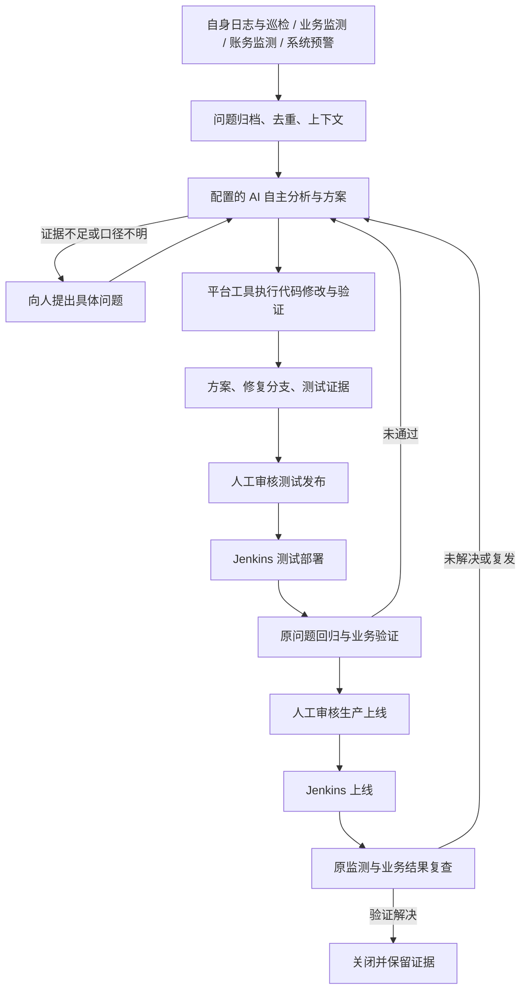

# Design：WorkHub 与业务线监测驱动的自主迭代

| 项目 | 内容 |
| --- | --- |
| 需求编码/唯一目录 | REQ-bf94e06e-8737-47dc-a7ba-68dba9556f9e；沿用本目录 |
| 所属业务线/仓库 | BL000012-工作台；workhub-server、workhub-web，目标业务代码在实际归属仓库 |
| 对应 Proposal / 状态 | v3 / 草案，待完整规格统一确认；v1/v2 不再生效 |
| 当前事实核对 | 2026-11-04，本地 server `codex/development-20261102`、web `codex/development-20261103`；工作区已有改动；未核实实际部署版本 |

## 1. 现状与证据

- 三个菜单在前端 router 中分别为 `/ops/monitors`（业务监测）、`/ops/accounting`（账务监测）、`/ops/system-alerts`（系统预警）。
- `ElkSystemAlertCollector` 按业务线/环境采集、分类、入库和通知；`XxlJobFailureAlertService` 产生带 Job/Log ID 的失败通知；已有定时入口。`OpsMonitorService` 的 MQ 类型仍为未接入采集，不能把配置字段当成有效数据源。
- `AccountingReconcileExecutor` 保存规则结果、异常条数/差异金额/样本，区分 WARN/ERROR、FAILED、SKIPPED；总结果为 SUCCESS/WARNING/PARTIAL/FAILED。只读对账失败与实际账务差异需分别处理。
- `DefaultAiGatewayClient` 支持 API/CLI，API 适配 Responses 和 Chat Completions 风格；现有请求主要返回文本/JSON，未提供平台统一的工具循环。`AiUseCaseDefinitions` 的研发分析仍只允许 CLI，CLI 有绕过沙箱路径，不能直接复用为新的自主执行边界。
- `ReleaseService` 为版本记录 CRUD，已核查代码无实际 Jenkins 发布适配。用户明确测试与生产均使用 Jenkins。
- 真实业务线/AI 配置尚未核验，最近 MCP 查询因数据库连接失败；不能从目录名推断真实归属。来源与用户答复见 [目标澄清](目标澄清.md)。

## 2. 架构与责任

WorkHub 持有持续任务与审核状态，AI 可替换，Jenkins 负责现有发布流程。采用当前应用与 MySQL、既有调度/线程池/AI 网关/只读诊断/Git 能力，不预先引入消息队列或新执行基础设施。

| 模块 | 负责 | 不负责 |
| --- | --- | --- |
| SignalAdapter / SignalIngestService | 读取已授权来源、游标、事件幂等、问题聚合 | 仅凭告警文案决定改代码 |
| AutonomyCaseService / Orchestrator | 问题、步骤、上下文、预算、依赖、恢复与澄清 | 模型原始凭据或任意远程命令 |
| AiAgentLoop / ProviderAdapter | 从现有配置选择 AI，规范化动作/工具结果，保存每轮证据 | 审核自己的发布或绕过工具权限 |
| AutonomyToolExecutor | 受控日志/只读数据/代码搜索、隔离文件修改、构建测试 | 任意主机配置、业务库写入、私自发布 |
| ChangeSetService / GitDeliveryService | 仓库分支、提交、跨仓库依赖、验证清单及 MR | 直接推默认/受保护分支 |
| ReviewService / JenkinsReleaseService | 版本绑定审核、发布出站请求、队列/构建/部署状态 | 把构建成功当作业务修复成功 |
| VerificationService | 测试回归、上线后原问题复查、复发关联 | 在没有新鲜有效数据时宣告解决 |
| 前端 autonomy 页面与监测入口 | 问题进度、证据、人工澄清/审核/驳回、配置 | 直接访问 AI/GitLab/Jenkins 或校验业务状态 |

## 3. 契约与数据

### 3.1 信号、问题与上下文

统一信号包含 `sourceType/sourceEventId/sourceVersion`、业务线/系统/环境、发生与采集时间、规则或任务 ID、严重程度、脱敏样本/受控证据引用。来源类型覆盖 SELF_LOG、BUG、INSPECTION、BUSINESS_MONITOR、ACCOUNTING、SYSTEM_ALERT。

来源事件唯一键防重复入库；问题指纹按业务线、系统、环境、规范化错误/规则和业务对象维度形成，原始时间戳不直接作为每次新问题的依据。已关闭问题再次出现关联旧问题并重新评估，不永远压制复发。高频重复只累计次数和最新证据，不重复发起模型/代码/发布任务。

优先复用已有持久化监测结果进行有界扫描；事务后事件用于唤醒，游标扫描负责补漏。扫描游标与信号入库同事务推进，失败不前移。WorkHub 自身日志/巡检需绑定实际运行环境和受控来源；不默认读取任意目录。停机恢复后按游标补扫，明确持续不可用时无法由停机的控制服务自行分析。

分析前解析业务线、环境、关联服务、GitLab 项目、代码基线与只读资源；单侧证据不足时扩展到已授权的关联业务线/共享系统。例如消费分期和嘉泰消费分期涉及再保理链路时，遵守已存在跨业务线规则。无法唯一定位时进入 NEEDS_INPUT，不猜仓库/分支。

账务结果按规则级处理：WARN/ERROR 形成差异候选；FAILED 形成监测执行问题；SKIPPED 记录不适用/缺表/未执行原因，不当作通过或账务缺陷；查询失败不以零异常解释。诊断输出包含事实、推断、影响、原因证据、方案、验收、回退、未知项及所需变更类型。

自主问题单关联原监测与既有需求/工作项；不存在关联时可形成 AI 来源的待整理需求，实施事实存于自主问题链路。新流程使用一次配置授权下的自动分析/研发，不套用旧草案逐条“确认设计完成”才编码的门槛；普通人工需求流程保持既有规则。业务线启用时明确可自动执行范围，超出范围才提具体澄清。

### 3.2 多 AI 的共同执行循环

新增场景 `autonomy.diagnose`、`autonomy.plan`、`autonomy.implement`、`autonomy.review`、`autonomy.evaluate`，均允许 API/CLI；Provider/模型/强度/超时沿用现有 AI 场景配置，允许按业务线选定配置。实际每轮使用的 Provider 与模型保存，不按供应商品牌或 Codex 特判能力。

平台循环协议采用受验证的结构化 `AgentStep`：

- `kind=TOOL_CALL`：`callId/tool/arguments`；工具名必须属于该阶段可用清单，服务端校验对象归属、授权范围、输入类型与预算。
- `kind=RESULT`：诊断、方案、变更说明或复核结论，附证据引用；不能以结果文本改变平台审核或发布状态。
- `kind=NEEDS_INPUT`：具体问题、已有证据、影响范围；用户答复以受审计上下文继续同一问题。

平台执行工具，保存 `callId`、输入摘要、结果与幂等键，再把有界结果返回模型；断点恢复不得把同一变更工具重复执行。API 可按其协议返回结构化内容；对不支持原生工具/严格 JSON Schema 的接入，采用明确配置的文本动作协议与严格解析/有限纠正，同样由平台执行工具，不能悄悄降级权限或转交 Codex。非法动作/格式超过次数限额即明确失败，禁止执行自由文本命令。

CLI 是另一种模型适配，不自动获得宿主机完整权限；不能把所有 CLI 程序都套用 Codex 参数。按实际已配置 CLI 协议提供适配器；已安装程序和版本需预检。默认走共同动作协议；若适配原生工具模式，仍必须通过同样的目录、网络、工具策略和审计验证后启用。当前全局配置和旧分析通道不因本功能自动扩权。

工具至少包括证据检索、受控 SQL 只读查询、仓库文件搜索/读取、补丁应用、Git 差异读取、已批准构建/测试命令；业务库写、主机配置、远端发布不出现在模型可直接执行的清单中。模型可生成数据修正或配置处置建议，实际执行需对应对象的明确审核和现有受控流程。

每个启用 Provider 必须验证：结构化动作、工具结果回读、临时仓库代码修改、测试失败修复和结果解释；API 验证中不调用 Codex 代做。注册能力、真实可用性与质量分别显示。某 Provider 不可用时保留错误并支持按明确策略重试/切换，不能冒充其已完成任务。

### 3.3 代码、跨仓库变更与独立验证

每个问题版本保存方案/验收快照和涉及仓库的 `repositoryId/baseBranch/baseSha/sourceBranch/resultSha`。专用工作区独立于用户未提交目录；通过已有授权映射解析目标，基线不存在就阻断，不自动退回默认分支。平台控制 Git 凭据和提交推送，模型不能更改受保护远端设置或强推。

补丁作用于限定目录，拒绝越界路径/软链接、敏感配置和未经授权范围。构建测试由平台在受限执行环境运行命令清单、记录退出码和输出摘要。命令需要的工具/缓存未准备时请求具体处理，不自行安装。文件/命令沙箱、进程树取消和隔离账户条件不足时功能不启用，不能回退为关闭沙箱。

多个仓库形成共同变更清单与依赖顺序，每个仓库独立分支/测试/提交，关联同一问题版本。整体未准备好不得审核整体发布；局部失败保留已完成成果和真实状态。对仓库冲突、代码基线变化或范围变更重新规划和验证，不静默覆盖人工改动。

自动复核可由配置 AI 执行，但实际构建/测试证据由平台取得；模型自述不能作为成功开关。预算包含总时长、模型调用步数、修复次数、并发和输出大小，有界修复后仍失败转待处理。审核后任何新代码使旧审核失效。

### 3.4 人工审核与 Jenkins

Jenkins 接入配置按实例以及业务线/系统/环境绑定现有具体 Job，保存凭据引用、仓库关系、精确提交/产物参数映射、部署结果和回退证据入口；不能把用户输入的任意 URL 或模型输出作为调用目标。接入探针只读，不用试发布代替连通性测试。

审核材料包括问题证据、方案版本、多仓库提交清单、实际测试、环境、Job/绑定版本、发布参数、影响与回退。审核人必须是有对应业务线/环境权限的活跃用户。测试发布和生产发布分别绑定自己的材料；生产审核引用已通过测试的同一精确版本。用户驳回的意见进入下一轮分析/修复，不能绕过审核继续发布。

发布协议：

1. 同事务保存不可变审核快照与待发发布请求，以 `(approvalId, environmentCode, manifestHash)` 唯一防重复；后台持有者条件领取。
2. 校验批准未失效、精确版本仍一致、Job 绑定未变化和调用权限有效；通过实际参数触发指定的参数化 Job。若现有 Job 只构建随时变化的分支头且不能证明检出的 SHA，阻断接入并准备可审查的 Job 改造，不发布未绑定版本。
3. 保存实际 queue ID/URL、build number、版本/产物与运行结果，按持久化句柄轮询；超时不是构建停止。请求是否送达不确定时先查询、对账；无法唯一关联则保留 UNKNOWN，不盲目重发或只查 lastBuild。
4. 完整区分 QUEUED、BUILDING、DEPLOYING、SUCCEEDED、FAILED、ABORTED、UNKNOWN，状态依据实际 Job 回执。多服务发布按依赖推进，部分成功后失败停止后续操作并呈现现场及回退建议。
5. 仅批准状态可触发 POST 发布；AI 无批准接口。取消已开始的 Jenkins 构建需明确操作并核对实际终态，不因观察超时认定停止。生产回退不在未授权时自动执行。

[Jenkins Remote Access API](https://www.jenkins.io/doc/book/using/remote-access-api/) 支持按 Job 触发参数化构建与查询相关对象；具体 Job 参数必须读取实际配置，不套用假定的 BRANCH/ENV 名称。认证优先复用获批 API token；若采用用户名密码模式，按实际服务的 crumb/session 机制处理，保留 CSRF 保护。依据：[Jenkins CSRF 说明](https://www.jenkins.io/doc/book/security/csrf-protection/)。本轮未连接或修改真实 Jenkins。

### 3.5 问题状态、验证和恢复

主路径：`DISCOVERED → ANALYZING → IMPLEMENTING → VERIFYING_LOCAL → WAITING_TEST_REVIEW → DEPLOYING_TEST → VERIFYING_TEST → WAITING_PROD_REVIEW → DEPLOYING_PROD → OBSERVING → RESOLVED`。另有 NEEDS_INPUT、BLOCKED、FAILED、CANCELLING/CANCELLED；多个子任务状态独立保存，不能用某个子任务成功覆盖整个问题。

代码修复结束即可形成审查包，不在编码前新增常规人工门槛。非代码问题形成处置方案并按其真实类型等待审核/明确处理，不伪造空分支。问题被认定为误报/不适用时保存依据；不修改原监测规则来掩盖尚未解决的故障。

测试验证必须针对原问题及相关业务链路，生产观察使用新鲜的原监测/巡检结果和已批准验收窗口。数据源故障、缺少新数据、仅构建成功、旧数据仍未处理均不足以关闭；历史数据修正可作为关联待办保留，准确标注代码已修复但问题未全部处理。复发保留旧诊断/发布证据，开始新一轮评估。

问题状态、步骤、模型调用、工具执行、审核、Jenkins 句柄与观察游标全部持久化。领取使用数据库条件更新/版本与租约，重复回调幂等。取消先停止所属进程树，确认退出再释放任务；旧持有者和迟到输出不能覆盖新状态。WorkHub 自身发布前先保存发布请求，Jenkins 独立执行；应用重启后对账已有 build 并继续验证，不重复触发自发布。

### 3.6 持久化与 API

新增数据位于 WorkHub 自身 MySQL，迁移放 `workhub-bootstrap/src/main/resources/db/schema/mysql/`；应用正常记账不等于授权 AI 写业务库。

| 数据对象（实施前核对现有命名） | 主要字段/约束 |
| --- | --- |
| `pm_autonomy_signal` | 来源/事件/版本唯一键、业务线/系统/环境、发生时间、脱敏引用、caseId |
| `pm_autonomy_case` | 问题编号、指纹、状态/版本、诊断与方案版本、关联需求、首次/最近发生、出现次数；同指纹活动问题唯一 |
| `pm_autonomy_run` / `pm_autonomy_step` | caseId/version/阶段、Provider/model/配置快照、owner/lease/version、预算、callId、结果/失败；单活动执行与步骤幂等键 |
| `pm_autonomy_change` | caseVersion、仓库、base/result SHA、分支/MR、依赖、实际验证摘要；仓库与版本唯一 |
| `pm_autonomy_review` | caseVersion、目标环境、manifestHash、Job 绑定版本/参数摘要、审批人/时间/结论/意见；不可变历史 |
| `pm_autonomy_deployment` | 审核 ID、稳定请求键、Job/queue/build、实际 SHA/产物、部署/观察状态与错误；发布请求唯一 |
| 配置与来源游标 | 业务线自动执行范围、来源/工具/预算、各阶段 AI 配置引用、Jenkins 实例与 Job 映射、验证规则；敏感值使用既有加密/引用机制 |

详细 SQL 类型与索引在按实际 MySQL/现有表核对后落实；迁移保持存量人工流程兼容，不执行未经授权 DDL，也不以应用启动试探迁移。

| API 前缀 `/api/autonomy` | 语义与权限 |
| --- | --- |
| `GET /cases`、`GET /cases/{id}`、`GET /cases/{id}/evidence` | 按业务线/环境/状态分页与证据查看；`autonomy:case:view` 加对象归属校验 |
| `POST /cases/{id}/clarifications` | 回答具体问题，附 expectedVersion；`autonomy:case:operate` |
| `POST /cases/{id}/retry`、`POST /cases/{id}/cancel` | 按当前阶段处理、保留历史、不重复外部副作用；operate |
| `POST /cases/{id}/reviews` | `{expectedVersion,environmentCode,manifestHash,decision,comment}`；`autonomy:release:review` 及对应环境权限；批准只交由服务端生成发布请求 |
| `GET /cases/{id}/deployments` | Jenkins 与验证进度；view |
| `GET/PUT /policies`、`GET/PUT /jenkins-bindings` | 范围/AI/预算/验证与 Jenkins 映射；`autonomy:config:manage`，加配置版本与审计 |
| `POST /jenkins-bindings/{id}/probe` | 只读验证实例、Job、权限/参数，不能触发 build；config manage |

信号采集由内部受控适配器调用服务完成；新增外部信号入口须单独的认证/来源与幂等约束，不提供匿名任意事件注入。API 沿用当前响应与异常惯例；冲突返回明确原因，所有权由服务端确定，不接受客户端随意替换业务线、仓库、模型密钥或 Jenkins 地址。

## 4. 非功能与范围控制

- 配置级持续授权定义可自动分析/研发的业务线、环境和仓库；运行权限从服务端策略计算，不能由模型输出或日志文本提升。未配置接入保持可见的未就绪状态，不冒充已支持。
- 模型请求和工具输出做脱敏、有界上下文与来源标记，凭据不进入提示词/工作区/日志；外部日志与仓库材料不能作为审核或发布指令。
- 调度有持久化队列、全局/业务线并发、总耗时/步骤/重试限制和停止开关；默认值须在配置预览中明确。重复错误合并，避免自主组件自己的日志触发无限改代码循环。
- 执行器、依赖、Jenkins 插件/Job 或配置需要变更时先准备具体差异并取得相应授权；本轮不安装软件或修改运行配置。
- 审计区分模型建议、平台实测、人类审核与外部执行；报告修订追加版本，保留原始事实。

## 5. 交付与回滚

本地实现与隔离测试 → 核实 Provider、业务线与 Jenkins 接入 → 发布本功能后按授权逐条启用 → WorkHub 自身与三类监测代表场景跑通完整链路 → 全部目标业务线接入验收。先试点不缩减 AC-11。

发布本功能前准备迁移、前后端版本、接入配置预览和回退方案；默认不开启未经配置的真实自主任务。回退先停止新任务、取消/对账在途操作，保留问题/审核/构建证据；不自动删除分支、回滚数据库或中断他人 Jenkins 构建。

按实际完成状态更新平台/业务线现状、迭代日志、Provider 覆盖表、Jenkins/仓库/环境接入矩阵与需求档案。未验证项目仍保留未完成。

## 6. 一致性与待核实

- 本版落实主动发现、多 AI 全流程、代码分支、人工审核、WorkHub 调 Jenkins 测试发布/上线与效果闭环，取消旧版本的仅 CLI、仅 MR、无发布范围。
- AC-01/02→§3.1；AC-03→§3.2；AC-04→§3.3；AC-05/06→§3.4；AC-07/08/09→§3.5；AC-10→§3.6；AC-11→§5。
- 用户方向已明确，运行前待核实 Jenkins 实例/Job/参数/回执、实际 Provider 和业务线/环境清单、工具链与源数据权限。不能伪造接入结果。
- 完整 v3 规格确认仍按仓库 SDD 执行；该确认是建设本功能，不是给未来每条常规自主问题增加人工规格审批。
- [Proposal](proposal.md) · [Tasks](tasks.md) · [用户答复与代码事实](目标澄清.md)。
